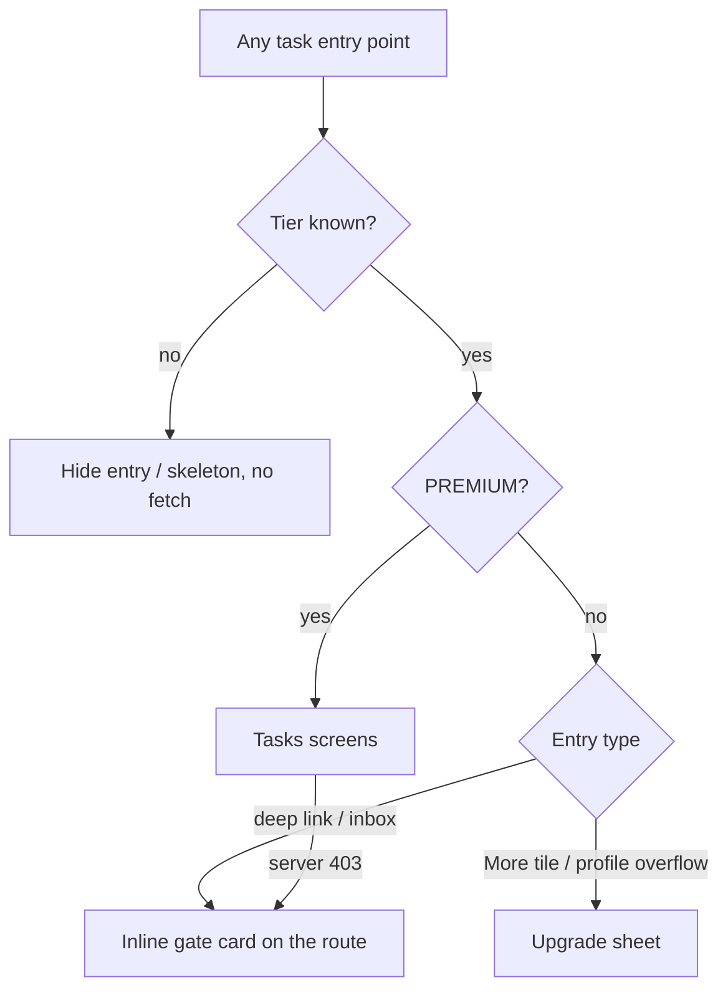

# Tier gating for Remote care tasks (PREMIUM)

| | |
|---|---|
| Area | Chat, notifications, tasks |
| Who sees it | Doctor on BASIC or PRO (gate); PREMIUM sees nothing of this file; clinic staff never see tasks |
| Reached from | More sheet (entry), task push/inbox tap, patient profile overflow → task, shell tab bounce |
| Screen type | Hidden/locked entry + upgrade sheet (NEW) + inline gate card (NEW) |
| Current Flutter source | `lib/core/subscription/doctor_subscription.dart`, `lib/state/subscription/doctor_subscription_provider.dart` (`doctorFeatureProvider`), `lib/features/shell/presentation/main_shell.dart` (More sheet `canUseTasks`, tab bounce), `lib/features/tasks/presentation/tasks_screen.dart` (fetch skip) |
| Spec | `docs/kmp-spec/07-chat-notifications-tasks.md` §3 (feature gate), `00-README.md` open decision 2 and verified bug 12, ticket TASK-01 |

## 1. Purpose
Make it clear to a non-premium doctor that remote-care tasks exist and what upgrading gives them, without letting them hit a 403 or a dead screen. Seen once (then ignored) by BASIC/PRO doctors; also protects deep links.

## 2. Entry points
- **More sheet**: today the "Tasks" tile is **hidden** entirely when the tier is below PREMIUM. Target: show the tile with a lock badge; tap → upgrade sheet (open question: hide vs lock — README convention allows either, this file proposes *lock*).
- **Desktop sidebar** (not in scope for phones) hides it too.
- **Task push / inbox "View Result"** for a non-premium doctor: today the router selects the Tasks tab (which the shell bounces back to Home) and still pushes Task details, which then shows "Task not found" after a 403. Target: open the **inline gate card** on the Task details route.
- **Patient profile overflow → task**: today the create form opens regardless of tier (no check) and the save fails with "Failed to create task: 403". Target: the overflow item is hidden/locked and the form route shows the gate card.
- **Tier drops while on the Tasks tab** (profile refresh): shell bounces to Home silently. Target: banner "Remote care tasks are no longer included in your plan" (NEW).
- **Tier unknown** (profile still loading, or clinic staff): Flutter fails *open* (treated as PREMIUM). Target per open decision 2: hide gated entries until the profile has loaded (skeleton tile in the More sheet), never fail open.

## 3. Layout, top to bottom (phone portrait)
### More sheet tile (locked variant, NEW)
- Same tile as other More entries: icon (clipboard-check), label "Tasks", trailing **lock icon** and a small "Premium" chip. Dimmed to 60 %.

### Upgrade sheet (NEW, bottom sheet)
1. Illustration (checklist + phone).
2. Title "Remote care tasks are a Premium feature".
3. Three bullets: "Assign medication, vitals and exercise programmes", "Patients check in from their app", "You get notified on every submission".
4. Primary "See Premium plans" → Subscription screen (folder 08); text button "Not now".

### Inline gate card (NEW, replaces screen content on Task details / Create task when reached by deep link)
- Centred card: lock icon, title "Premium feature", body "Upgrade to Premium to view and manage remote care tasks.", primary "See Premium plans", secondary "Back".

## 4. Data and formats
| Field | Source | Format rule |
|---|---|---|
| Tier | `GET /api/doctors/me` → `subscription.tier` (BASIC / PRO / PREMIUM) | Tasks require PREMIUM. |
| Unknown tier | profile not loaded / missing | Today → PREMIUM (fail open). Target → "unknown": entries hidden, no fetch, skeleton tile. |
| Clinic staff | role from JWT | Never tasks, regardless of tier. |
| Server authority | 403 on `/api/tasks*` | Always treat a 403 as "locked" and show the gate, even if the cached tier says PREMIUM. |

### Gate matrix (target behaviour)
| Entry point | Tier unknown | BASIC / PRO | PREMIUM | Clinic staff |
|---|---|---|---|---|
| More sheet "Tasks" tile | skeleton tile, not tappable | locked tile → upgrade sheet | opens list | tile absent |
| Patient profile overflow → task | item hidden | item locked → upgrade sheet | opens create form | n/a (no patient profile) |
| TASK_COMPLETED push / inbox "View Result" | hold route until tier known | gate card on the details route | task details | dropped (card still marked read) |
| Tasks API returns 403 | — | gate card | gate card (cache stale → refresh profile) | — |
| Tier drops while in Tasks | — | bounce to Home + banner | — | — |

## 5. Primary flow (happy path, BASIC doctor)
1. Opens More → sees "Tasks" with a lock and "Premium" chip.
2. Taps → upgrade sheet → "See Premium plans" → Subscription screen.
3. After upgrading (tier refreshed on resume/profile reload) → the lock disappears; the Tasks tile opens the list.

## 6. Screen states
- **First load**: tier unknown → locked/hidden entries with a skeleton; no 403 requests fired.
- **Empty**: n/a.
- **Error on load**: profile failed → treat as unknown (hidden), show the global profile error banner (folder 08); never fail open.
- **Offline**: last known tier from the cached profile applies.
- **Refreshing**: tier re-read on app resume and profile refresh; entries update live; if the user is inside Tasks when the tier drops → bounce to Home + banner.
- **Partial data**: tier present but tasks endpoint 403 (server/client disagreement) → gate card.
- **Permission needed**: n/a.
- **Locked by tier**: this file.
- **Role difference**: clinic staff → tasks never appear, no lock tile either (staff cannot upgrade a doctor's plan).

## 7. Interactions and secondary flows
- **Tap locked tile** → upgrade sheet. **See Premium plans** → Subscription (folder 08); **Not now / scrim** → close.
- **Gate card "See Premium plans"** → Subscription; **Back** → previous screen.
- **Inbox "View Result" on a locked account** → gate card; the notification is still marked read.
- **Tier upgrade completes** (Stripe webhook → profile) → on next resume the lock is gone; no toast needed beyond the subscription screen's own confirmation.

## 8. Edge cases
- Tier downgrade while a Create task form is half filled → save returns 403 → gate card replaces the form (input lost; acceptable, rare) with banner explaining why.
- Push TASK_COMPLETED for a downgraded doctor whose old tasks are still running → gate card; the task keeps running server-side (backend behaviour UNVERIFIED).
- PRO doctor (not BASIC) → same gate; the sheet copy must not say "Basic".
- Tier string unexpected (e.g. "ENTERPRISE") → today → PREMIUM; target → unknown (hidden) and log.
- Profile loads slowly (> 3 s) → More sheet shows the skeleton tile; tapping does nothing.
- Deep link before the profile loads (cold start) → hold the route until the tier is known, then decide list vs gate.
- Language switch → sheet copy switches.
- Font scale 200 % → sheet scrolls; buttons full width.
- Screen reader: tile reads "Tasks, Premium feature, locked".
- Admin changes the tier and forces logout (admin copy says the user is logged out) → on next login the correct tier applies.

## 9. Validation and messages
| Field/action | Rule | When checked | Message (English) | Where shown |
|---|---|---|---|---|
| Open tasks | tier == PREMIUM | On tap / route | "Remote care tasks are a Premium feature" | Upgrade sheet / gate card |
| Tasks API | not 403 | On any response | "Upgrade to Premium to view and manage remote care tasks." | Gate card |
| Tier drop | tier changed below PREMIUM while in Tasks | On profile refresh | "Remote care tasks are no longer included in your plan" | Top banner on Home |

## 10. Navigation out
- Upgrade sheet / gate card → Subscription screen (folder 08). Back → where the user was.
- Nothing to save.

## 11. Copy
- Existing: `subscriptionTierPremium` "Premium", `subscriptionTierPro` "Pro", `subscriptionTierBasic` "Basic", `remoteCareTasks` "Remote Care Tasks", `tasks` (missing in en.json; embedded "Tasks"), `back` "Back".
- **NEW** (no gate copy exists today because the entry is simply hidden): "Remote care tasks are a Premium feature", "Assign medication, vitals and exercise programmes", "Patients check in from their app", "You get notified on every submission", "See Premium plans", "Not now", "Premium feature", "Upgrade to Premium to view and manage remote care tasks.", "Remote care tasks are no longer included in your plan".

## 12. Known problems in the current app (do not carry over)
- Tier fails open to PREMIUM when unknown or for clinic staff (doc 00 verified bug 12) — a BASIC doctor can see the Tasks tile for a moment on cold start and the shell prefetches `/api/tasks` for everyone (403 swallowed).
- The entry is hidden, so BASIC/PRO doctors never learn the feature exists.
- Deep links and the patient-profile overflow bypass the gate and end in "Task not found" / "Failed to create task: 403".
- Silent bounce to Home when the tier drops.
- No upgrade copy anywhere in the strings.

## 13. Open questions for design
- Hide vs lock the More tile (README allows both). Recommendation: lock with a "Premium" chip — discoverability sells the plan.
- Should the Home attention centre show a one-time promo card for tasks to PRO doctors?
- Should PRO include read-only access to tasks created before a downgrade?
