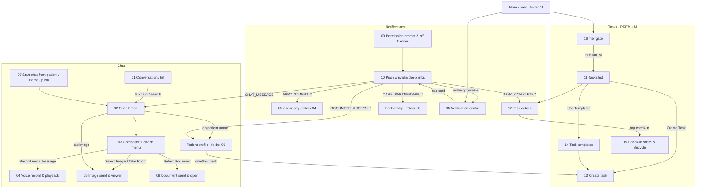

# 07 · Chat, Notifications, Remote-care Tasks — flow map and index

Spec: [`docs/kmp-spec/07-chat-notifications-tasks.md`](../../kmp-spec/07-chat-notifications-tasks.md). Conventions: [`../00-README.md`](../00-README.md). Every file follows [`../_TEMPLATE.md`](../_TEMPLATE.md).

## 1. Flow map

## 2. Files

| File | Screen | Role | Tier | Purpose |
|---|---|---|---|---|
| [01-conversations-list.md](01-conversations-list.md) | Conversations list (Chat tab root) | Doctor, Staff | BASIC | Find a thread, see unread, search people, start a conversation |
| [02-chat-thread.md](02-chat-thread.md) | Chat thread | Doctor, Staff | BASIC | Read/answer one conversation; bubble types, read state, timestamps |
| [03-composer-and-attach-menu.md](03-composer-and-attach-menu.md) | Composer + attach sheet | Doctor, Staff | BASIC | Type/send text, choose an attachment type, send states and retry |
| [04-voice-message-record-playback.md](04-voice-message-record-playback.md) | Voice recorder bar + voice bubble | Doctor, Staff | BASIC | Record, cancel, send and play voice notes |
| [05-image-send-and-viewer.md](05-image-send-and-viewer.md) | Image pick/send + full-screen viewer | Doctor, Staff | BASIC | Photo pipeline (compress/upload), bubble, pinch-zoom viewer |
| [06-document-send-and-open.md](06-document-send-and-open.md) | Document pick/send + open | Doctor, Staff | BASIC | PDF/doc card, size/name, open externally |
| [07-start-chat-from-patient-or-appointment.md](07-start-chat-from-patient-or-appointment.md) | Start-chat intent | Doctor (Staff via push/search) | BASIC | Land in the right thread from a patient, Home hero or push |
| [08-notification-centre.md](08-notification-centre.md) | Notification centre (inbox) | Doctor, Staff | — | Day-grouped inbox, filters, mark read, 18-type catalogue and targets |
| [09-notification-permission-and-disabled-banner.md](09-notification-permission-and-disabled-banner.md) | Permission pre-prompt, system redirect, off banner | Doctor, Staff | — | Ask for push permission in context; surface "notifications off" |
| [10-push-arrival-and-deep-links.md](10-push-arrival-and-deep-links.md) | Push arrival + deep-link router | Doctor, Staff | — | Foreground/background/cold-start behaviour and landing per type |
| [11-tasks-list.md](11-tasks-list.md) | Tasks list (Tasks root) | Doctor | PREMIUM | Summary counts, filters, task cards, create/template entry |
| [12-task-details.md](12-task-details.md) | Task details | Doctor | PREMIUM | Task info, progress, check-ins, cancel |
| [13-create-task.md](13-create-task.md) | Create / assign task | Doctor | PREMIUM | Patient, schedule (even/custom), dates, input and notes rules |
| [14-task-templates.md](14-task-templates.md) | Task templates picker | Doctor | PREMIUM | Pick a template to prefill the create form (read-only list) |
| [15-task-completion-and-patient-status.md](15-task-completion-and-patient-status.md) | Check-in sheet + status lifecycle | Doctor | PREMIUM | How tasks/check-ins change state, what the doctor and patient see |
| [16-tasks-tier-gate.md](16-tasks-tier-gate.md) | Tier gate + upgrade sheet | Doctor (BASIC/PRO) | gate | Locked entry, upgrade sheet, inline gate card for deep links |

## 3. Not designed (and why)

| Item | Reason |
|---|---|
| Typing indicator | Dead UI: the flag is never set and no typing transport (WebSocket/SSE) exists (spec §8 #1). Drop until a real channel is built. |
| Task template create / edit / delete | The client only reads `GET /api/tasks/templates`; no write endpoint is known. Empty-state copy suggests templates are derived server-side from created tasks (UNVERIFIED). Design only the picker (file 14). |
| Document-access Approve / Reject in the inbox | Endpoints and controller methods exist but no UI calls them (spec §2.1; NOTIF-04 optional). Decide with product before designing. |
| Notification settings screen behind the inbox gear | The gear switches to the same tab (no-op). Either remove or design it in folder 08 as part of Settings. |
| Message actions (reply, forward, delete, edit, reactions) | No endpoints; out of scope for the rewrite. |
| Message search inside a thread, media gallery per conversation | No endpoints; not in the Flutter app. |
| Presence / last seen / delivered receipts beyond the status field | No data from the backend. |
| In-thread paging / "load older" | Backend returns all messages in one call; cursor support UNVERIFIED. Designed as a note in file 02 only. |
| Web-specific push (service worker, browser Notification API) | Mobile rewrite; irrelevant. |
| Draft tasks | The app never saves drafts; the status exists only for backend parity. |
| Patient-side task screens | Belong to the patient app; file 15 summarises what the patient sees for consistency only. |

## 4. Area rules

- **Who can chat with whom.** Any doctor or clinic staff member can search *doctors and patients* and start a conversation with either; the client enforces no restriction (the server is authoritative — UNVERIFIED rules). A conversation has exactly two participants; there are no group threads. Starting a conversation never sends an automatic message. Chat is a BASIC feature.
- **Staff vs doctor.** Clinic staff have the 4-tab shell (Chat, Clinic, Notifications, Profile): they get the full chat and inbox, but no Home, no patient profile (so no "Send message" quick action), and **never tasks** — task deep links are dropped for staff. Appointment deep links for staff need a defined landing (today the router sets a doctor tab index; see file 10 §6).
- **Sender labelling.** Bubbles that are not mine carry a role label "Doctor"/"Patient" from the message's sender role (a clinic colleague appears as "Doctor").
- **Timestamps.** Chat times, inbox relative times and day groups use the **practice timezone**; check-in "missed" judgement and "submitted at" use the **patient's timezone**; check-in slot times are patient wall-clock and are never converted.
- **Unread badge sources.** Chat badge (bottom bar Chat tab, More sheet) = `GET /api/messages/unread-count`; per-card pills = `unreadCount` in the conversations list. Notifications badge (More sheet tile, staff tab, Home bell) = `GET /api/notifications/unread/count`, refreshed on open, pull-to-refresh, mark read, app resume and every foreground push — never polled. Target: chat badge is also push/event-driven instead of the 10 s poll; both badges cap at "99+".
- **Mark-read rules.** Chat: on opening a thread and (target) whenever a new message arrives while it is open. Notifications: on card tap, on inline action, on "Mark all as read", and best-effort on push tap.
- **Task tier gate.** Remote-care tasks require **PREMIUM**. The gate applies to the More tile, the patient-profile overflow action, the Tasks/Task-details/Create routes and task deep links; a server 403 always shows the gate. Unknown tier = hidden (never fail open — reverses the Flutter behaviour, per open decision 2 in doc 00).
- **Attachments.** One attachment per message; pipeline = upload (multipart `file`) → send message with URL. Images ≥ 500 KB are re-encoded (JPEG 85, ≤ 1 920 px); target cap 20 MB for every type; allowed document extensions pdf, doc, docx, jpg, jpeg, png (jpg/png become image messages). Voice = AAC-LC `.m4a`, 16 kHz mono 32 kbps, whole-second duration; target 5 min cap.
- **Polling to retire** (replace with push-driven refresh): conversations list + open thread 5 s, chat unread 10 s, task details 15 s. Pull-to-refresh is added to every list.
- **Feedback.** Skeletons for loading, top banners for progress/errors/confirmations, red-right confirmation dialogs for destructive actions (Cancel task). No SnackBars, no blocking progress dialogs (the "Opening appointment..." dialog goes).
