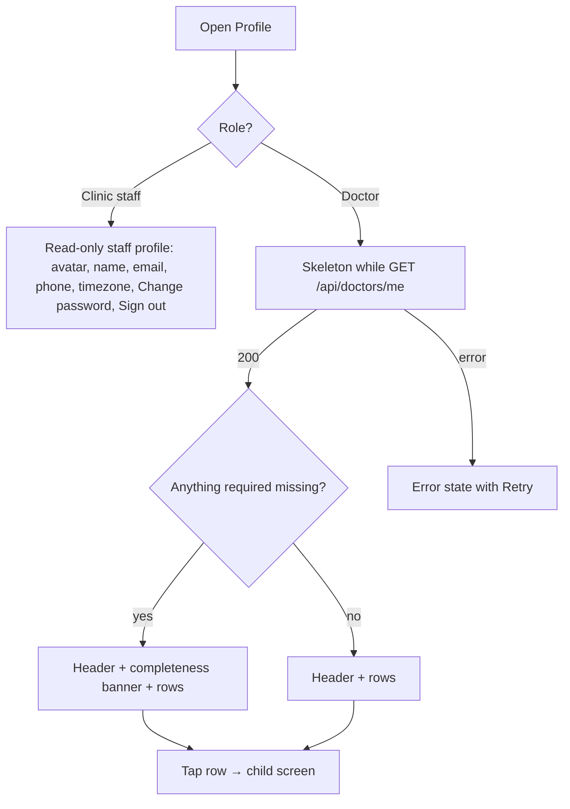

# Profile (tab root)

| | |
|---|---|
| Area | Profile, settings, reports & legal |
| Who sees it | Doctor and Clinic staff (staff see a read-only variant, see §6). No tier gate. |
| Reached from | More sheet → Profile; push "profile incomplete" reminder (UNVERIFIED, no such push type today); Home header avatar tap (proposed) |
| Screen type | Tab root (pushed inside the More tab; tab bar stays visible) |
| Current Flutter source | `lib/features/profile/presentation/profile_screen.dart` (live code from line 821), `lib/state/profile/profile_providers.dart` |
| Spec | `docs/kmp-spec/08-profile-settings-reports-legal.md` §1.1–1.4, §1.12, tickets PROF-01, PROF-02 |

## 1. Purpose
The hub from which the doctor reaches everything about themselves: identity, contact, clinic address, timezone, billing and plan, settings, security. Visited rarely after onboarding (a few times a month), but it is the first place a new doctor goes when something is missing (no timezone, no photo, no services), so it must say clearly what is still missing.

## 2. Entry points
- **More sheet → Profile** (doctor) — opens as the root of the More tab, replacing whatever was in that tab.
- **More sheet → Profile** (clinic staff, 4-tab shell) — the Profile tab root for staff is this screen's read-only variant.
- **Settings row inside this screen** and every section card push their screens on top of this one (tab bar hidden while pushed).
- **Target, NEW:** tapping the avatar/name in the Home header also lands here (today the header is not tappable).
- **Return** from any child screen lands back here with the touched section's preview refreshed.

## 3. Layout, top to bottom (phone portrait)
1. **App bar** — title "Profile". No back button (tab root). Right action: none (logout is at the bottom of the list, not in the app bar).
2. **Identity header card** — avatar (72 px, initials fallback), "Dr. med. First Last" (display-name rule, §4), profession in the app language, practice timezone chip ("Asia/Tashkent"), tier badge (BASIC / PRO / PREMIUM, hidden while the tier is unresolved). Tapping the card opens *Edit profile*. Tapping the avatar opens the photo action sheet directly (see `02-edit-profile.md`).
3. **Completeness banner** (NEW, only when something required is missing) — progress line "Profile 60 % complete" plus up to three missing items as chips: "Add practice timezone", "Add photo", "Add clinic address", "Add services". Each chip deep-links to the field. Hidden when 100 %.
4. **Section list** — one row per destination, each with an icon, title, a one- or two-line live preview and a chevron. Order and previews:
   1. Personal information — "First Last · 12.03.1984 · Dentist"
   2. Contact & clinic address — phone · email · "Street, City"
   3. Practice timezone — "Asia/Tashkent (UTC+5)"; warning dot when empty
   4. Extended profile — "Biography, services, certificates, social media"
   5. Services & pricing — "N services · M groups" (today a static subtitle)
   6. Schedule — "Update or change your schedule" (leaves this area, opens the schedule setup from area 04)
   7. Subscription & billing — "PRO · renews 12 Nov" (renewal date UNVERIFIED — backend does not expose it today)
   8. Settings — "Country, language, starting screen, security"
   9. Reports — opens the Reports screen (`14-reports.md`); doctors only
5. **Sign out** — full-width secondary (destructive-tinted) button under the list, 24 px above the bottom inset. Opens `15-logout-confirmation.md`.
6. **Footer** — app version "Shifa Doctor 1.0.0 (3)" in caption style, tappable → About (`13-about-legal-support.md`).

The whole page scrolls; the app bar is pinned. Missing values in previews render as "—" (today) → target: the row preview says "Not set" in secondary colour.

## 4. Data and formats
| Field | Source | Format rule |
|---|---|---|
| Display name | profile.firstName + lastName | "Dr. med. First Last"; if both empty show "Your name" placeholder (`yourName`). Ellipsis after one line in the header, two in cards. |
| Date of birth | profile.dob (yyyy-MM-dd) | shown `dd.MM.yyyy`; blank when absent |
| Profession | profile.profession (English catalogue label) | displayed in app language (en/ru → English, uz → Uzbek Latin, uz-Cyrl → transliterated) |
| Timezone | profile.timeZone (IANA) | "Region/City (UTC±h)" — offset computed for *now*; today only the raw IANA id is shown |
| Phone | contact.phone | as stored (E.164 preferred, `+998 90 123 45 67` grouping is a display-only nicety, open question) |
| Email | contact.email | lower-case as stored |
| Address preview | locationStreetAddress, locationCity | "Street, City"; legacy free-text `address` is shown only when the structured fields are empty |
| Tier | subscription.tier | BASIC / PRO / PREMIUM; unknown → badge hidden, features behave as PREMIUM until resolved (see README rules) |
| Photo | profile.photoUrl + cache-buster | circle crop, initials fallback (first letters of first + last name) |
| Completeness % | computed client-side | required set: first name, last name, profession, timezone, phone, photo, at least one location, at least one service. Each 12.5 %. |

## 5. Primary flow (happy path)
1. Doctor opens More → Profile. Header card, banner slot and nine rows render as a skeleton (grey blocks matching the final layout) while `GET /api/doctors/me` runs (one call returns profile, contact, billing, settings, subscription).
2. Content fades in; previews fill; the completeness banner appears if anything is missing.
3. Doctor taps a row → child screen pushes in from the right, tab bar hides.
4. Doctor saves on the child screen → child pops; this screen shows the refreshed preview (the profile is re-fetched after every save) and, when the save closed a gap, the banner chip disappears with a short collapse animation.

## 6. Screen states
- **First load:** skeleton for header card (circle + two lines + chip), banner slot collapsed, nine rows (icon circle + title line + preview line). No spinner.
- **Empty:** n/a as a whole (a doctor always exists). Per-row empty = "Not set" preview; a fully empty profile shows the banner at 0 %.
- **Error on load:** illustration + "Something went wrong" + Retry button; the Sign out button stays available so a doctor with a broken profile can still leave. Today: a bare centred text with no retry.
- **Offline:** last fetched profile is shown from cache with a top banner "You're offline — showing saved data". Rows still open; saves are blocked on the child screens. If nothing is cached → error state with "No internet connection" (NEW string).
- **Refreshing:** pull-to-refresh on the list; the content does not jump — previews update in place. Background refresh after returning from a child screen is silent.
- **Partial data:** the single endpoint returns four blocks; if a block is missing (e.g. `billing` null) the corresponding row shows "Couldn't load" in the preview and still opens; it does not block the rest. Today a missing block crashes the cast (whole screen error).
- **Permission needed:** n/a here (camera/photos are asked on *Edit profile*).
- **Locked by tier:** nothing on this screen is locked. The tier badge is informational; Subscription row always opens.
- **Role difference:** clinic staff see: avatar + name card, three read-only rows (email, phone, practice timezone), Change password (same component as `11-security.md`), Language, Sign out. No completeness banner, no billing, no services, no reports, no settings. Data comes from `GET /api/me/profile`.

## 7. Interactions and secondary flows
- **Tap header card** → push Edit profile → `02-edit-profile.md`.
- **Tap avatar** → photo action sheet (Take photo / Choose from gallery / Remove photo) without leaving this screen; upload progress shown as a ring on the avatar; success = avatar swaps, banner "Photo updated".
- **Tap completeness chip** → push the owning screen scrolled to that field (field gets focus/highlight for 1 s).
- **Tap a row** → push the child; chevron rows only, no swipe actions.
- **Tap Schedule** → leaves the area: pushes the schedule setup (area 04) inside the More tab.
- **Tap Reports** → push Reports (`14-reports.md`).
- **Tap Sign out** → confirmation dialog (`15-logout-confirmation.md`).
- **Pull-to-refresh** → re-fetch; haptic tick on release.
- **System back / back gesture** on this root → leaves the More tab (returns to the previously selected main tab), never exits the app from here.
- **Long-press** on a row: n/a.
- **Tap version footer** → About.

## 8. Edge cases
- Very long names (Uzbek double surnames, 40+ characters): header name wraps to two lines max, then ellipsis; the "Dr. med." prefix is never dropped.
- Names with apostrophes/diacritics (O'rinboyev, Ғафуров): rendered as stored; initials fallback uses the first grapheme, not the first byte.
- Photo URL set but image 404s → fall back to initials silently, no error banner.
- Tier unknown (field missing or unparseable) → badge hidden; everything else unchanged.
- Subscription expired mid-session (tier downgraded by admin) → the badge updates on the next profile fetch; locked features elsewhere react; this screen does not pop anything.
- One required item missing → banner shows one chip; the percentage still reads 87.5 % → round to "88 %".
- 0 services but services row preview "0 services" — do not treat as error.
- Slow network (> 3 s): skeleton stays; after 10 s show an inline "Still loading…" caption under the header skeleton (no modal).
- Double tap on a row → only one push (debounce navigation).
- 401 while loading → global logout flow (area 01), not an error state here.
- Deep link to a child (e.g. "Add timezone" from the Calendar warning) while a sheet is open elsewhere → close the sheet, switch to More tab, push the child; this root is on the stack beneath it.
- Rotation: list reflows; the header card keeps avatar left / text right in landscape.
- Language switch while open (from Settings → Language): titles, previews (profession, timezone label) re-render immediately; no refetch needed except profession display.
- Font scaling 200 %: rows grow in height, previews allow two lines, chevron stays vertically centred; banner chips wrap to multiple lines.
- Screen reader: order = title, header card (one element: "Dr. med. …, Dentist, Asia/Tashkent, Pro plan, button"), banner (percentage then chips), rows (title + preview + "button"), Sign out, version.
- Clinic staff who somehow receive a doctor-only link → stay on the staff variant; no 403 is surfaced.

## 9. Validation and messages
| Field/action | Rule | When | Message (EN) | Where |
|---|---|---|---|---|
| Load | 200 required | on open | "Something went wrong" + Retry | full-screen state |
| Load offline, cache present | — | on open | "You're offline — showing saved data" **NEW** | top banner |
| Load offline, no cache | — | on open | "No internet connection" **NEW** + Retry | full-screen state |
| Photo upload | see `02-edit-profile.md` | after pick | "Photo updated" / "Upload failed" | top banner |
| Partial block missing | — | after load | "Couldn't load" **NEW** | row preview |

## 10. Navigation out
- Child screens (push): nothing to keep here; on return refresh previews from the repository (already refreshed by the child's save).
- Schedule (push, area 04): same.
- Sign out: dialog; on confirm the whole stack is replaced by Login.
- System back: switches back to the previous main tab; profile state is kept in memory.

## 11. Copy
- Title: `profile` ("Profile"); staff variant same.
- Header placeholder: `yourName` ("Your Name").
- Rows: `profileInformation` ("Profile Information") → rename to "Personal information" (`personalInformation`); `contactDetails` ("Contact Details") → "Contact & clinic address" **NEW**; `practiceTimezone` ("Practice timezone"); `extendedProfile` + `extendedProfileSubtitle`; `servicesPricing` + `servicesPricingSubtitle`; `schedule` + `updateOrChangeSchedule`; "Subscription & billing" **NEW** (today `paymentAndInvoicing` "Payment & Invoicing"); `settings` + `settingsSubtitle` (update text to "Country, language, starting screen, security"); `navReports` ("Reports").
- Completeness: "Profile {percent} % complete" **NEW**; chips "Add practice timezone", "Add photo", "Add clinic address", "Add services" **NEW**.
- Previews: "Not set" **NEW**; "Couldn't load" **NEW**.
- Buttons: `signOut` ("Sign Out"), `retry` ("Retry").
- Errors: `somethingWentWrong`; `networkError` ("Network error. Please check your connection.").
- Footer: "Shifa Doctor {version} ({build})" **NEW**.

## 12. Known problems in the current app (do not carry over)
- Desktop-style two-pane list/detail with a "← Profile" text button on phones; the section cards act as selected tabs with a 2 px border — replace by push navigation.
- Every panel ends with a full-width **Save** that, for five of the eight panels, only shows a "saved" snackbar and persists nothing (spec quirk #1). Save must exist only where there is something to save.
- Loading is a centred spinner; error is bare text without Retry; missing blocks crash the screen.
- The staff variant labels the email row with "Enter email address" (`enterEmail`) and renders raw exception text on error.
- Settings is labelled "Settings" with a gear on desktop but "Profile" on mobile; one name ("Profile") in the rewrite.
- No tier/plan is shown anywhere, so the doctor cannot tell what they are paying for.
- The Password section is a top-level row; it belongs under Security (`11-security.md`).
- Language is only reachable from the More sheet, not from Profile/Settings.

## 13. Open questions for design
- Should the completeness banner be a dismissible card or a persistent progress header until 100 %?
- Should Sign out live at the bottom of this screen (proposed) or stay in the More sheet (today), or both?
- Tier badge: text pill next to the name vs. a separate "Your plan" row preview only.
- Should Reports be a row here, in the More sheet, or both (it is both today on desktop vs mobile)?
- Is "Dr. med." the right prefix for every profession and every language (today it is hard-coded for all)?
