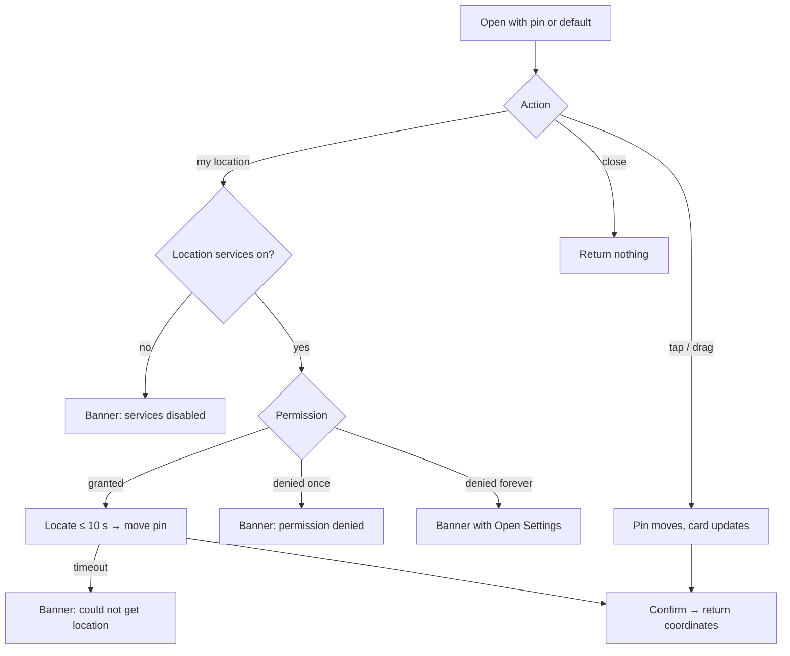

# Map pin picker

| | |
|---|---|
| Area | Profile, settings, reports & legal |
| Who sees it | Doctor (from the clinic address form and from area 04's practice-location editor). No tier gate. |
| Reached from | `03-contact-and-clinic-address.md` → "Pick on map" / coordinates line; area 04 location editor → same button |
| Screen type | Full screen (pushed, modal feel) |
| Current Flutter source | `lib/features/profile/presentation/location_picker_widget.dart` (`_MapPickerScreen`, lines 360–596) |
| Spec | `docs/kmp-spec/08-profile-settings-reports-legal.md` §3.2, §12 (maps row), ticket PROF-07 / LOC-2; README decision "address + coordinates first, native map behind expect/actual" |

## 1. Purpose
Let the doctor drop one pin where the practice is, or confirm the pin that address search produced. Used once per location. In the first KMP release this screen may ship with a simpler map (static tiles, pan/zoom, one pin); the behaviour below is the target for the native-map version and the v1 must not contradict it.

## 2. Entry points
- Address form → "Pick on map" with the current coordinates (or none).
- Address form → tap on the coordinates line / static preview.
- Area 04 practice-location editor → identical.
- Arrives with: optional current pin; returns: one coordinate pair or nothing (cancel).

## 3. Layout, top to bottom (phone portrait)
1. **App bar** — close (×) on the left, title "Select Location on Map", right action **Done** (check) — same result as the bottom Confirm.
2. **Map** fills the rest. One red pin. Initial camera: current pin at zoom 15, else Tashkent centre (41.2995, 69.2401) at zoom 15 (target: zoom 12 and a hint "Tap the map to place the pin" when there is no pin yet).
3. **Search chip** (NEW, optional): a pill at the top of the map "Search address" that opens the same suggestion search as the form; selecting moves the pin. Not present today.
4. **My-location FAB** — top-right (today) → target bottom-right above the card, standard crosshair icon; shows a spinner while locating.
5. **Bottom card** (floating, 20 px inset): title "Selected Location", one line with the reverse-geocoded short address when known ("Amir Temur ko'chasi 12, Tashkent") else "Latitude 41.299500 · Longitude 69.240100", caption "Drag the pin or tap the map to adjust", full-width primary **Confirm**.

## 4. Data and formats
| Field | Source | Format rule |
|---|---|---|
| Pin | tap / drag / my-location / incoming value | lat, lng as doubles; displayed to 6 decimals (`toStringAsFixed(6)`) |
| Short address in card | reverse geocoding proxy, debounced 600 ms after the pin stops | "street number, city"; empty while loading; falls back to coordinates |
| Default centre | constant | Tashkent 41.2995, 69.2401 |
| Tiles | today OSM raster `tile.openstreetmap.org` with UA `com.shifa.doctor`; target native map | attribution shown bottom-left when OSM is used |

## 5. Primary flow (happy path)
1. Screen opens centred on the existing pin (or Tashkent).
2. Doctor taps the crosshair → OS permission prompt (first time) → map animates to the device position, pin moves there.
3. Doctor drags the pin 50 m to the clinic entrance; card shows the short address after a moment.
4. Doctor taps Confirm → pops with the coordinates; the address form fills (see `03` §5).

## 6. Screen states
- **First load:** map tiles load progressively (grey grid placeholder); pin and card appear immediately. No spinner over the whole map.
- **Empty (no pin passed):** pin at default centre, card caption "Tap the map to place the pin" **NEW**, Confirm enabled (confirming the default is allowed but the form will show the hint "Check the pin position" **NEW** if the pin was never moved — UNVERIFIED need).
- **Error on load:** tiles fail (no network) → map shows the grey grid; pin interactions still work; card shows coordinates; a thin banner "Map couldn't load — you can still place the pin" **NEW**.
- **Offline:** as above; reverse geocoding skipped (card shows coordinates only); Confirm works.
- **Refreshing:** n/a.
- **Partial data:** reverse geocoding fails → card shows coordinates; no error (the form handles the address banner).
- **Permission needed:** location — asked only when the crosshair is tapped, never on open. Denied once → banner "Location permissions are denied." Denied permanently → banner "Location permissions are permanently denied. Please enable them in settings." with action "Open Settings". Services off → "Location services are disabled. Please enable them." The map and pin stay fully usable without permission.
- **Locked by tier:** n/a.
- **Role difference:** clinic staff may reach this only through the clinic-workspace location editor (area 09) if that exists; same behaviour.

## 7. Interactions and secondary flows
- **Tap on map** → pin jumps there (today); target: tap moves the pin with a short drop animation and the camera does not move.
- **Drag pin** (NEW) → pin follows the finger with a lift effect; card address refreshes after the drop.
- **Pinch / two-finger rotate** → standard map gestures; rotation resets with a compass button (native map default).
- **Crosshair** → §5; while locating the button shows a spinner and is disabled; a second tap is ignored.
- **Search chip** (if included) → suggestion sheet; select → camera + pin move.
- **Confirm / Done** → pop with coordinates.
- **Close (×) / back gesture** → pop with nothing; if the pin was moved, ask "Discard the new pin position?" **NEW** (dialog, Discard destructive / Keep). Today: back discards silently.
- **Long-press** → same as tap (place pin). 

## 8. Edge cases
- No pin and the doctor confirms without touching → coordinates = Tashkent centre; the form marks the address as "needs check" rather than silently saving a wrong place (open question whether to block instead).
- GPS fix takes > 10 s → stop with banner "Error getting current location" (`errorGettingCurrentLocation`); pin unchanged.
- Device location is 2 000 km away from the current pin (doctor is travelling) → still move; no sanity check.
- Location accuracy > 100 m (indoors) → still move; show a translucent accuracy circle if the map supports it.
- Permission granted "while using" vs "once" (iOS) → both fine; "once" asks again next time.
- Precise location off (iOS 14+) → coarse fix (~1 km) accepted; caption "Approximate location — drag the pin to the exact spot" **NEW**.
- Airplane mode → tiles grey, pin usable, confirm works, geocoding skipped.
- Very fast tap-tap-tap → each tap moves the pin; reverse geocoding only fires 600 ms after the last move.
- Rotation → camera position and pin preserved; bottom card re-lays out; the OS permission prompt survives rotation.
- Font scaling 200 % → bottom card grows; map area shrinks but is never under 40 % of the screen; the FAB moves above the card.
- Dark mode → map style follows the system (native map); pin colour stays red/brand.
- Deep link while open → the picker is popped without result (form keeps its previous values) before the link is handled.
- 401 → the geocoding proxy call fails; the screen is not auth-bound otherwise; global logout handles the rest.
- Returning coordinates equal to the incoming ones → form is not marked dirty.
- Screen reader: map is one element "Map, pin at <short address>"; provide explicit buttons "Move pin to my location", "Confirm location"; coordinates readable in the card. Dragging is not accessible — the search chip and my-location are the accessible paths.
- OSM tile policy (if OSM tiles remain in v1): correct user agent, cache tiles, no bulk prefetch.

## 9. Validation and messages
| Field/action | Rule | When | Message (EN) | Where |
|---|---|---|---|---|
| My location | services enabled | tap | "Location services are disabled. Please enable them." (`locationServicesDisabled`) | top banner (warning) |
| My location | permission granted | tap | "Location permissions are denied." (`locationPermissionDenied`) | top banner |
| My location | permission not permanently denied | tap | "Location permissions are permanently denied. Please enable them in settings." (`locationPermissionDeniedForever`) + "Open Settings" **NEW** | top banner with action |
| My location | fix within 10 s | after tap | "Error getting current location" (`errorGettingCurrentLocation`) | top banner |
| Tiles | loaded | open | "Map couldn't load — you can still place the pin" **NEW** | thin banner |
| Confirm | always allowed | — | — | — |
| Close with moved pin | — | back | "Discard the new pin position?" **NEW** | dialog |

## 10. Navigation out
- Confirm / Done → pop with coordinates → the form runs reverse geocoding and becomes dirty; nothing is saved yet.
- Close / back → pop without result (after the discard dialog when moved); the form is unchanged.
- OS Settings (from the permission banner) → app goes to background; on return the picker is still open.

## 11. Copy
- Title: `selectLocationOnMap` ("Select Location on Map").
- Card: `selectedLocation` ("Selected Location"), `latitude` ("Latitude"), `longitude` ("Longitude"), `confirm` ("Confirm"), "Tap the map to place the pin" **NEW**, "Drag the pin or tap the map to adjust" **NEW**, "Approximate location — drag the pin to the exact spot" **NEW**.
- FAB tooltip: `getCurrentLocation` ("Get Current Location"); `currentLocation` ("Current Location").
- Errors: `locationServicesDisabled`, `locationPermissionDenied`, `locationPermissionDeniedForever`, `errorGettingCurrentLocation`; "Open Settings" **NEW**; "Map couldn't load — you can still place the pin" **NEW**.
- Discard: "Discard the new pin position?" **NEW**, `discard`, "Keep" **NEW**.

## 12. Known problems in the current app (do not carry over)
- Pin cannot be dragged; only tap-to-move.
- My-location button sits top-right over the map, not near the thumb.
- Raw exception text is appended to the "Error getting current location" message.
- Permission flow stops with a snackbar; no "Open Settings" action for the permanently-denied case.
- No discard protection on back; no address text in the card (coordinates only).
- Uses OSM raster tiles via `flutter_map`; the rewrite plan is native maps (Google Maps on Android, MapKit on iOS) behind a shared interface, after an address-first v1.
- A 50 ms artificial delay "waits for state" before geocoding (implementation smell, not UX).

## 13. Open questions for design
- v1 without a real map: is a static image + "Use my location" + address search acceptable, or must a pannable map exist from day one?
- Block Confirm when the pin was never moved from the default, or allow with a warning?
- Include the address search chip here, or keep search only on the form?
