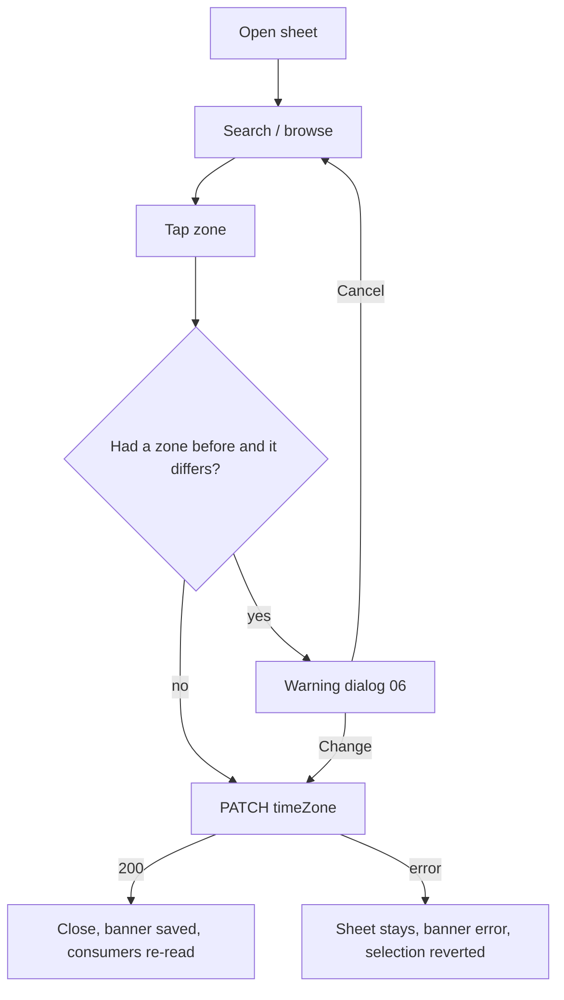

# Practice timezone picker

| | |
|---|---|
| Area | Profile, settings, reports & legal |
| Who sees it | Doctor. Clinic staff see their timezone read-only (it comes from the clinic). No tier gate. |
| Reached from | Profile root → "Practice timezone" row; Contact & clinic address → timezone row; completeness chip "Add practice timezone"; Calendar "device timezone differs" notice → "Change"; registration step 2 (area 01) reuses the sheet |
| Screen type | Bottom sheet (full height, 92 %) with search; confirmation dialog in `06-practice-timezone-change-warning.md` |
| Current Flutter source | `lib/features/profile/presentation/searchable_timezone_dropdown.dart`, list in `lib/core/services/timezone_service.dart` (`commonIanaTimeZones`), save in `profile_screen.dart` ~1494–1503 |
| Spec | `docs/kmp-spec/08-profile-settings-reports-legal.md` §1.5 (timezone row), §12 (timezone row), ticket PROF-06; `03-calendar-schedule.md` §4 / TZ-1, TZ-2 |

## 1. Purpose
Choose the IANA zone in which the doctor's schedule, calendar, appointment times and "today" are computed. Set once; changing it later shifts how every existing slot is displayed, so the change is confirmed (`06`). Every date/time in the app is rendered in this zone, never the phone's.

## 2. Entry points
- Profile root row → sheet opens over the root.
- Contact & clinic address row → sheet over that form (the form stays dirty-safe; the timezone saves on its own).
- Completeness chip / Calendar notice "Change" → More tab → Profile root → sheet auto-opened.
- Registration step 2 → the same sheet, but the value is returned to the form instead of saved (no warning dialog).
- Arrives with: current zone (may be empty) and a suggested zone = device zone (when it differs or when nothing is set).

## 3. Layout, top to bottom (phone portrait)
1. **Grab handle + title row** — "Practice timezone", close (×) right.
2. **Search field** — auto-focused, placeholder "Search timezone" (city, region or "UTC+5"), clear button.
3. **Suggested** section (when search is empty) — up to two rows: "Device timezone · Asia/Tashkent (UTC+5)" and, if set, "Current · Europe/Berlin (UTC+1)" with a tick.
4. **All timezones** — curated list of 47 zones sorted by region then city (Africa 4, America 11, Asia 14, Australia 3, Europe 12, Pacific 2, UTC), sticky region headers ("Africa", "America", …). Each row: primary "City" (last path segment, underscores → spaces, e.g. "Buenos Aires"), secondary "Region/City · UTC±h:mm now". Selected row has a tick. If the current value is not in the 47, it is inserted at the top of its region (today: inserted at index 0 of the whole list).
5. **Footer** — none; selecting a row acts immediately (opens the warning dialog when the zone changes an existing value).

Target option (PROF-06 "or the full list with search"): behind the 47 curated rows, a "Show all timezones" row expands to the platform's full ~420 zone list with the same search. Design the list for 400+ rows either way.

## 4. Data and formats
| Field | Source | Format rule |
|---|---|---|
| Zone id | profile.timeZone ← `PATCH /api/doctors/me/profile {"timeZone": "<IANA>"}` | stored as IANA id exactly (`Asia/Tashkent`); never an offset |
| Display | computed | "City" + "Region/City · UTC+5" with the offset **at the current instant** (DST-aware; shows "UTC+2" for Berlin in summer) |
| Device zone | platform API (today `iana_time_zone` plugin, null on web) | used only for the Suggested row and the mismatch notice |
| Search | local, case-insensitive substring | matches id ("tash"), city with spaces ("buenos aires"), region ("europe"), offset text ("+5", "utc+5"), and the app-language city alias when available (e.g. "Toshkent") |

## 5. Primary flow (happy path)
1. Doctor opens the sheet; search is focused; Suggested shows the device zone.
2. Doctor types "tash" → list filters to "Tashkent · Asia/Tashkent · UTC+5".
3. Tap → if no zone was set before: saves immediately (`PATCH`), sheet closes, banner "Practice timezone saved" **NEW**. If a different zone was set: the warning dialog (`06`) opens on top of the sheet; Confirm saves and closes both.
4. Profile root row and the Calendar re-read the zone; the Calendar mismatch notice disappears if device and practice zones now match.

## 6. Screen states
- **First load:** list is local — no skeleton; the offsets are computed synchronously. The Suggested row waits for the device zone (≤ 100 ms); until then the row is omitted, not a placeholder.
- **Empty (nothing set):** title gets a subtitle "Required for your calendar" **NEW**; no Current row; closing without choosing is allowed but the completeness chip stays.
- **Error on load:** n/a (local data).
- **Offline:** list works; tapping a zone attempts the PATCH → fails → banner "Network error. Please check your connection."; the previous selection is restored; the sheet stays open.
- **Refreshing:** n/a.
- **Partial data:** zone value unknown to the platform database (typo from an old import, e.g. "Asia/Tashkent " with a space) → shown as "Unknown timezone: <raw>" in the Current row with a warning icon; every other screen falls back to UTC until fixed (TZ-1 rule).
- **Permission needed:** n/a (device zone needs no permission).
- **Locked by tier:** n/a.
- **Role difference:** clinic staff: not reachable; their Profile root shows the zone read-only with the caption "Set by your clinic".

## 7. Interactions and secondary flows
- **Type** → instant filter; headers hide when their region has no matches; "No timezone found" empty state with the hint "Try the city name in English" **NEW**.
- **Tap row** → §5. The row shows a brief tick animation before the sheet closes.
- **Tap Suggested device zone** → same as any row.
- **Clear search (×)** → full list, scroll position reset to the selected zone (keep the selected row visible on open as well).
- **Drag down / tap scrim / ×** → close without change.
- **Keyboard "Search"/"Done"** → if exactly one result, select it; otherwise just hide the keyboard.
- **Long-press row** → n/a.
- **Show all timezones** (if designed) → expands in place; search now covers the full list; a "Curated only" chip returns.

## 8. Edge cases
- 400+ zones with the full list: list must be virtualised; sticky headers; search debounce not needed (local), but keep typing responsive at 200 % font.
- Two cities with the same offset (Tashkent and Karachi) → both listed; the offset is secondary text, never the only differentiator.
- DST moment: offsets displayed are for now; a zone picked today in Berlin says UTC+2, tomorrow UTC+1 — the stored id is unaffected. Do not show "UTC+1/+2".
- Device zone unknown (web, some emulators) → Suggested section shows only Current or is hidden.
- Device zone not in the curated 47 (e.g. Asia/Samarkand) → still offered in Suggested and selectable; it is inserted into the list under Asia.
- Current value equals the tapped value → no dialog, no PATCH, sheet closes.
- PATCH fails with a server message → banner shows the message; selection reverts.
- 401 on PATCH → global logout; sheet is destroyed.
- Save succeeds but the consumer refresh is slow → the row on the root shows the new value optimistically from the response.
- Tapping a zone while a previous PATCH is in flight → second tap ignored (row shows a small progress ring).
- Deep link while the sheet is open → sheet closes without change.
- Rotation → sheet persists; search text kept.
- Language switch → city aliases and headers re-render; ids unchanged.
- Font 200 % → rows two lines; region headers wrap; search field height grows.
- Screen reader: rows announced "Tashkent, Asia slash Tashkent, UTC plus 5, selected"; headers as headings; search as a search field with result count ("12 results") announced on change.
- Registration reuse: no PATCH and no dialog — the sheet returns the value; the completeness logic does not apply.

## 9. Validation and messages
| Field/action | Rule | When | Message (EN) | Where |
|---|---|---|---|---|
| Search | — | typing | "No timezone found" **NEW** (today hard-coded English) + "Try the city name in English" **NEW** | empty state in list |
| Select | id must be a valid IANA zone | tap | — (list only offers valid ids) | — |
| Save | 200 | after PATCH | "Practice timezone saved" **NEW** | top banner (on the screen beneath) |
| Save | error | after PATCH | server `message` or `networkError` | top banner over the sheet |
| Unknown stored value | parseable | open | "Unknown timezone: {value}" **NEW** | Current row |

## 10. Navigation out
- Select + (optional) confirm → PATCH → sheet closes → underlying screen refreshes its row; Calendar, Home, appointments recompute "today" and times on their next build (they watch the profile).
- Close without change → nothing.
- 401 → logout.

## 11. Copy
- Title: `practiceTimezone` ("Practice timezone"); placeholder `practiceTimezonePlaceholder` ("Practice timezone (e.g. Europe/Berlin)") → sheet search placeholder "Search timezone" **NEW**.
- Sections: "Suggested" **NEW**, "Device timezone" **NEW**, "Current" **NEW**, "All timezones" **NEW**, region names (Africa, America, Asia, Australia, Europe, Pacific, UTC) **NEW**.
- Empty: "No timezone found" **NEW**, "Try the city name in English" **NEW**.
- Subtitle when empty: "Required for your calendar" **NEW**.
- Staff caption: "Set by your clinic" **NEW**.
- Banner: "Practice timezone saved" **NEW**; `networkError`.

## 12. Known problems in the current app (do not carry over)
- Label and hint are hard-coded English ("Practice timezone (e.g. Europe/Berlin)", "Search timezone", "No timezone found") in all languages.
- Rows show only the raw id ("America/Argentina/Buenos_Aires") with no city or offset; no region headers; no device-zone suggestion.
- Selection saves instantly with no confirmation and no success feedback, even though it shifts every slot on the calendar.
- A dialog (centred, 500 px max) instead of a bottom sheet; unknown current value is prepended to the whole list.
- Web could not detect the device zone, so the mismatch notice logic was unreliable there (irrelevant for mobile).

## 13. Open questions for design
- Curated 47 only, or curated + "Show all" (≈ 420)? The curated list lacks Samarkand/Bukhara (same zone as Tashkent, so acceptable) but also lacks e.g. Asia/Baku.
- Show the current local time per row ("14:32") in addition to the offset?
- Should the device-zone suggestion be a one-tap "Use device timezone" button rather than a list row?
