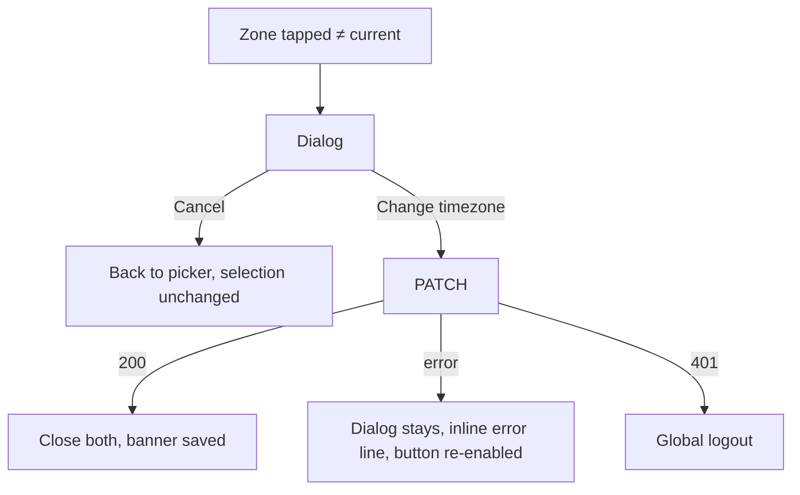

# Practice timezone change — impact warning

| | |
|---|---|
| Area | Profile, settings, reports & legal |
| Who sees it | Doctor. No tier gate. |
| Reached from | `05-practice-timezone-picker.md` when the doctor picks a zone different from the one already saved |
| Screen type | Dialog (on top of the picker sheet) |
| Current Flutter source | n/a — does not exist today (selection saves immediately, `profile_screen.dart` ~1498–1503) |
| Spec | `docs/kmp-spec/03-calendar-schedule.md` §4 (practice-timezone rules, TZ-1), `08-…` ticket PROF-06; README rule "every date/time on screen is in the practice timezone" |

## 1. Purpose
Make the consequence of changing the practice timezone explicit before it happens: existing availability rules and booked appointments are stored as instants, so "09:00 Tashkent" becomes "06:00 Berlin" on screen — the slots do not move, their labels do. Rare (once when relocating), but a wrong tap here corrupts the doctor's mental model of their week. Target behaviour; nothing like it exists in Flutter.

## 2. Entry points
- Timezone picker → tap a zone ≠ current saved zone. Never shown when no zone was set, when the same zone is re-selected, or during registration.
- Arrives with: old zone, new zone, counts of upcoming appointments and active availability rules (from the calendar cache; may be unknown).

## 3. Layout, top to bottom (phone portrait)
1. **Title** — "Change practice timezone?"
2. **Body**
   - Line 1: "From **Asia/Tashkent (UTC+5)** to **Europe/Berlin (UTC+1)**."
   - Line 2 (impact): "Your existing availability and {n} upcoming appointments keep their real time. They will be shown in the new timezone — for example 09:00 becomes 05:00." The example uses the actual offset difference at the current instant.
   - Line 3 (when the device zone ≠ new zone): "Your phone is set to Asia/Tashkent. The calendar will show a notice while they differ."
   - Optional checkbox (open question): "Also shift my weekly availability so it stays at the same local times" — only if the backend offers a bulk shift (UNVERIFIED; no endpoint today). If absent, omit the checkbox and keep the sentence that availability is unchanged.
3. **Actions** — "Cancel" (text, left) · "Change timezone" (filled, right; not destructive-red because nothing is deleted, but visually primary).

## 4. Data and formats
| Field | Source | Format rule |
|---|---|---|
| Old / new zone | picker | "Region/City (UTC±h)" with offsets at now |
| Example time shift | computed | 09:00 in old zone converted to new zone, 24-hour `HH:mm`; if the difference is 0 (two ids, same offset, e.g. Tashkent → Karachi) the sentence becomes "Times will look the same today, but daylight-saving rules may differ." |
| Upcoming appointments count | calendar cache (next 30 days) | integer; if unknown write "your upcoming appointments" without a number |
| Device zone | platform | id + offset |

Worked examples for the example-time sentence (computed at the moment the dialog opens):

| Old → new | Offset difference now | Sentence |
|---|---|---|
| Asia/Tashkent → Europe/Berlin (winter) | −4 h | "09:00 becomes 05:00" |
| Asia/Tashkent → Europe/Berlin (summer) | −3 h | "09:00 becomes 06:00" |
| Asia/Tashkent → Asia/Karachi | 0 h | "Times will look the same today, but daylight-saving rules may differ." |
| Europe/London → Asia/Kolkata | +5 h 30 | "09:00 becomes 14:30" |
| Pacific/Auckland → America/Los_Angeles | −20 h / −21 h | "09:00 becomes 12:00 the previous day" |

## 5. Primary flow (happy path)
1. Dialog appears with a short scale-in over the sheet; the sheet is dimmed.
2. Doctor reads the example, taps "Change timezone".
3. Button shows a progress ring; `PATCH /api/doctors/me/profile {"timeZone": new}`.
4. 200 → dialog and sheet close together; banner "Practice timezone saved"; Profile row, Calendar, Home and appointment screens re-read the zone.

## 6. Screen states
- **First load:** instant; counts may arrive 1 s later — the sentence first reads "your upcoming appointments", then updates with the number without resizing the dialog abruptly (reserve the line).
- **Empty:** no upcoming appointments and no availability → body line 2 becomes "You have no availability or upcoming appointments yet, so nothing changes on your calendar." and the dialog may be skipped entirely (open question).
- **Error on load:** n/a.
- **Offline:** the PATCH fails → inline error "Network error. Please check your connection." under the body; button re-enabled; Cancel always works.
- **Refreshing:** n/a.
- **Partial data:** counts unavailable → generic wording (see §4).
- **Permission needed:** n/a.
- **Locked by tier:** n/a.
- **Role difference:** clinic staff never see it.

## 7. Interactions and secondary flows
- **Change timezone** → PATCH; double tap ignored while the ring shows.
- **Cancel / tap outside / back gesture** → close the dialog only; the picker stays open with the previous selection ticked.
- **Checkbox** (if present) → adds the bulk shift to the request (UNVERIFIED backend).
- **Tap the device-zone sentence** → n/a (plain text).

## 8. Edge cases
- Old and new offsets equal today but differ in DST (London ↔ Lisbon-like pairs) → the "same today" wording (§4).
- Old zone unknown/invalid (bad stored value) → body says "From an invalid timezone to …" and the impact line is dropped; Change is allowed (it repairs the profile).
- Change across the date line (Auckland → Los Angeles): the example may land on "yesterday" — write "09:00 becomes 12:00 the previous day".
- Doctor is mid-video-call or has an appointment in progress → still allowed; the running visit's times re-label; no special warning (open question).
- Appointments > 30 days ahead → not counted; wording says "upcoming" without "all".
- Slow PATCH (> 3 s) → ring stays; after 30 s client timeout → inline network error.
- Server rejects the zone (400) → inline message from the server; selection reverts in the picker.
- 401 → logout, both layers dismissed.
- Rotation → dialog persists.
- Language switch → n/a while open.
- Font 200 % → body scrolls inside the dialog; buttons stack vertically (primary on top).
- Screen reader: title read first, then body, then buttons; the ring state announced as "Saving".
- Second change within the same session → same dialog each time; no "don't ask again".
- Doctor confirms, then immediately changes back → two PATCHes, two dialogs; no merging — the second dialog's example is computed from the new current zone.
- Counts come from the calendar cache, which may be stale by minutes → the number is prefixed "about" when the cache is older than 5 minutes ("about 12 upcoming appointments").
- Clinic staff calendars (area 04) that display this doctor's slots re-label on their next load; no push to staff devices — mention nothing in the dialog, but note for engineering.
- Half-hour and 45-minute zones (Kolkata, Kathmandu) → the example must keep minutes ("14:30", "14:45"), never round.
- Offline when the dialog opens (counts unknown, PATCH impossible) → generic wording and the inline network error on confirm; Cancel returns to the picker where the previous zone is still selected.

## 9. Validation and messages
| Field/action | Rule | When | Message (EN) | Where |
|---|---|---|---|---|
| Confirm | network/server | after PATCH | server `message` / `networkError` | inline under body |
| Confirm | success | after 200 | "Practice timezone saved" **NEW** | top banner on the underlying screen |

## 10. Navigation out
- Change → PATCH → close dialog and sheet → underlying screen (Profile root or Contact form) refreshes its timezone row; the Contact form's other dirty fields are untouched.
- Cancel → back to the picker.

## 11. Copy
- Title: "Change practice timezone?" **NEW**
- Body: "From {old} to {new}." **NEW**; "Your existing availability and {count} upcoming appointments keep their real time. They will be shown in the new timezone — for example {oldTime} becomes {newTime}." **NEW** (plural forms for uz/ru); "Times will look the same today, but daylight-saving rules may differ." **NEW**; "Your phone is set to {deviceZone}. The calendar will show a notice while they differ." **NEW**; "You have no availability or upcoming appointments yet, so nothing changes on your calendar." **NEW**.
- Checkbox (conditional): "Also shift my weekly availability to the same local times" **NEW**.
- Buttons: `cancel` ("Cancel"), "Change timezone" **NEW**.
- Related existing copy for the calendar notice: `calendarTimezoneMismatchHint`.

## 12. Known problems in the current app (do not carry over)
- No confirmation at all: tapping a row in the timezone dropdown PATCHes immediately; the only visible effect is that calendar times silently change.
- The calendar's mismatch notice is dismissible per session only and is the sole hint that something is off.

## 13. Open questions for design
- Skip the dialog when the doctor has no availability and no appointments?
- Is the bulk "shift availability" option worth asking the backend for, or is re-doing the schedule acceptable for a relocation?
- Dialog vs. a second step inside the sheet (inline confirmation card at the bottom)?
