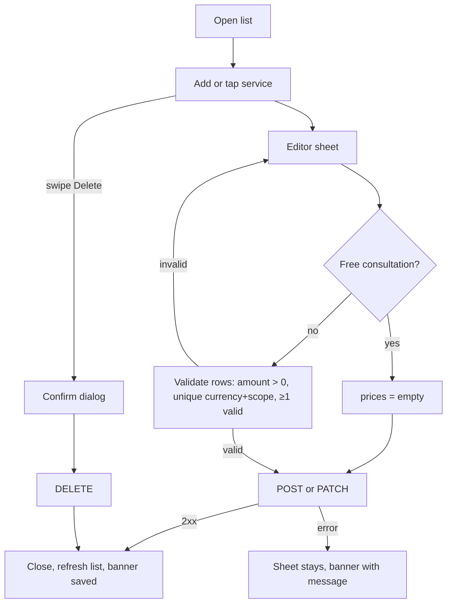

# Services & pricing (own services, groups, prices)

| | |
|---|---|
| Area | Profile, settings, reports & legal |
| Who sees it | Doctor only. No tier gate. Clinic-managed services appear read-only. |
| Reached from | Profile root → "Services & pricing" row; Extended profile link; completeness chip "Add services"; booking sheet "Add a service first" empty state (area 04) |
| Screen type | Full screen (pushed) + service editor sheet + groups editor sheet |
| Current Flutter source | `lib/features/profile/presentation/services_pricing_screen.dart`; locations from `lib/state/locations/doctor_location_actions.dart` |
| Spec | `docs/kmp-spec/08-profile-settings-reports-legal.md` §2, tickets SVC-01, SVC-02 |

## 1. Purpose
Define what the doctor offers and at what price so patients can book and pay: a list of services, optionally grouped, each with one or more prices (currency + optional per-location override) or marked as a free video consultation. Set up once, edited when prices change. Clinic-managed services come from the Clinic workspace (area 09) and are shown but not editable here.

## 2. Entry points
- Profile root → row → pushed.
- Extended profile → "Set prices in Services & pricing" link.
- Completeness chip "Add services" → pushed with the editor sheet opened for a new service.
- Area 04 booking flow empty state → pushed; on return the booking sheet refreshes its service list.

## 3. Layout, top to bottom (phone portrait)
1. **App bar** — back, title "Services & Pricing", right icon **Groups** (folder) → groups editor sheet.
2. **Summary strip** (NEW) — "{n} services · {m} groups"; chip filter per group when > 1 group ("All", "Consultations", "Orthodontics", …).
3. **List** — grouped by group name (ungrouped first as "No group"), each service as a row: title (bold), description (2 lines max, ellipsis), price lines ("150 000 UZS · All locations", "20 EUR · Berlin clinic") or "Free consultation (video)" tag, "Clinic-managed" tag when applicable; active toggle state shown as a dimmed row + "Inactive" tag when `isActive` is false (field exists; no UI today). Tap → editor; swipe left → Delete (own services only).
4. **FAB / bottom primary** — "Add Service" (sticky bottom button, 16 px above the inset).

### Service editor sheet (90 % height)
Title "New Service" / "Edit Service"; fields: Title (required), Description (2–4 lines), Group (dropdown: "No group" + groups), **Free consultation (video)** switch with helper, **Prices** section (helper "Prices: add a default row for all locations, or separate rows to override specific clinics."): N rows of [Amount (decimal) · Currency (UZS/USD/EUR/RUB + any unknown existing code) · Scope ("All locations (default)" or "Label — City")], "Add price row", row remove (when > 1); hidden entirely when Free consultation is on. Footer: Cancel · Save.

### Groups editor sheet
Title "Service groups", helper "Use groups to organize services on your profile. Lower sort order appears first."; rows: name + sort order (number) + delete; "Add group" row; Save per row (today) → target: drag handle to reorder (sort order derived), inline rename.

## 4. Data and formats
| Field | Source → saved | Format rule |
|---|---|---|
| Service | `GET/POST/PATCH/DELETE /api/doctors/me/services[/{id}]` body `{title, description, isActive, isFreeConsultation, groupId?, prices[]}` | title 1–80 chars (NEW limit), description ≤ 500 |
| Price | `prices[] {amountMinor, currency, locationId?}` | entered as decimal "25.00" → saved `round(x*100)`; displayed with the app money formatter: UZS no decimals with thin-space grouping ("150 000 UZS"), USD/EUR/RUB two decimals; today shows `amountMinor/100` with raw formatting |
| Currency | `UZS, USD, EUR, RUB`; unknown codes preserved | default UZS |
| Scope | `locationId` null = all locations; else one of the doctor's practice locations (`GET /api/doctors/me/locations`) | label "Label — City" or "Location #id" when the location no longer exists |
| Group | `GET/POST/PATCH/DELETE /api/doctors/me/service-groups[/{id}]` `{name, sortOrder}` | sorted by sortOrder then name client-side |
| Clinic-managed | `clinicManaged: true` | read-only row, tag "Clinic-managed" |
| Active | `isActive` | new → true; preserved on edit; toggle in editor (NEW) |

## 5. Primary flow (happy path)
1. Open → skeleton (3 rows) → list.
2. Tap "Add Service" → editor sheet, Title focused.
3. Type "Consultation", pick group "General", amount "150000" UZS, scope All locations → Save.
4. Sheet closes with a slide; new row appears in its group with a brief highlight; banner "Service saved" **NEW**.

## 6. Screen states
- **First load:** skeleton rows (title line + two short lines) under the app bar; summary strip skeleton.
- **Empty:** illustration + "No services yet" **NEW** + "Patients can only book what you list here. Add your first service." **NEW** + primary "Add Service". Groups icon still available.
- **Error on load:** "Failed to load" (`failedToLoad`) + Retry. Today: services call failure is silently ignored and shows an empty list.
- **Offline:** cached list shown with the offline banner; Add/Edit/Delete disabled (buttons dimmed with the offline reason on tap).
- **Refreshing:** pull-to-refresh; rows update in place.
- **Partial data:** locations call fails → scope dropdown offers only "All locations" and existing location-scoped prices show "Location #id"; a hint in the editor "Couldn't load your locations" **NEW**. Groups call fails → everything under "No group" + hint.
- **Permission needed:** n/a.
- **Locked by tier:** n/a.
- **Role difference:** clinic staff: not reachable (clinic services are managed in area 09).

## 7. Interactions and secondary flows
- **Tap row** → editor (clinic-managed row → bottom banner "This service is managed under Clinic → Services. Edit it there." and no sheet).
- **Swipe left on own row** → Delete action → dialog "Delete service?" with the title, "Appointments already booked keep their price." **NEW** (UNVERIFIED) → DELETE → row removed → banner "Service deleted" **NEW** with Undo? (no restore endpoint — no Undo).
- **Group chip** → filters the list.
- **Groups icon** → groups sheet: add (name required, sort order defaults to last+1), rename, reorder by drag, delete (dialog "Delete group? Its services stay and become ungrouped." **NEW**).
- **Editor: Free consultation on** → price rows collapse with animation; off → the previous rows return.
- **Editor: Add price row** → new row with UZS and All locations; remove (×) when > 1.
- **Editor: Save** → validation → request; double tap ignored.
- **Editor: Cancel / drag down with changes** → "Discard changes?" dialog.
- **Keyboard "Done"** on amount → closes keyboard; decimal keyboard with "," accepted as ".".

## 8. Edge cases
- 0 services → empty state; 1 → no group headers if ungrouped; 100+ → virtualised list, group headers sticky, filter chips scroll horizontally.
- Very long title (80 chars) → two lines then ellipsis; description 500 chars → 2 lines + "more" expands inline.
- Amount "0" or empty → row ignored; if no valid row remains → "Add at least one valid price" (today hard-coded English).
- Amount with thousands separators or spaces ("150 000") → stripped; "1,5" → 1.50; negative → blocked.
- Amount huge (99 999 999 999 UZS) → allowed if the server accepts; display with grouping.
- Duplicate (currency, scope) pair → "Duplicate currency and location combination" (today hard-coded) → target inline on the second row.
- Same currency for All locations and one specific location → allowed (override semantics).
- Location deleted after a price referenced it → scope shows "Location #12 (removed)" **NEW**; saving keeps it unless the doctor changes it (open question: drop automatically?).
- Unknown currency from the server ("KZT") → kept in the dropdown for that row only.
- Free consultation + prices previously set → prices are sent empty and lost on save; warn inline "Existing prices will be removed" **NEW**.
- Title empty → "This field is required" (`fieldRequired`) — today not validated at all.
- Server 4xx on save → banner with server `message`; sheet stays. Today: status not checked, failure looks like success.
- Delete 404 (already deleted elsewhere) → treat as success, refresh.
- Group deleted while editor open → Save returns 4xx → message; reopen groups list.
- Sort order collision (two groups with 1) → secondary sort by name; drag reorder rewrites all sortOrders sequentially.
- Clinic-managed service in a group the doctor deletes → stays as it is (server decides).
- Slow network > 3 s on save → ring; 30 s timeout → network banner.
- 401 → logout.
- Rotation → list and sheet state kept.
- Language switch → labels; currency formatting follows locale (decimal separator).
- Font 200 % → price rows stack vertically (amount full width, then currency + scope); chips wrap.
- Screen reader: rows "Consultation, 150 000 sum, all locations, button"; swipe action exposed as a custom action "Delete".

## 9. Validation and messages
| Field/action | Rule | When | Message (EN) | Where |
|---|---|---|---|---|
| Title | required, ≤ 80 | Save | `fieldRequired` ("This field is required") | inline |
| Description | ≤ 500 | typing | counter | inline |
| Amount | > 0, decimal ≤ 2 places | Save | "Add at least one valid price" **NEW key** (today hard-coded) | inline under prices |
| Price pair | unique (currency, scope) | Save | "Duplicate currency and location combination" **NEW key** | inline on the row |
| Free consultation with prices | — | toggle | "Existing prices will be removed" **NEW** | inline warning |
| Save | 2xx | after request | "Service saved" **NEW** / server `message` | top banner |
| Delete | confirm | swipe | "Delete service?" **NEW** | dialog |
| Group name | required | Save | `fieldRequired` | inline |
| Clinic-managed tap | — | tap | `serviceManagedByClinic` | top banner (info) |
| Load | 200 | open | `failedToLoad` + `retry` | full-screen state |

## 10. Navigation out
- Back → pop to Profile root (summary preview refreshes); booking sheet (if it opened this) refreshes its services.
- Editor/groups sheets → close to the list; list refreshes.

## 11. Copy
- Title `servicesPricing` ("Services & Pricing"); root subtitle `servicesPricingSubtitle`; panel text `servicesPricingPanelDesc`.
- List: `addService` ("Add Service"), `newService`, `editService`, `serviceManagedByClinicShort` ("Clinic-managed"), `serviceManagedByClinic`, `priceScopeAllLocations` ("All locations (default)"), `serviceFreeConsultation` ("Free consultation (video)"), `serviceFreeConsultationHint`, "Inactive" **NEW**, "No services yet" **NEW**, "Patients can only book what you list here. Add your first service." **NEW**, "{n} services · {m} groups" **NEW**.
- Editor: `serviceTitleLabel` ("Title"), `serviceDescriptionLabel` ("Description"), `serviceGroupLabel` ("Group"), `serviceGroupNone` ("No group"), `servicePricesSection`, `servicePriceLabel` ("Price amount (e.g. 25.00)"), `serviceCurrencyLabel` ("Currency (EUR/UZS/USD)") → fix to include RUB, "Add price row" **NEW**, `save`, `cancel`.
- Groups: `serviceGroupsTitle` ("Service groups"), `serviceGroupsHint`, "Add group" **NEW**, "Sort order" **NEW**, "Delete group? Its services stay and become ungrouped." **NEW**.
- Errors: `failedToLoad`, `retry`, `networkError`.

## 12. Known problems in the current app (do not carry over)
- **No response-status checks on any write** (create, edit, delete, groups) — failures look like success (verified bug #17).
- Delete has no confirmation; title emptiness is not validated; two validation messages are hard-coded English.
- Services list failure is swallowed (empty list, no error); loading is a centred spinner.
- Desktop `AlertDialog` 460 px wide for the editor; `ListTile` with three-line subtitle mixing group, description and prices.
- Money displayed as `amountMinor/100` without locale formatting ("150000.0 UZS").
- `isActive` exists in the data but cannot be toggled.
- Currency label says "EUR/UZS/USD" while RUB is also offered.

## 13. Open questions for design
- Group filter chips vs. sticky headers only?
- Should an "Inactive" toggle exist in the editor (hide from booking without deleting)?
- Drag-to-reorder groups (proposal) vs. numeric sort order (today)?
- Where does the completeness chip "Add services" land — here (prices) or on Extended profile (tags)? Proposal: here.
