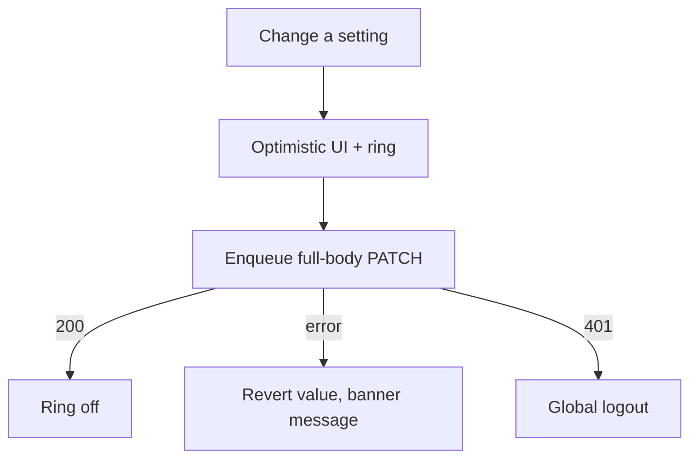

# Settings

| | |
|---|---|
| Area | Profile, settings, reports & legal |
| Who sees it | Doctor (full). Clinic staff: reduced (Language, Security → password only, About). |
| Reached from | Profile root → "Settings" row; More sheet → Language opens the language screen directly (area 01) |
| Screen type | Full screen (pushed) with grouped rows; pickers as bottom sheets |
| Current Flutter source | `profile_screen.dart` (panel `settings`, ~1783–1955), `lib/state/profile/profile_actions.dart` (`buildDoctorSettingsPatch`, `patchSettings`), `lib/features/settings/presentation/app_lock_settings_section.dart` (embedded) |
| Spec | `docs/kmp-spec/08-profile-settings-reports-legal.md` §1.8, §6, tickets SET-01, SET-02, SET-03; `01-architecture-core-auth-shell.md` §8 (language sync) |

## 1. Purpose
Account-level preferences that are not "who I am": country, app language, which tab opens first, two security flags stored on the server, and the doors to Security, Notifications, Privacy & data, About. Visited rarely; each change applies immediately (no Save button).

## 2. Entry points
- Profile root → Settings row → pushed.
- Deep link from the Security banner on login ("Set up app lock") → Settings → Security (`11`).
- More sheet → Language goes straight to the language screen (area 01 `language` file); the Language row here opens the same screen.

## 3. Layout, top to bottom (phone portrait)
1. **App bar** — back, title "Settings".
2. **Group "General"**
   - Country — value "Uzbekistan" → sheet with Germany / Uzbekistan / USA / Other (wire values are these English words; labels localised).
   - Language — value "Uzbek (UZ)" → pushes the language screen (area 01): English, Uzbek (UZ), Uzbek (Cyrillic), Russian.
   - Starting screen — value "Home" → sheet: Chat, Home, Calendar (labelled `navAppointments` today), Patients, Clinic, Tasks (only when the PREMIUM tasks feature is allowed), Reports, Notifications, Profile. Helper "Main tab when you open the app. Notifications still open the relevant screen."
3. **Group "Security"**
   - Security → `11-security.md` (change password, app lock, biometrics, session info). Row preview: "App lock on · Face ID" / "App lock off".
   - Two-factor Authentication — switch (server flag `twoFA`; nothing in the app enforces it, UNVERIFIED backend behaviour). Helper "Ask for a code when signing in on a new device" **NEW** (confirm with backend before writing this promise).
   - Encrypted Documents — switch (server flag `encryptedDocs`, default on). Helper "Store uploaded documents encrypted at rest" **NEW** (UNVERIFIED meaning).
4. **Group "Notifications"** — Notifications row → OS notification settings for the app (there is no in-app preference screen; see README "Not designed"). Preview: "Allowed" / "Blocked in system settings".
5. **Group "Data & legal"** — Privacy & data (`12`), About, legal & support (`13`).
6. **Footer** — version caption.

Switches change state instantly with a small inline ring on the right while the PATCH runs; on failure they snap back.

## 4. Data and formats
| Field | Source → saved | Format rule |
|---|---|---|
| Country | settings.country ← `PATCH /api/doctors/me/settings` (full body) | one of `Germany`, `Uzbekistan`, `USA`, `Other`; default `Uzbekistan`; displayed localised (`germany`, `uzbekistan`, `usa`, `otherCountry`) |
| Language | local store `doctor_language` (`en`, `uz`, `uz-Cyrl`, `ru`) + `doctor_language_explicit`; backend `PUT /api/doctors/me/language {en|uz|ru}` (uz-Cyrl → uz) and `settings.language` in the next settings PATCH | label per locale; the row value shows the language in its own name |
| Starting screen | settings.defaultStartTab ← PATCH | keys `chat, home, calendar, patients, clinic, tasks, reports, notifications, profile`; default `home`; `tasks` hidden unless allowed; if the stored value is not allowed, fall back to `home` |
| twoFA | settings.twoFA ← PATCH | bool, default false |
| encryptedDocs | settings.encryptedDocs ← PATCH | bool, default true |
| PATCH body | always full: `{country, language, twoFA, encryptedDocs, defaultStartTab}` | built from the **latest** state, writes serialised (queue) so two quick toggles do not overwrite each other |
| Notification permission | OS | "Allowed" / "Blocked" |

## 5. Primary flow (happy path)
1. Open → rows with current values (from the cached profile; skeleton only on cold open).
2. Tap Starting screen → sheet → "Calendar" → sheet closes, row shows "Calendar", ring on the row for the PATCH duration → done silently (no banner for preference changes; a banner only on failure).
3. Toggle Two-factor → ring → done.
4. Back → Profile root.

## 6. Screen states
- **First load:** rows with value skeletons (title visible, value shimmer) when the profile is not in memory.
- **Empty:** n/a — defaults always apply (country Uzbekistan, start Home, 2FA off, encryption on).
- **Error on load:** inherit Profile root error; Language, Security (app lock part), About still work because they are local — show them above an inline error for the server-backed rows.
- **Offline:** server-backed rows (Country, Starting screen, 2FA, Encrypted documents) disabled with the offline helper; Language, App lock, About work.
- **Refreshing:** n/a.
- **Partial data:** settings block missing → server-backed rows show "—" and are disabled with "Couldn't load settings" + Retry inline.
- **Permission needed:** Notifications row reflects the OS permission; tapping opens OS settings.
- **Locked by tier:** "Tasks" is absent from the Starting-screen options below PREMIUM; nothing else.
- **Role difference:** clinic staff see Language, Security (password only, no app lock? — app lock is device-level and should also be available to staff: proposal yes), Notifications, About. No Country, Starting screen, 2FA, Encrypted documents, Privacy & data (no doctor profile to export/delete — open question).

## 7. Interactions and secondary flows
- **Country row** → bottom sheet, radio list, current ticked → select → PATCH → sheet closes.
- **Language row** → push language screen; on return the whole settings screen re-renders in the new language; the shell re-renders too.
- **Starting screen row** → sheet; selecting applies from the next cold start (helper says so).
- **Switches** → optimistic; revert on error.
- **Security row** → push `11`.
- **Notifications row** → OS settings; on return the preview re-reads the permission.
- **Privacy & data** → push `12`. **About** → push `13`.
- **Back** → pop; nothing to confirm (no form).

## 8. Edge cases
- Two switches toggled within 300 ms → both persist (queued PATCHes built from the latest state; today the second overwrites the first with a stale snapshot).
- PATCH fails for one toggle → only that switch reverts; the other keeps its value.
- Stored `defaultStartTab = tasks` but tier is now PRO → row shows "Home" and the next PATCH sends `home` (silent repair).
- Stored country "Germany" while the app language is Uzbek → shows "Germaniya" (localised label), wire value unchanged.
- Language switched to uz-Cyrl → backend receives `uz`; app shows Cyrillic via transliteration; the profession label and timezone city names transliterate too.
- Language change while a PATCH is queued → the queued body carries the new language tag.
- Notification permission revoked in OS while the app is open → preview updates on resume.
- Slow PATCH > 3 s → ring stays; 30 s → revert + network banner.
- 401 → logout.
- Rotation → sheets persist.
- Font 200 % → row value wraps under the title; switches stay right-aligned.
- Screen reader: switches announced with state and helper; rows "Country, Uzbekistan, button".
- Clinic staff deep-linked to a doctor-only row → row not present; land on Settings root.

## 9. Validation and messages
| Field/action | Rule | When | Message (EN) | Where |
|---|---|---|---|---|
| Any server-backed change | 200 | after PATCH | on failure: server `message` or `networkError`; on success: none (today `settingsSaved` snackbar on a dead Save button) | top banner |
| Language change | local | immediately | `languageChanged` ("Language changed successfully") — keep as a brief banner | top banner |
| Settings block missing | — | open | "Couldn't load settings" **NEW** + `retry` | inline |

## 10. Navigation out
- Back → Profile root (Settings row preview refreshes: "Country, language, starting screen, security").
- Language screen, Security, Privacy & data, About → push/pop; nothing to confirm.
- OS settings → background/foreground; state re-read on resume.

## 11. Copy
- Title `settings` ("Settings"); root preview `settingsSubtitle` → update text.
- Rows: `country` ("Country"), `germany`, `uzbekistan`, `usa`, `otherCountry` ("Other"); `language` ("Language"), `english`, `uzbek` + " (UZ)", `uzbekCyrillicMenu` ("Uzbek (Cyrillic)"), `russian`; `startingScreen` ("Starting screen"), `startingScreenHint`; option labels `chat`, `home`, `navAppointments` → rename to "Calendar" **NEW**, `patients`, `clinicNavClinic` ("Clinic"), `tasks`, `navReports` ("Reports"), `notifications`, `profile`.
- Security group: "Security" **NEW**, `twoFactorAuthentication` ("Two-factor Authentication"), `encryptedDocuments` ("Encrypted Documents"), helpers **NEW**.
- Groups: "General" **NEW**, "Notifications" **NEW**, "Data & legal" **NEW**; Notifications preview "Allowed" / "Blocked in system settings" **NEW**.
- Rows: "Privacy & data" **NEW**, "About, legal & support" **NEW**.
- Errors: `networkError`, "Couldn't load settings" **NEW**.

## 12. Known problems in the current app (do not carry over)
- Settings is a panel inside Profile with a dead full-width **Save** ("Settings saved" snackbar, nothing saved by it); every control PATCHes immediately anyway.
- Full-body PATCH built from the settings map captured at build time → two quick toggles overwrite each other (spec quirk #18).
- Language dropdown here does not refresh the push-notification localisation cache (the standalone language screen does); neither sends `settings.language` on its own.
- App lock card is embedded at the bottom of this panel with **all seven of its strings missing** from the string files (shows raw keys like `appLock`).
- No Security/Notifications/Privacy/About destinations exist; Password is a sibling panel.
- Dropdowns are desktop form fields rather than rows + sheets.

## 13. Open questions for design
- Keep 2FA and Encrypted documents here (as today/spec) or move them into Security (`11`)? Proposal: Security.
- Should Country be shown at all (it only feeds the billing/locale default)?
- Starting-screen: sheet with icons of the tabs, or plain radio list?
