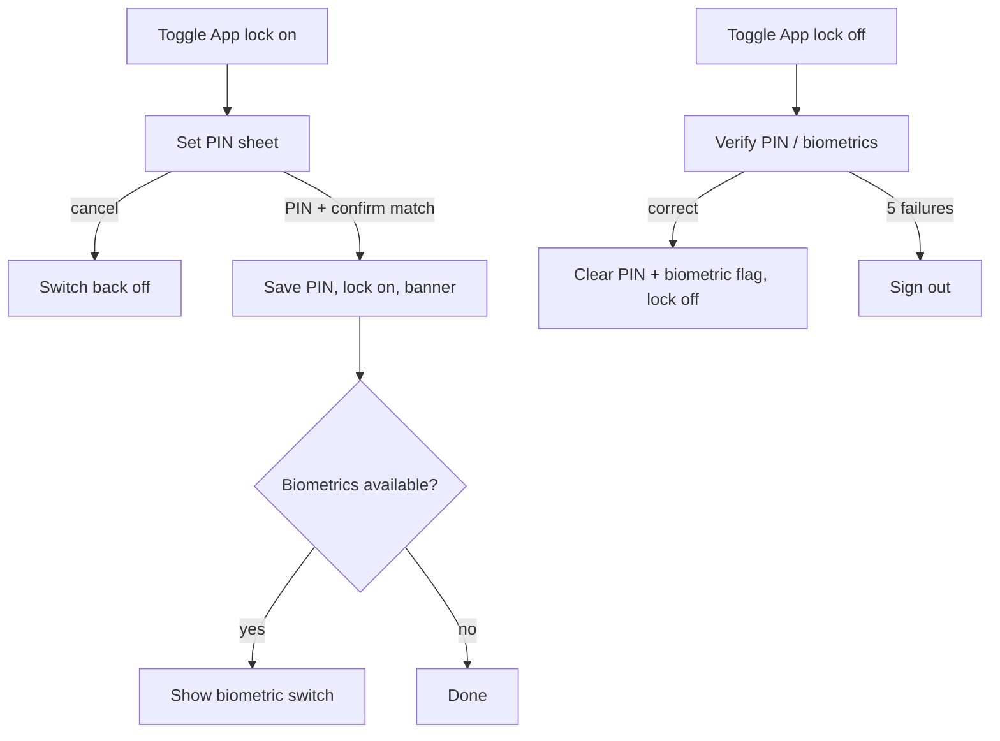

# Security (change password, app lock, biometrics, session)

| | |
|---|---|
| Area | Profile, settings, reports & legal |
| Who sees it | Doctor and Clinic staff (staff: change password + app lock; no 2FA/encryption flags). No tier gate. |
| Reached from | Settings → Security; Profile root (staff variant) → Change password; login-time banner "Set up app lock" (area 01, proposal) |
| Screen type | Full screen (pushed) + PIN set/confirm sheet + PIN verify sheet; the lock screen itself is area 01 |
| Current Flutter source | `profile_screen.dart` (panel `password`, ~2221–2267; staff form ~2410–2470), `lib/state/profile/profile_actions.dart` (`changePassword`), `lib/features/settings/presentation/app_lock_settings_section.dart`, `lib/core/services/app_lock_service.dart`, `lib/core/services/inactivity_timer_service.dart`, `lib/core/utils/password_validation.dart` |
| Spec | `docs/kmp-spec/08-profile-settings-reports-legal.md` §1.11, §6.2, tickets PROF-04 (password), SET-03 (app lock UI); `01-architecture-core-auth-shell.md` §7 (lock + inactivity rules, LOCK-01) |

## 1. Purpose
Everything that protects the account and the device: change the password, turn on a PIN lock for the app with optional biometrics, and see how sessions expire. Set up once; password changes are rare. This is a healthcare app on a personal phone — the app lock should be easy to switch on.

## 2. Entry points
- Settings → Security row → pushed.
- Staff Profile root → "Change password" row → opens this screen scrolled to the password card (staff see the same screen minus flags).
- Proposed: first-launch banner after login "Protect patient data — set up app lock" → here with the PIN sheet open.

## 3. Layout, top to bottom (phone portrait)
1. **App bar** — back, title "Security".
2. **Card "App lock"** (native mobile only)
   - Switch "App lock" with subtitle "Require PIN when reopening the app".
   - When on: row "Biometric unlock" switch (only when the device supports biometrics; label adapts: "Face ID", "Touch ID", "Fingerprint" where the platform tells us, else "Biometric unlock"); row "Change PIN" (NEW — today impossible without turning the lock off and on); caption "Locks after 5 seconds in the background and on every cold start" (current rule from area 01; "Lock after" delay options are an open question).
3. **Card "Password"** — fields Current password, New password, Confirm new password, each with show/hide eye; live requirement checklist under New password (8+ chars, uppercase, lowercase, number, special character, ≤ 128) — the same component as registration; button **Change password** (full width inside the card; disabled until all rules pass and confirm matches).
4. **Card "Sessions"** (informational, NEW) — "You stay signed in for 30 days without activity on this device" (native rule), "Sign out of this device" → logout confirmation (`15`). "Sign out everywhere" only if the backend offers it (UNVERIFIED — not today).
5. Optional (if moved from Settings): Two-factor Authentication and Encrypted Documents switches — see `10` §13.

### PIN set sheet (enable / change)
Title "Set PIN"; numeric keypad entry, 4–6 digits, dots indicator with a "Done" affordance once ≥ 4 digits (the user chooses the length — never auto-advance at 4); step 2 "Confirm PIN" repeats; mismatch shakes and restarts step 2. Cancel closes without change.

### PIN verify sheet (disable / change PIN first step)
Title "Enter your PIN"; same keypad; biometrics offered when enabled; 5 wrong attempts → the sheet closes and the account is signed out (area 01 rule, `maxPinAttempts = 5`).

## 4. Data and formats
| Field | Source → saved | Format rule |
|---|---|---|
| App lock enabled | secure storage `app_lock_enabled` | local only, per device |
| PIN | secure storage `app_lock_pin` → target: salted hash | 4–6 digits (`minPinLength 4`, `maxPinLength 6`), digits only |
| Biometric enabled | secure storage `biometric_enabled` | only meaningful when the lock is on; cleared when the lock is turned off |
| Current / new password | `POST /api/auth/reset-password {currentPassword, newPassword}` | new: 8–128 chars, ≥ 1 upper, ≥ 1 lower, ≥ 1 digit, ≥ 1 special (backend `PasswordPolicy`); today the profile form only checks ≥ 6 — align with the policy |
| Inactivity | constants: native 30 days, web 1 h; activity persisted at most every 5 min | informational; `defaultInactivitySeconds = 30` exists but is unused |
| Lock delay | 5 s background threshold (area 01) | informational caption |

## 5. Primary flow (happy path — enable app lock)
1. Toggle "App lock" on → PIN set sheet → enter 6 digits → tap Done → "Confirm PIN" → repeat → sheet closes; switch stays on; a banner "App lock is on" **NEW**.
2. If biometrics are available, the "Biometric unlock" row appears; the doctor turns it on → OS biometric prompt to confirm ownership → enabled.
3. Next time the app returns from the background after 5 s, the lock screen (area 01) appears.

Password happy path: fill three fields → checklist all green → Change password → ring → 200 → fields cleared, banner "Password updated successfully"; other sessions are not affected (UNVERIFIED).

## 6. Screen states
- **First load:** instant (local flags) except the biometric availability check (≤ 200 ms; row appears when known — no placeholder). The password card never loads anything.
- **Empty:** lock off → only the App lock switch and its subtitle; password fields empty.
- **Error on load:** n/a.
- **Offline:** app lock fully works (local). Password card: Change password disabled with "You're offline — password can't be changed now" **NEW**.
- **Refreshing:** n/a.
- **Partial data:** biometric check throws → treat as unavailable; row hidden.
- **Permission needed:** biometrics need no permission; iOS Face ID shows the system usage prompt the first time (requires the usage description string — "Unlock Shifa Doctor", localised).
- **Locked by tier:** n/a.
- **Role difference:** clinic staff: App lock card + Password card; no Sessions text about 30 days? (same rule applies — keep). No 2FA/encryption flags.

## 7. Interactions and secondary flows
- **App lock on** → PIN set sheet; cancel reverts the switch.
- **App lock off** → verify sheet; cancel keeps it on; success clears PIN and biometric flag.
- **Change PIN** → verify sheet → set sheet.
- **Biometric unlock on** → OS prompt; if the user cancels the prompt, the switch reverts. Off → immediate.
- **Password fields** → show/hide toggles; checklist updates per keystroke; Confirm mismatch shown on blur.
- **Change password** → request; on success clear fields and keep the screen; double tap ignored.
- **Sign out of this device** → `15`.
- **Back** → pop; dirty password fields → unsaved-changes dialog.
- **Keyboard "Next"/"Done"** → moves between the three fields; Done on the last submits when valid (today Enter submits on the staff form only).

## 8. Edge cases
- PIN of 5 or 6 digits → must be enterable and verifiable (today the lock screen auto-verifies at 4 digits, making longer PINs unusable — verified bug #1).
- PIN "0000" or "1234" → allowed (no strength rule) — open question whether to warn.
- Biometrics enrolled after the lock was set up → row appears on the next visit (re-check on resume).
- Biometrics removed from the device while enabled → the lock screen falls back to PIN; this screen shows the switch off with a caption "No biometrics enrolled on this device" **NEW**.
- Device without secure hardware → still works (software keystore) — no UI difference.
- Lock enabled but PIN missing (corrupt storage) → treat as lock off; show the switch off.
- Current password wrong → server message ("Failed to change password" fallback) shown inline under Current password, field cleared.
- New password equals current → server decides (UNVERIFIED); if accepted, fine.
- Password with leading/trailing spaces → not trimmed (passwords are literal); the current field is trimmed today — do not trim either.
- Password 128+ chars → blocked at input.
- Paste into Confirm → allowed.
- Password change 200 → the token stays valid (no re-login) — UNVERIFIED; if the backend invalidates sessions, the next request 401s and the global logout kicks in: show "Password changed — please sign in again" **NEW** on the login screen.
- Slow network > 3 s → ring; 30 s → network banner, fields kept.
- 401 on change → logout.
- Rotation → sheets persist; typed PIN dots preserved.
- Language switch → labels; the OS biometric prompt uses the OS language.
- Font 200 % → keypad stays 3×4 but scales; checklist wraps.
- Screen reader: PIN entry announces "digit n of 6 entered", never the digit; switches announce state; checklist items announce "met/not met".

## 9. Validation and messages
| Field/action | Rule | When | Message (EN) | Where |
|---|---|---|---|---|
| PIN | 4–6 digits | Done | "PIN must be 4–6 digits" **NEW** | inline in sheet |
| Confirm PIN | equals PIN | Done | "PINs don't match" **NEW** | inline, shake |
| Verify PIN | matches stored | Done | "Incorrect PIN" (`incorrectPin`, key exists in code, **missing in all string files**) | inline; after 5 → sign out |
| Current password | required | submit | `currentPasswordIsRequired` ("Current password is required") | inline |
| New password | 8–128, upper, lower, digit, special | typing + submit | checklist `passwordRequirementMinLength`, `…Uppercase`, `…Lowercase`, `…Digit`, `…SpecialChar`, `…MaxLength`; errors `passwordTooShort`, `passwordTooLong` | checklist under field |
| Confirm new | equals new | blur + submit | `newPasswordConfirmationMismatchError` ("New password and confirmation do not match"); empty → `pleaseConfirmNewPasswordError` | inline |
| Change password | 200 | after POST | `passwordUpdatedSuccessfully` / server `message` or `error` / fallback "Failed to change password" **NEW key** | banner / inline |
| Offline | — | open | "You're offline — password can't be changed now" **NEW** | helper |

## 10. Navigation out
- Back → Settings (Security row preview updates: "App lock on · Face ID").
- Sign out → `15` → Login.
- 5 failed PIN attempts → Login (lock cleared? no — the PIN stays for the next login; area 01 rule).

## 11. Copy
- Title "Security" **NEW**.
- App lock (all keys exist in code but have **no values in en/uz/ru** — add them): `appLock` ("App lock"), `appLockSubtitle` ("Require PIN when reopening the app"), `biometricUnlock` ("Biometric unlock"), `setPin` ("Set PIN"), `pin` ("PIN"), `confirmPin` ("Confirm PIN"), `incorrectPin` ("Incorrect PIN"); "Change PIN" **NEW**, "Enter your PIN" **NEW**, "App lock is on" **NEW**, "Locks after 5 seconds in the background and on every cold start" **NEW**, "No biometrics enrolled on this device" **NEW**; biometric prompt reason "Unlock Shifa Doctor" **NEW key** (hard-coded today).
- Password: `password`, `changeOrResetPassword` ("Change or reset your password here"), `currentPassword`, `newPassword`, `confirmNewPassword`, `passwordUpdatedSuccessfully`, requirement keys above; button "Change password" **NEW** (today `save`).
- Sessions: "You stay signed in for 30 days without activity on this device" **NEW**, `signOut`.

## 12. Known problems in the current app (do not carry over)
- All seven app-lock strings are missing from every language file; the card shows raw keys.
- PIN stored in plaintext; lock screen auto-verifies at 4 digits (5/6-digit PINs unusable); the attempt counter resets when the lock screen rebuilds.
- No "Change PIN"; disabling requires the PIN but there is no way to recover a forgotten PIN except 5 failures → sign out (acceptable, but must be explained).
- Password rule on this form is "Minimum 6 characters" (hard-coded English) while the backend policy and registration require 8+ with character classes — a 6-char password fails server-side with a raw message.
- Password panel is a top-level Profile section with a generic **Save** button; Enter-to-submit works only in the staff variant.
- Biometric reason string hard-coded English; `defaultInactivitySeconds = 30` constant suggests an inactivity option that was never built.

## 13. Open questions for design
- Offer a "Lock after" delay (Immediately / 1 min / 5 min) instead of the fixed 5 s? Needs LOCK-01 to support it.
- Move 2FA and Encrypted documents switches here?
- Show the password checklist always, or only once the field has focus?
- Should "Sign out" live here, on Profile root, in the More sheet — or all three?
