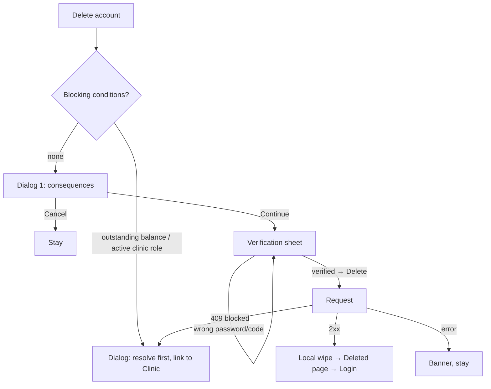

# Privacy & data (export, delete account + confirmation)

| | |
|---|---|
| Area | Profile, settings, reports & legal |
| Who sees it | Doctor. Clinic staff: delete-account only if product confirms staff may self-delete (open question). No tier gate. |
| Reached from | Settings → "Privacy & data" |
| Screen type | Full screen (pushed) + two-step delete confirmation (dialog → verification sheet) |
| Current Flutter source | n/a — **nothing exists today** (no export, no delete-account endpoint or screen; admin can delete a user via `deleteUser` in the admin panel only) |
| Spec | not covered by `docs/kmp-spec/08-…` (gap); store requirement: Apple App Store Review 5.1.1(v) and Google Play "account deletion" policy require in-app account deletion for apps that offer account creation (this app has invite-key registration, area 01). Backend endpoint to be requested in `15-api-reference.md` "backend requests" |

## 1. Purpose
Give the doctor the legally required controls over their own data: see what Shifa stores, request an export, and delete the account. Rare, but mandatory for store approval. Everything here is a **target** design; the backend endpoints do not exist yet and must be requested (marked UNVERIFIED).

## 2. Entry points
- Settings → Privacy & data → pushed.
- Store-mandated discoverability: must be reachable within two taps from the Profile root (Profile → Settings → Privacy & data satisfies this).
- A support deep link (`shifa://settings/privacy`) for support agents to send — proposal.

## 3. Layout, top to bottom (phone portrait)
1. **App bar** — back, title "Privacy & data".
2. **Card "Your data"** — short text: "Shifa stores your profile, schedule, appointments, chat messages and the documents you and your patients upload. Patient records belong to the patients and are kept according to medical record-keeping rules." Link "Privacy policy" → `13`.
3. **Row "Request a copy of my data"** — chevron; opens a confirmation sheet "We'll email a download link to {email} within 30 days" (UNVERIFIED process) → `POST /api/doctors/me/data-export` (UNVERIFIED) → row shows "Requested on {date}" and is disabled until fulfilled. Hidden entirely if the backend declines to build it (then the card text says to contact support).
4. **Row "Permissions"** — chevron → OS app settings (camera, photos, microphone, location, notifications) with a caption listing what each is used for.
5. **Card "Delete account"** (destructive, at the bottom, separated) — text: "Deleting your account removes your profile, schedule and messages. Patient medical records are retained as required by law and detached from your account. Upcoming appointments will be cancelled and patients notified. This cannot be undone." Button "Delete account" (destructive outline).

## 4. Data and formats
| Field | Source → saved | Format rule |
|---|---|---|
| Email for export | contact.email | masked "k•••@gmail.com"? No — show full, it is the user's own |
| Export request date | server (UNVERIFIED) | `dd.MM.yyyy` in practice timezone |
| Delete account | `DELETE /api/doctors/me` or `POST /api/doctors/me/delete-request` (UNVERIFIED; admin side has `deleteUser` with the text "Permanently delete this user and all their data (appointments, messages, profile)…") | requires re-authentication: current password (password users) or email OTP (OTP users) — mirror the login methods of area 01 |
| Upcoming appointment count | calendar cache | integer for the warning sentence |
| Outstanding balance / active treatment plans | clinic finance (area 09), UNVERIFIED | if > 0, deletion is blocked with guidance |

## 5. Primary flow (happy path — delete)
1. Doctor taps "Delete account" → **Dialog 1** "Delete your account?" with the consequences list (bulleted: profile and settings removed; {n} upcoming appointments cancelled and patients notified; chats removed for you; medical records retained by law) and buttons Cancel / Continue (destructive red, right).
2. Continue → **Verification sheet**: "Confirm it's you" — password field (or "Send code to {email}" → 6-digit code field), plus a typed confirmation "Type DELETE to confirm" (open question whether both are needed; proposal: re-auth only).
3. Tap "Delete account" (destructive, enabled when verified) → ring → request.
4. 200/202 → the app signs out locally, clears all local data (token, app-lock PIN, language stays), and lands on a full-screen "Your account has been deleted" page with "Done" → Login. If the backend uses a grace period, the page says "Your account will be deleted in {days} days. Sign in again to cancel."

## 6. Screen states
- **First load:** instant; export row value may load ("Requested on …") — show the row without value until known.
- **Empty:** n/a.
- **Error on load:** export status fails → row still tappable; no status.
- **Offline:** rows disabled except Permissions; delete button disabled with the offline helper. Verification sheet never opens offline.
- **Refreshing:** n/a.
- **Partial data:** blocking checks unavailable (finance call fails) → proceed and let the server answer 409.
- **Permission needed:** n/a (Permissions row only opens OS settings).
- **Locked by tier:** n/a — deletion must work on every tier including expired.
- **Role difference:** clinic staff: if allowed, the consequences text replaces appointment/records sentences with "You will lose access to {clinic}. The clinic admin can re-invite you."; clinic OWNER role → blocked: "Transfer clinic ownership before deleting your account" with a link to area 09.

## 7. Interactions and secondary flows
- **Request a copy** → confirmation sheet → request → banner "Export requested — we'll email you" **NEW** → row disabled with date.
- **Permissions** → OS settings.
- **Delete account** → §5. Dialog 1's Continue is on the right in red; Cancel is the default focus.
- **Verification: Forgot password** → link to the forgot-password flow (area 01) — deletion is abandoned.
- **Back / swipe down on the verification sheet** → abandons deletion silently (no extra dialog; nothing happened yet).
- **Deleted page "Done"** → Login screen with the stack cleared.

## 8. Edge cases
- Upcoming appointments 0 → the sentence is omitted; 1 → singular; 100+ → "100+ upcoming appointments".
- Active video call or in-person visit in progress → block with "Finish or cancel the current visit first" **NEW**.
- Unpaid invoices / active treatment plans in a clinic → 409 from the server → dialog with the reason and a link to the Clinic workspace.
- Doctor is a clinic OWNER → blocked as above.
- Wrong password 3 times in the verification sheet → sheet closes with banner "Too many attempts. Try again later." **NEW** (rate limit per area 01 OTP rules, UNVERIFIED for password).
- OTP code expired → "Invalid or expired OTP." (`invalidOtp`) with Resend.
- Request succeeds but the local wipe is interrupted (app killed) → on next launch the token is invalid → 401 → Login; no stale data visible because the token is gone.
- Request times out (30 s) → "Network error…" and stay; the doctor may retry; the backend must make the call idempotent.
- Deletion with a grace period: the doctor signs in during the period → login shows a banner "Your account is scheduled for deletion on {date}. Cancel deletion?" (area 01 to design).
- App lock on → the PIN is cleared with the account (device-level data of a deleted account must not linger); language preference is kept.
- Export requested twice → second tap shows "Already requested on {date}".
- Double tap on the final Delete → one request.
- Rotation → sheets persist; typed password preserved.
- Language switch → n/a while here.
- Font 200 % → dialog consequences list scrolls; buttons stack with Continue on top.
- Screen reader: destructive button announced "Delete account, button, destructive"; dialog reads the whole consequences list before the buttons.

## 9. Validation and messages
| Field/action | Rule | When | Message (EN) | Where |
|---|---|---|---|---|
| Export | one open request at a time | tap | "Export requested — we'll email you" **NEW** / "Already requested on {date}" **NEW** | banner / row |
| Delete dialog | — | tap | "Delete your account?" **NEW** + consequences list **NEW**; buttons `cancel` / `continue` | dialog |
| Password | required, matches | Delete | "Incorrect password" **NEW** (server `message`) | inline |
| OTP | 6 digits, valid | Delete | `invalidOtp` | inline |
| Blocked | server 409 | Delete | reason from server, fallback "Your account can't be deleted yet" **NEW** | dialog |
| Success | 2xx | after request | "Your account has been deleted" **NEW** / "Your account will be deleted in {days} days" **NEW** | full-screen page |
| Network | — | after request | `networkError` | banner |

## 10. Navigation out
- Back → Settings.
- Successful deletion → Deleted page → Login; every provider/cache is cleared like a logout plus the app-lock PIN.
- Forgot password → area 01 flow; returning lands on Login (deletion abandoned).
- Blocked → Clinic workspace (area 09) or Calendar as linked.

## 11. Copy
- Title "Privacy & data" **NEW**; "Your data" **NEW** + paragraph **NEW**; "Privacy policy" **NEW**; "Request a copy of my data" **NEW**; "We'll email a download link to {email} within 30 days" **NEW**; "Requested on {date}" **NEW**; "Permissions" **NEW** + caption **NEW**.
- Delete: "Delete account" **NEW**; consequences paragraph **NEW**; "Delete your account?" **NEW**; bullets **NEW**; "Confirm it's you" **NEW**; "Type DELETE to confirm" **NEW** (if kept); "Finish or cancel the current visit first" **NEW**; "Transfer clinic ownership before deleting your account" **NEW**; "Your account has been deleted" **NEW**; "Done" (`done` missing in en.json — **NEW**); `cancel`, `continue`.
- Existing related copy for tone: `deleteUserConfirm` (admin) — "Permanently delete this user and all their data (appointments, messages, profile)? … This cannot be undone."
- Errors: `invalidOtp`, `networkError`.

## 12. Known problems in the current app (do not carry over)
- There is no privacy, export or delete-account function anywhere in the doctor app; deletion is admin-only. Shipping to the stores without it risks rejection.
- Logout does not clear the app-lock PIN or registration state (area 01 quirk) — deletion must clear everything.

## 13. Open questions for design
- Re-authentication only, or re-auth + typed "DELETE"? (Proposal: re-auth only; typed confirmation adds friction without security.)
- Immediate deletion vs. grace period (needs backend decision; affects the final page and the login banner).
- Is data export in scope for v1, or "contact support" text only?
- Do clinic staff get self-service deletion?
