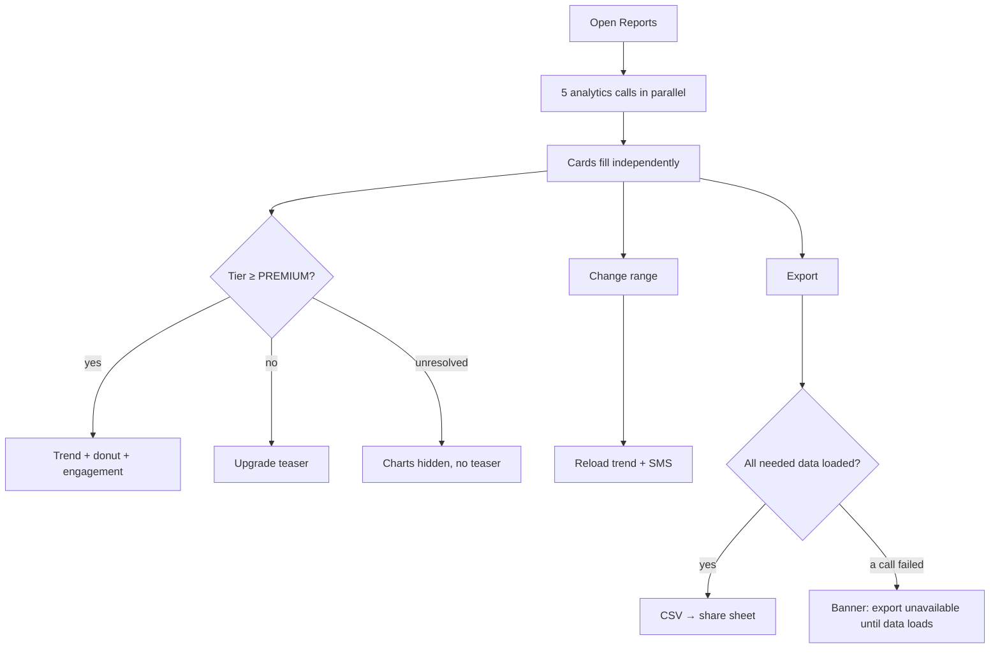

# Reports

| | |
|---|---|
| Area | Profile, settings, reports & legal |
| Who sees it | Doctor only. KPI cards and SMS usage on every tier; trend chart, visit-type donut and engagement only on **PREMIUM** (advanced analytics). |
| Reached from | More sheet → Reports; Profile root → Reports row; Home analytics section "See all reports" (area 02); "Starting screen = Reports" setting |
| Screen type | Full screen inside the More tab (tab bar visible when it is the tab root; hidden when pushed from Profile) + date-range picker + export share sheet |
| Current Flutter source | `lib/features/reports/presentation/reports_screen.dart`; shared widgets `lib/features/home/presentation/analytics_*.dart`, `lib/core/widgets/appointments_trend_chart.dart`, `visit_type_donut_chart.dart`; range `home_dashboard_date_range_provider.dart`; export `home_dashboard_export_service.dart` |
| Spec | `docs/kmp-spec/08-profile-settings-reports-legal.md` §7, ticket REPORT-01; widget internals in `02-home-ai-intelligence.md` (analytics) |

## 1. Purpose
A quiet place to look at practice numbers over a period and take them away as a file: today's KPIs, SMS reminder spend, and — on PREMIUM — appointment trend, visit-type split and patient engagement. Weekly or monthly habit for some doctors; many never open it. It re-uses the Home analytics components; this file describes composition, period handling and export, not chart internals (area 02).

## 2. Entry points
- More sheet → Reports (tab root of More; replaces the More content).
- Profile root → Reports row (pushed over Profile).
- Home → analytics section header link (area 02) → same.
- Settings → Starting screen = Reports → app opens here.
- Deep links: none today.

## 3. Layout, top to bottom (phone portrait)
1. **App bar / header** — title "Reports", subtitle "Clinic analytics, trends, and performance reports".
2. **Toolbar** — **Date range** button (outlined, calendar icon, label "17 Oct – 23 Oct, 2026") and **Export** button (filled, download icon). On phones the two stack vertically (today) → target: one row, range button flexible, export as icon button.
3. **Section "Clinic performance"** (card)
   - **KPI cards** (2×2 grid): Appointments Today, Completed Today, Cancelled / No-show, New Patients Today — numbers only; these are *today* figures and ignore the period (see §12).
   - **SMS reminders** card: "SMS sent {n}", "Total SMS cost {amount} {currency}", caption "{price} {currency} per SMS"; if SMS is not allowed for the account: "SMS reminders are not enabled for your account. Contact support." — this card does honour the period (from/to).
   - **PREMIUM only**: Appointments trend (line/bar per day for the period's day count), Visit Type Distribution (donut Video Call vs In-person), Patient Engagement (Active Patients (30d), Documents Received (30d)).
   - Below PREMIUM: an **upgrade teaser** card (NEW) in place of the three charts: lock icon, "Trends, visit types and engagement are on PREMIUM", button "See plans" → `09`. Today the charts are simply absent with no explanation.
4. Bottom clearance for the tab bar.

## 4. Data and formats
| Field | Source | Format rule |
|---|---|---|
| Period | shared state with Home: start/end calendar days, default last 7 days (today − 6 … today), picker range today − 365 … today + 30 | label "d MMM – d MMM, yyyy" (today English month abbreviations hard-coded — target localised); days are **practice-timezone** days |
| KPIs | `GET /api/doctor/analytics/overview` → appointmentsToday, completedToday, cancelledToday, newPatientsToday | integers; period-insensitive |
| Trend | `GET /api/doctor/analytics/appointments-trend?days={dayCount}` → [{date yyyy-MM-dd, count}] | one point per day; x labels in practice timezone |
| Visit types | `GET /api/doctor/analytics/consultation-types` → {video, inPerson} | period-insensitive today |
| Engagement | `GET /api/doctor/analytics/engagement` → {activePatients, documentsReceived} | fixed 30-day windows |
| SMS usage | `GET /api/doctor/analytics/sms-usage?from=&to=` → {sentCount, totalCostMinor, currency, pricePerSmsMinor, smsRemindersAllowed} | money via the shared formatter (minor units → "12 500 UZS") |
| Export | CSV built client-side: header "SHIFA Dashboard Export", "Period,{startIso},{endIso}", "Metric,Value" rows (8 metrics), blank, "Date,Appointments" per trend point; file `shifa_dashboard_{start}_{end}.csv`, shared via the OS share sheet | UTF-8; target: label period-insensitive metrics as "(today)"/"(30d)" and localise metric names |

## 5. Primary flow (happy path)
1. Open → header + toolbar render; KPI grid, SMS card and (PREMIUM) charts show skeletons.
2. Data arrives per card independently (five calls); each card swaps skeleton → content without the page jumping (fixed card heights).
3. Doctor taps the date range → platform range picker (helper "Select date range") → picks 1–31 Oct → Apply → label updates; trend and SMS cards reload (skeleton inside the card only); KPIs stay.
4. Doctor taps Export → button shows a ring → CSV built from the already loaded data → OS share sheet (Files, Telegram, mail…) → banner "Export started — check your downloads" → today's wording; target "Report ready to share".

## 6. Screen states
- **First load:** title/subtitle/toolbar immediate; KPI grid = 4 skeleton tiles; SMS card skeleton; chart skeletons (PREMIUM) with the same heights as the real charts. No centred spinner.
- **Empty:** all zeros / no trend points → KPI tiles show "0"; charts show "No data yet" inside the card (keep the card frame); SMS "0 sent".
- **Error on load:** per card: "Failed to load" + Retry inside that card; the rest of the page works. Export is disabled while any of the four export sources is in error (tooltip/banner explains).
- **Offline:** last loaded values shown with the offline banner; range change and Export disabled; Retry buttons disabled.
- **Refreshing:** pull-to-refresh reloads all five; cards keep old content with a subtle shimmer overlay, no jump. Range change reloads only the two period-aware cards.
- **Partial data:** e.g. SMS call 403 (feature not enabled) → the card shows the not-allowed text, not an error.
- **Permission needed:** none; sharing uses the OS sheet (no storage permission needed on modern OS versions).
- **Locked by tier:** below PREMIUM the three advanced cards are replaced by one teaser card with "See plans". While the tier is unresolved, show neither the charts nor the teaser (avoid flicker both ways).
- **Role difference:** clinic staff: not available (not in their More sheet; a deep link lands on their Profile root).

## 7. Interactions and secondary flows
- **Date range button** → platform date-range picker; Cancel keeps the range; selecting end before start is impossible in the picker (the controller also ignores it).
- **Export** → §5; disabled with ring while building; second tap ignored.
- **Tap KPI tile** → n/a today → proposal: Appointments Today opens the Calendar on today (area 04). Keep as open question.
- **Tap trend point / donut segment** → tooltip with the value (chart component behaviour, area 02).
- **Tap teaser "See plans"** → `09` with PREMIUM highlighted and "Needed for: Advanced analytics".
- **Pull-to-refresh** → reload all.
- **Back** (when pushed from Profile) → pop; as tab root → back to the previous main tab.

## 8. Edge cases
- Period of 1 day → trend has one point; chart shows a single bar/point, not an empty line. Period of 365 days → 365 points; chart must thin x-labels (every 30 days) and stay scrollable or aggregate weekly (open question).
- Range crossing midnight in practice timezone while the phone is in another zone → days are computed in practice timezone; the picker's "today" must also be practice-today (today it uses device time — verified bug #9 family).
- Range including future days (up to +30 allowed) → trend returns zeros for future dates; SMS none.
- Today's KPIs vs. a historical range → the KPI title says "Today" explicitly; the CSV labels them "(today)".
- Numbers ≥ 10 000 → grouped "12 345"; SMS cost in minor units with a currency the formatter does not know → fall back to "{amount} {code}".
- `smsRemindersAllowed = false` → not-allowed text; `pricePerSmsMinor = 0` → hide the price caption.
- One of the five calls > 3 s → that card keeps its skeleton; after 15 s the card shows "Still loading…" caption; no global timeout.
- Export while trend is still loading → wait up to 10 s, then export with what is there and append a "Trend: unavailable" line? Proposal: disable Export until the four sources are loaded; show a banner if tapped early.
- Share sheet cancelled → no banner (do not say "Export started").
- Share target fails (no app) → OS handles; nothing to do.
- Tier changes while open (admin downgrade) → on next refresh charts swap to the teaser.
- 401 on any call → global logout.
- Rotation → charts re-layout; range kept.
- Language switch → month names in the range label and metric names re-render; CSV uses the current language for metric names (open question: always English for spreadsheets?).
- Font 200 % → KPI grid becomes 1 column; toolbar stacks; chart legends wrap.
- Screen reader: each KPI tile "Appointments today, 12"; charts expose a text summary ("7 days, total 48 appointments, peak Tuesday 11"); Export announces "Exporting" then "Share sheet opened".

## 9. Validation and messages
| Field/action | Rule | When | Message (EN) | Where |
|---|---|---|---|---|
| Date range | start ≤ end, within −365…+30 days | picker | picker prevents invalid | — |
| Card load | 200 | open/refresh | "Failed to load" (`failedToLoad`) + `retry` | inside card |
| Card empty | — | data | "No data yet" (`analyticsNoData`) | inside card |
| SMS not allowed | flag | data | `reportsSmsNotAllowed` | inside card |
| Export | sources loaded | tap | "Export started — check your downloads" (`exportStarted`) → target "Report ready to share" **NEW**; failure "Could not export dashboard data" (`exportFailed`); early tap "Export is available once the data has loaded" **NEW** | top banner |
| Tier teaser | tier < PREMIUM | render | "Trends, visit types and engagement are on PREMIUM" **NEW**, "See plans" **NEW** | card |

## 10. Navigation out
- Back → Profile root or previous tab; the Home dashboard shares the same range state, so changing the period here also changes Home's period (by design today — flag in §13).
- See plans → `09`.
- Share sheet → external app; return lands here.

## 11. Copy
- Title `navReports` ("Reports"), subtitle `reportsScreenSubtitle`; section `clinicPerformance` ("Clinic performance"), `clinicPerformanceSubtitle` ("Analytics overview").
- Toolbar: `selectDateRange` ("Select date range"), `export` ("Export").
- KPIs: `appointmentsToday` ("Appointments Today"), `completedToday` ("Completed Today"), `cancelledToday` ("Cancelled / No-show"), `newPatientsToday` ("New Patients Today").
- SMS: `reportsSmsTitle` ("SMS reminders"), `reportsSmsSent` ("SMS sent"), `reportsSmsSpent` ("Total SMS cost"), `reportsSmsRateHint` ("{{price}} {{currency}} per SMS"), `reportsSmsNotAllowed`.
- Charts: `appointmentsLast` (trend title, with day count), `visitTypeDistribution` ("Visit Type Distribution"), `videoCall` ("Video Call"), `inPerson` ("In-person"), `engagementSummary` ("Patient Engagement"), `activePatients` ("Active Patients (30d)"), `documentsReceived` ("Documents Received (30d)"), `analyticsNoData` ("No data yet").
- Export: `exportStarted`, `exportFailed`; CSV metric names (today English literals: "Appointments today", "Completed today", "Cancelled today", "New patients today", "Active patients (30d)", "Documents received (30d)", "Video consultations", "In-person consultations") → reuse the keys above.
- Teaser **NEW** as in §9. Errors: `failedToLoad`, `retry`, `error`.

## 12. Known problems in the current app (do not carry over)
- The date range only affects the trend (`days`) and SMS (`from/to`); KPIs, visit types and engagement ignore it, yet the CSV labels everything with the chosen period (spec quirk #19). The design must label today/30-day figures honestly until the backend adds period parameters.
- Below PREMIUM the advanced charts silently vanish — no explanation, no upgrade path.
- Range label uses hard-coded English month abbreviations; the picker's bounds use device time, not practice time.
- Export success says "check your downloads" even on mobile where a share sheet opens (web wording).
- The range state is shared with Home — changing it here changes Home's dashboard without telling the user.
- Toolbar stacks two full-width buttons on phones; page uses a single scroll view with no pull-to-refresh.

## 13. Open questions for design
- Keep the shared period with Home, or make Reports' period independent?
- Preset chips (7 d / 30 d / This month / Custom) instead of only a calendar range picker?
- Should KPI tiles be tappable shortcuts (today's calendar, patients list)?
- CSV language: English column names always, or localised?
