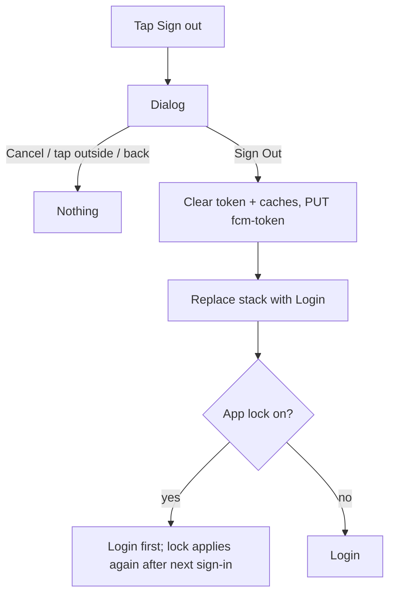

# Sign out confirmation

| | |
|---|---|
| Area | Profile, settings, reports & legal |
| Who sees it | Doctor and Clinic staff. No tier gate. |
| Reached from | More sheet → Sign out (today); Profile root → Sign out button (target); Security → "Sign out of this device" |
| Screen type | Dialog |
| Current Flutter source | `lib/features/shell/presentation/main_shell.dart` (`_MobileMoreLogoutButton` ~2179–2225 and three other copies of the same dialog), `lib/state/auth/auth_controller.dart` (`logout`, ~383–414) |
| Spec | `docs/kmp-spec/01-architecture-core-auth-shell.md` §2.10 (logout), §4 (storage keys, what is cleared); `08-…` §1.8 note "logout lives in the shell More sheet" |

## 1. Purpose
Prevent an accidental sign-out (the button sits near other rows) and make clear what signing out means on a phone that may be shared in a clinic: the session ends, app-lock stays configured, unsent drafts are lost. Used rarely by doctors on personal phones; daily by receptionists on shared clinic devices.

## 2. Entry points
- More sheet → Sign out row (bottom of the sheet, after Language).
- Profile root → Sign out button (bottom).
- Security → "Sign out of this device".
- Not shown for automatic sign-outs (inactivity 30 days native, JWT expiry, 401, 5 failed PIN attempts, admin role mismatch) — those go straight to Login with a reason banner (area 01).

## 3. Layout, top to bottom (phone portrait)
1. **Title** — "Sign Out".
2. **Body** — "Are you sure you want to sign out?" plus, when relevant, one extra line:
   - app lock on: "Your PIN stays set on this device." (NEW; today unmentioned)
   - an upload or recording is in progress: "An upload is still running and will be cancelled." (NEW)
   - unsynced draft (SOAP note, chat message being typed — area 05/07 to confirm drafts exist): "Unsaved notes will be lost." (NEW)
3. **Actions** — "Cancel" (text, left) · "Sign Out" (destructive red, right).

## 4. Data and formats
| Field | Source | Format rule |
|---|---|---|
| App lock state | local secure storage | boolean → extra line |
| In-flight uploads | upload queue (area 06/07) | count > 0 → extra line |
| What logout clears | `authTokenProvider`, secure token storage, API client token; `PUT /api/doctors/me/fcm-token {fcmToken: ""}` best-effort; invalidates profile, me-profile, clinic workspace, appointments, patients, tasks caches | — |
| What logout keeps | app-lock PIN + flags, language + explicit flag, OTP rate-limit history; today also registration draft state and the Firebase user (area 01 quirks — target: clear registration state) | — |
| Inactivity timer | `shifa_doctor_last_activity_ms` | cleared when the session ends (service disposed) |
| Last-used tab / clinic selection | `shellProvider`, `clinic_workspace_selected_id:<meId>` | tab reset to the start-tab setting; clinic selection is keyed per user and kept |
| Push token on the server | `PUT /api/doctors/me/fcm-token {"fcmToken": ""}` | fire-and-forget; failure ignored so a dead network never blocks sign-out |

## 5. Primary flow (happy path)
1. Tap Sign out → dialog scales in; Cancel has focus by default.
2. Tap "Sign Out" → the dialog closes; a short full-screen fade with the Shifa mark (≤ 400 ms) while the token is cleared and the push token is unregistered (best-effort, not awaited beyond 2 s).
3. Login screen replaces the whole stack; the tab index resets to the default start tab for the next login; a neutral banner "You've signed out" **NEW** (optional).

## 6. Screen states
- **First load:** instant.
- **Empty:** n/a.
- **Error on load:** n/a.
- **Offline:** sign out works fully offline (local clear); the push-token unregister silently fails and is retried at the next login (today: ignored). Body adds no offline warning.
- **Refreshing:** n/a.
- **Partial data:** n/a.
- **Permission needed:** n/a.
- **Locked by tier:** n/a.
- **Role difference:** identical for staff; on shared clinic devices the extra app-lock line matters more — wording unchanged.

## 7. Interactions and secondary flows
- **Sign Out** → §5; double tap ignored (the dialog is gone after the first).
- **Cancel / scrim tap / back gesture** → close, nothing happens.
- **Hardware back during the fade** → ignored.
- **Sign out while a video call is active** → not offered: the Sign out row is disabled with the caption "End the call first" **NEW** (area 05 owns the call state); today nothing prevents it.
- **Sign out while the voice session / dictation is recording** (area 03) → the dialog's extra line "Recording will be stopped" **NEW**; confirming stops the recorder before clearing the session.
- **Keyboard** → none involved; if a text field had focus behind the dialog, the keyboard is dismissed when the dialog opens.

## 8. Edge cases
- Token already expired when the user taps Sign out → same path; no error.
- Receptionist on a shared clinic tablet signs out between shifts → the next person sees Login in the last-used language; if the previous user had app lock on, the lock stays armed for the device (see the PIN question below).
- Sign out immediately after a profile save whose refetch is still running → the refetch result is discarded (providers invalidated); nothing is shown.
- Logout request for the FCM token returns 401 → ignored (no logout loop; area 01 rule "no token sent → skip").
- Two logout triggers at once (user taps Sign out while an inactivity timeout fires) → single navigation to Login; the dialog, if still open, is dismissed.
- Sign out with a pending upload → upload cancelled; the partially uploaded file is discarded; the extra body line warned about it.
- Sign out with unsent chat text → lost; area 07 may persist drafts locally per user — if so, the line is unnecessary.
- Deep link arrives while the dialog is open → dialog dismissed as Cancel; the link is handled (it needs the session).
- App lock enabled → the PIN remains; after the next sign-in the lock applies normally. If a *different* account signs in on the same device, the old PIN still protects the app (open question: clear PIN when the signed-in user id changes).
- Language stays as chosen; the Login screen appears in the same language.
- Push notification tapped after sign out → opens Login; the deep link is remembered until after login (area 01).
- Rotation → dialog persists.
- Font 200 % → body wraps; buttons stack (Sign Out on top in red).
- Screen reader: title, body, then "Cancel, button", "Sign Out, button, destructive"; focus returns to the Sign out row on Cancel.
- Biometric-only users (no password memorised) → signing out means they must know their password/OTP to return — add the line "You'll need your password or an email code to sign back in" **NEW** when the last login was ≥ 30 days ago? (Open question; simpler: always show for staff.)

## 9. Validation and messages
| Field/action | Rule | When | Message (EN) | Where |
|---|---|---|---|---|
| Confirm | — | tap row | title `signOut` ("Sign Out"), body `signOutConfirm` ("Are you sure you want to sign out?") | dialog |
| Extra lines | conditional | render | "Your PIN stays set on this device." **NEW**; "An upload is still running and will be cancelled." **NEW**; "Unsaved notes will be lost." **NEW** | dialog body |
| Blocked during call | call active | tap | "End the call first" **NEW** | row caption |
| After sign out | — | Login | "You've signed out" **NEW** (optional) | top banner on Login |

Alternative existing keys with the same meaning (do not use both): `logout` ("Logout"), `confirmLogout` ("Are you sure you want to log out?"). Pick "Sign out" everywhere.

## 10. Navigation out
- Sign Out → Login screen, whole navigation stack replaced; tab index reset; caches invalidated; next login refetches everything.
- Cancel → back to the originating screen with no change.

## 11. Copy
- `signOut` ("Sign Out"), `signOutConfirm` ("Are you sure you want to sign out?"), `cancel` ("Cancel").
- NEW lines as in §9. Decide one verb: "Sign out" (title-case "Sign Out" only in the button label per platform convention — open question).

## 12. Known problems in the current app (do not carry over)
- Four copies of the same confirmation dialog in the shell (dark sidebar, labelled, plain, mobile More sheet); only the shell buttons reset the tab index, so timeout/401 logouts can land the next login on a stale tab.
- Logout navigates twice (app-level listener and the button itself).
- Registration draft state (including a plaintext password) and the Firebase user survive logout.
- Two string pairs exist for the same dialog (`signOut`/`signOutConfirm` and `logout`/`confirmLogout`).
- No warning about in-flight uploads or active calls; nothing tells shared-device users that the app lock PIN persists.

## 13. Open questions for design
- Sign out entry in the More sheet, Profile root, Security — all three or fewer?
- Show the post-logout banner on Login, or keep Login clean?
- Clear the app-lock PIN when a different user signs in on the same device?
