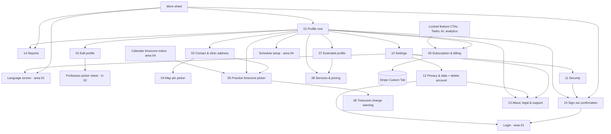

# 08 · Profile, settings, reports & legal — flow map and rules

Spec: [`docs/kmp-spec/08-profile-settings-reports-legal.md`](../../kmp-spec/08-profile-settings-reports-legal.md) (tickets PROF-01…08, SVC-01…02, SUB-01…02, SET-01…03, REPORT-01, LEGAL-01…02). Conventions: [`../00-README.md`](../00-README.md). Every file below follows [`../_TEMPLATE.md`](../_TEMPLATE.md).

Screens owned by other folders and only referenced here: the **lock screen / PIN entry** and the **language screen** (01), **schedule setup and practice locations** (04), **document viewer** (06), **analytics chart internals** (02).

## 1. Flow map

## 2. Files

| File | Screen | Role | Tier | Purpose |
|---|---|---|---|---|
| `01-profile-root.md` | Profile (tab root) | Doctor; staff read-only variant | all | Identity header, completeness banner, section rows, sign out, version |
| `02-edit-profile.md` | Edit profile + photo sheet + profession picker | Doctor | all | Photo, first/last name, DOB, gender, profession — explicit Save that really persists |
| `03-contact-and-clinic-address.md` | Contact & clinic address | Doctor | all | Phone, email, address-first location (search, structured fields, street), coordinates, timezone row |
| `04-map-pin-picker.md` | Map pin picker | Doctor | all | One draggable pin, my-location with 3 permission states, confirm → coordinates |
| `05-practice-timezone-picker.md` | Practice timezone picker sheet | Doctor (staff read-only) | all | Curated 47 IANA zones (+ optional full list), search, device suggestion, saves on pick |
| `06-practice-timezone-change-warning.md` | Timezone change warning dialog | Doctor | all | Explains the display shift of existing slots before changing an already-set zone |
| `07-extended-profile.md` | Extended profile | Doctor | all | Biography, service keywords, certificates (image/PDF), Telegram/Instagram |
| `08-services-and-pricing.md` | Services & pricing + editor + groups | Doctor | all | Bookable services with multi-currency / per-location prices, free video consultation, groups |
| `09-subscription-and-billing.md` | Subscription & billing | Doctor | all (content per tier) | Current plan, plan cards + feature matrix, upgrade via Stripe, Connect payouts, invoicing fields |
| `10-settings-root.md` | Settings | Doctor; staff reduced | all | Country, language entry, starting screen, 2FA / encrypted-docs flags, doors to Security / Notifications (OS) / Privacy / About |
| `11-security.md` | Security + PIN sheets | Doctor and staff | all | Change password (8+ policy), app lock on/off, change PIN, biometrics, session info |
| `12-privacy-and-delete-account.md` | Privacy & data + delete confirmation | Doctor (staff TBD) | all | Data summary, export request, permissions, two-step account deletion (store requirement; backend TBD) |
| `13-about-legal-support.md` | About, legal & support | Doctor and staff | all | Version, terms/privacy/licences viewer, conditional "My partnership contract", support channels |
| `14-reports.md` | Reports | Doctor | all; charts PREMIUM | KPI cards + SMS usage for all, trend/donut/engagement on PREMIUM, period picker, CSV share |
| `15-logout-confirmation.md` | Sign out confirmation | Doctor and staff | all | Confirm dialog with conditional warnings; what is cleared vs kept |

## 3. Not designed (and why)

| Item | Reason |
|---|---|
| **Notification preferences screen** | No in-app toggles or backend endpoint exist; push follows the OS permission (Settings → Notifications opens OS settings). SMS reminders are allowed per account by admin (read-only in Reports) and toggled per patient in the patient detail (area 06). Needs a product decision + endpoint before a screen is drawn. |
| **Lock screen / PIN entry overlay, biometrics prompt** | Area 01 (`01-launch-auth-shell`). This folder covers only the Security toggles and PIN set/verify sheets. |
| **Language screen** | Area 01. Settings and the More sheet only link to it. |
| **Schedule setup, practice locations list/editor** | Area 04; the address component from `03` is reused inside the location editor. |
| **Clinic settings, clinic services, clinic finance** | Area 09. The doctor-side Services & pricing (`08`) shows clinic-managed services read-only. |
| **Legal consent / signature flow** | Nothing exists for doctors; the only contract is issued and auto-signed from the admin web panel. LEGAL-01 is a spike; `13` reserves a view-only row if product says yes. No accept/sign UI is designed. |
| **Admin "change subscription tier" dialog** | Admin panel stays web (doc 10). |
| **Stripe checkout / onboarding pages** | Hosted by Stripe inside a Custom Tab / SFSafariViewController; only the return handling is ours (`09`). |
| **Desktop two-pane profile layout** | Phone-first rewrite; tablets get wider gutters, not split panes (00-README decision). |
| **Clinic-staff "web only" block screen** | Dropped by decision (staff allowed on mobile). |
| **Timezone debug screen, dead `ProfileController` fake data** | Dead code; not ported. |

## 4. Area rules

### 4.1 Which profile fields are required for which features
| Field | Required by | What happens when missing |
|---|---|---|
| Practice timezone | Calendar, Home "today", appointment times, video join window, Reports periods, Schedule setup | App falls back to UTC for computing times (TZ-1 rule) → every time looks wrong. Calendar shows a persistent warning "Set your practice timezone" with a link to `05`; Profile root completeness chip; Schedule setup refuses to save availability without it (area 04 to confirm). |
| First + last name | Shell header, patient app, chat, PDFs, consultation notes | "Dr. med." alone is shown; completeness chip. Save on `02` requires both. |
| Profession | Dental vs general documentation template (area 05), patient app listing, profile completeness | General template is used; chip "Add profession" — note `Implantologist` must count as dental in the rewrite. |
| Phone | Login identity, patient contact | Cannot be empty in practice; `03` requires it. |
| Email | Email OTP login, billing | Optional; without it OTP login and export emails are impossible — `12` and area 01 must say so. |
| Clinic address + coordinates | Patient directions / patient app map, "device timezone differs" context | Chip "Add clinic address"; nothing blocks. Coordinates are saved even without a resolved address. |
| At least one practice location (area 04) | Schedule rules, per-location prices in `08` | `08` scope dropdown shows only "All locations". |
| At least one service (`08`) | Patient booking | Booking sheet empty state links to `08`; chip "Add services". |
| Photo | Trust in the patient app | Initials avatar; chip "Add photo". |
| Stripe Connect account | Receiving card payments | Payments card shows "Not connected"; patients may be limited to cash/other gateways (UNVERIFIED). |
| App lock | none (device-level) | Proposed one-time banner after first login. |

### 4.2 Tier matrix (from the spec; backend is authoritative, the app only mirrors)
| Feature | BASIC | PRO | PREMIUM | Where it is gated in the UI |
|---|---|---|---|---|
| Calendar, documents, chat, patient management, basic analytics (KPI cards, SMS usage) | ✓ | ✓ | ✓ | never actually checked — always on |
| Video consultation | – | ✓ | ✓ | declared, **not checked anywhere today** (area 05 to decide) |
| AI notes (scribe) | – | ✓ | ✓ | in-person/video visit (area 05) |
| Speech-to-text | – | ✓ | ✓ | speech text field + voice session (areas 03/05/07) |
| Patient briefing | – | ✓ | ✓ | patient detail (area 06) |
| Ask Shifa AI / Intelligence | – | ✓ | ✓ | shell entry, Home widgets (areas 02/03) |
| Remote-care tasks | – | – | ✓ | Tasks tab/More item hidden; starting-screen option hidden (`10`) |
| Advanced analytics (trend, visit types, engagement) | – | – | ✓ | Reports (`14`) and Home analytics (area 02) |
| Differential diagnosis | – | – | ✓ | declared, not checked today |

Rules:
- Tier comes from `GET /api/doctors/me` → `subscription.tier`; unknown or still loading = **unresolved**. Today the app treats unresolved as PREMIUM (fail open). The rewrite keeps features usable while unresolved (no false locks) but **hides gated entries until resolved** and never shows an upgrade CTA or a tier badge for an unresolved tier (`09`, 00-README open decision 2).
- Locked presentation: Tasks and advanced analytics → entry hidden + a teaser card where content would be; AI features → control visible but dimmed with a one-line message and "See plans" → `09`. Nothing locked is ever a dead tap.
- Upgrades happen only through `09` (Stripe hosted checkout); PREMIUM checkout is UNVERIFIED on the backend — until confirmed, the PREMIUM button goes to support.
- Clinic staff have no tier (no `/api/doctors/me`); staff never see tier UI.

### 4.3 Other area-wide rules
- **Save model:** forms (`02`, `03`, `07` text fields, `09` invoicing, `11` password) use an explicit Save with dirty tracking and an unsaved-changes dialog; preferences (`10` rows/switches, `05` timezone pick, `07` tags/certificates, `11` app lock) apply immediately with an inline ring and revert on failure. No screen has a Save that saves nothing.
- **Feedback:** skeletons that match the layout; top banners for success/error; destructive dialogs with the red action on the right. Never snackbars, never raw exception text.
- **Server messages:** when the backend returns `message`, show it verbatim; otherwise use the localised generic strings (`networkError`, `somethingWentWrong`). Never show "Save failed: <body>".
- **Strings:** the seven app-lock keys, all Stripe/subscription copy, timezone labels, "Minimum 6 characters" and the two service-price validations are hard-coded or missing today and must be added to en/uz/ru.
- **Password policy** everywhere (change + registration): 8–128 characters, upper, lower, digit, special.
- **PIN:** 4–6 digits, user chooses the length, stored hashed; 5 failures = sign out.
- **Time:** every date on these screens (DOB display, export dates, contract dates, Reports periods) is formatted in the practice timezone; DOB itself is a calendar date and never shifts.
- **Money:** minor units + currency through the shared formatter (`08`, `09`, `14`).
