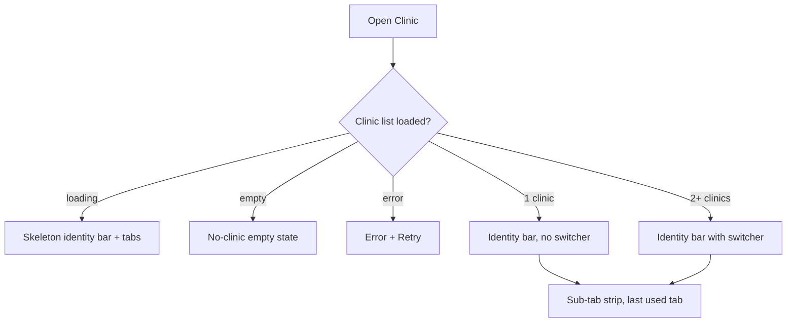

# Clinic workspace root

| | |
|---|---|
| Area | Clinic workspace |
| Who sees it | Doctor with at least one clinic membership (owner or member) · Clinic staff (tab root of their 4-tab shell). No tier gate — unlocked by membership, not subscription. |
| Reached from | Doctor: More sheet → Clinic (also the "Finance" entry, same destination); Home quick action "New treatment plan" when the doctor has a clinic; push deep links that target a clinic sub-tab. Staff: second tab of the shell. |
| Screen type | Tab root (identity bar + horizontally scrollable sub-tab strip + sub-tab content) |
| Current Flutter source | `lib/features/clinic/presentation/clinic_workspace_screen.dart`, `lib/state/clinic/clinic_providers.dart` |
| Spec | `docs/kmp-spec/09-clinic-workspace-finance-treatment-plans.md` §1, §2, tickets CLINIC-01, CLINIC-02, CLINIC-04 |

## 1. Purpose
The back office of a clinic the doctor belongs to: who works there, which services the clinic sells, the clinic's patients, treatment plans, money and receptionist invitations. An owner or clinic admin opens it several times a day (finance, bookings on behalf of colleagues); a plain member doctor opens it a few times a week (plans, services); a receptionist lives in it all day. A doctor with no clinic never sees it.

## 2. Entry points
- **More sheet → Clinic** (doctor): replaces the tab content; the sub-tab strip opens on the last selected sub-tab (today it always opens on Overview — see §12).
- **More sheet → Finance** (doctor): same screen; target behaviour is to land directly on the Finance sub-tab (today it lands on Overview).
- **Staff shell, tab 2** (clinic staff): tab root; there is no "More" for staff.
- **Home quick action "New treatment plan"**: if the doctor has no clinic, a banner "Set up a clinic workspace to create treatment plans." is shown and the Clinic tab is opened (which then shows the no-clinic empty state); if they have a clinic the wizard opens directly on top of the current tab with the first clinic (not the selected one — §12).
- **Overview quick actions / deep links** can ask the root to select a specific sub-tab (Calendar = 2, Patients = 3, Finance = 6).
- **App resume** silently reloads the clinic list, so a membership added by an admin appears without re-login.

## 3. Layout, top to bottom (phone portrait)
1. **App bar** — standard shell app bar (title "Clinic"). Sticky.
2. **Clinic identity bar** (sticky, tinted teal background): clinic icon, clinic **name** (bold, 1 line, ellipsis), and — only when the user belongs to 2+ clinics — a **clinic switcher** (today a dropdown next to the name; target: tapping the name opens a bottom sheet listing clinics with a check mark on the selected one). Below the name: `Time zone · Address` in one small grey line; below that `Your role: Owner (primary practice)` where "(primary practice)" appears only for the clinic flagged as the doctor's main practice.
3. **Sub-tab strip** (sticky, horizontally scrollable chips/tabs, 9 items): Overview · Doctors · Calendar · Patients · Services · Treatment plans · Finance · Invitations · Settings. Selected tab in teal. On a phone only ~4 fit; the strip scrolls and the selected tab must be kept visible.
4. **Sub-tab content** (fills the rest, scrolls independently). The Overview tab shows:
   1. Contact rows: phone (phone icon), email (mail icon) — each only when present; tapping phone dials, tapping email opens mail (today they are static rows — §12).
   2. Three **metric cards** in a wrap (2 per row on phones): "Appointments today", "Active doctors", "Patients this month". Values are whole numbers in teal; label small grey above.
   3. "Quick actions" heading + three secondary buttons wrapping: "My calendar" (doctor → shell Calendar tab, resets any colleague filter; staff → inner Calendar sub-tab), "Calendar" (inner Calendar sub-tab), "Patients" (inner Patients sub-tab).
5. The **Calendar sub-tab** is a plain list: hint text ("Use My schedule for your own calendar…"), a full-width primary button "My schedule" (hidden for staff — target; today it is a dead button for staff), then one secondary button per member "Calendar for: Dr Name" which opens the book-on-behalf schedule (file 06).
6. No FAB on the root; creation actions live inside the sub-tabs.

## 4. Data and formats
| Field | Source | Format rule |
|---|---|---|
| Clinic list | `GET /api/me/clinics` | Sorted as returned; default selection = remembered clinic for this user (key `clinic_workspace_selected_id:<meId>`) else first clinic |
| Clinic name | membership summary | Plain text, 1 line, ellipsis; identical names are possible — show address as disambiguator in the switcher |
| Time zone | membership summary (IANA, default "UTC") | Shown raw today ("Asia/Tashkent"); target: city name + current offset, e.g. "Tashkent (UTC+5)" |
| Address | membership summary | Optional; omit separator when empty |
| Role | membership role: OWNER, CLINIC_ADMIN, RECEPTIONIST, DOCTOR, NURSE | Localised labels: Owner, Clinic admin, Receptionist, Doctor, Nurse |
| Metric values | `GET /api/clinics/{id}/overview-stats` | Integers, no grouping needed (< 10 000). Two more fields (average waiting minutes, occupancy %) arrive but are never shown |
| Phone | clinic | Shown as stored; format E.164 → local display if possible |
| All dates and times inside the workspace | — | **Clinic time zone**, not the doctor's practice zone and not the phone's. This is the one area of the app where the clinic zone wins; say so in the identity bar. |

## 5. Primary flow (happy path)
1. User opens Clinic from the More sheet → identity bar and sub-tab strip render immediately with the cached clinic list; the Overview body shows skeleton cards (3 metric placeholders, 2 contact rows).
2. Stats arrive (< 1 s typical) → cards fill without layout jump.
3. User taps a sub-tab → content for that tab loads with its own skeleton; the strip scrolls the selected tab into view.
4. Switching clinics via the identity bar → every sub-tab reloads for the new clinic; the selection is persisted for this user.

## 6. Screen states
- **First load**: identity bar skeleton (name line, 2 meta lines), 9 ghost tabs, Overview skeleton (2 contact rows, 3 cards, 3 button pills). Never a centred spinner (today it is).
- **Empty (no clinic)**: centred illustration + "You are not linked to a clinic yet. When an administrator assigns you to a clinic, the Clinic workspace will appear here." No CTA (creation is admin-side; see file 20 §13). For staff this state should not be reachable — a staff account always has a membership; if it happens, show the same text plus "Sign out".
- **Error on load**: top banner "Couldn't load your clinics." + Retry button in the body; the tab strip is hidden until the list loads.
- **Offline**: identity bar and last loaded sub-tab content render from cache; a "You're offline" banner; actions that write are disabled.
- **Refreshing**: pull-to-refresh on the Overview reloads stats; content does not jump (cards keep size, values fade).
- **Partial data**: clinic list ok but stats fail → contact rows and quick actions render, the metric area shows an inline "Couldn't load stats · Retry".
- **Permission needed**: n/a.
- **Locked by tier**: n/a — no tier gate in this area.
- **Role difference**: Owner / clinic admin: all 9 sub-tabs. Member doctor: all 9 sub-tabs; Doctors tab has no "Default share" button and only their own share is editable if the clinic flag allows (see file 02). Receptionist / nurse (staff shell): all 9 sub-tabs; "My schedule"/"My calendar" are hidden; nurse has no write actions in Finance. Target: hide Invitations and Settings edit actions for non-owners once the server confirms the rules (UNVERIFIED).

## 7. Interactions and secondary flows
- **Tap sub-tab** → content switches; Finance tab triggers a refresh of all finance data (today ~10 requests; target: refresh only the visible finance view).
- **Swipe horizontally on content** → moves to the neighbouring sub-tab (today enabled); keep it but make sure tables that scroll horizontally win the gesture.
- **Tap clinic name / switcher** (2+ clinics) → bottom sheet of clinics → select → sheet closes, identity bar updates, all sub-tabs reload; selection persisted.
- **Tap phone row** → dialer; **tap email row** → mail app (target).
- **Tap metric card** → nothing today; target: "Appointments today" opens the inner Calendar sub-tab on today, "Patients this month" opens Patients (open question).
- **Quick action "My calendar"** (doctor) → leaves the workspace for the shell Calendar tab with the doctor's own calendar; the workspace keeps its state when the user returns.
- **Quick action "Calendar" / "Patients"** → selects the inner sub-tab.
- **Pull-to-refresh** on Overview → reloads clinic list + stats.
- **System back** on the root → leaves to the previous tab (doctor) / does nothing on a staff tab root.

## 8. Edge cases
- 1 clinic vs 40 doctors: the root is unaffected; the Calendar sub-tab's "one button per doctor" list becomes 40 buttons — target: a searchable list (file 06).
- User belongs to 2 clinics with the same name → show address under each in the switcher.
- Clinic with no address and no phone/email → identity bar shows only the time zone; Overview has no contact rows (no empty gap).
- Very long clinic name (60+ chars) → one line, ellipsis, full name in the switcher sheet.
- Time zone missing → backend default "UTC"; show it but mark it in the Settings tab as "not set" (owner should ask admin to fix).
- Membership removed while open → next refresh returns an empty list → root falls back to empty state; any pushed sub-screen (plan detail, schedule) gets 403/404 on its next call → banner "You no longer have access to this clinic" and pop to root.
- Stats endpoint slow (> 3 s) → skeleton persists; after 10 s show inline "Still loading…"; never block the tab strip.
- 401 while on the root → global logout flow (see area 01); unsaved sub-tab filters are lost, acceptable.
- Rotation / tablet landscape → identity bar becomes a single row; sub-tab strip fits without scrolling at ≥ 840 dp; content may use the wide layouts described per sub-tab.
- Font scaling 200 % → identity bar wraps to 4 lines; sub-tab labels wrap to 2 lines rather than truncating; metric cards stack 1 per row.
- Language switch while open → labels re-render; the Uzbek Cyrillic transliteration also applies to clinic names? No — clinic names are user data, never transliterated.
- Screen reader: order = clinic name (with "button, change clinic" when switcher present) → role line → tab strip (tabs announced "n of 9") → content.
- Deep link to a sub-tab while a sheet (wizard, payment) is open → the sheet stays; the sub-tab changes underneath; do not dismiss unsaved work.

## 9. Validation and messages
| Field/action | Rule | When checked | Message (EN) | Where shown |
|---|---|---|---|---|
| Clinic list load | HTTP 200 and JSON array | on load / resume | "Couldn't load your clinics." | top banner + Retry |
| Stats load | HTTP 200 | on load | "Couldn't load stats." | inline in metric area |
| Switch clinic | id must be in the list | on select | — (silently falls back to first clinic) | — |
| Home quick action without clinic | at least one membership | on tap | "Set up a clinic workspace to create treatment plans." | top banner |

## 10. Navigation out
- Sub-tab content pushes (plan detail, doctor schedule, patient detail) keep the tab bar hidden and return to the same sub-tab with filters intact.
- "My calendar" → shell Calendar tab; returning via the tab bar restores the workspace state.
- Clinic switch does not navigate; it reloads in place.
- Logout / 401 → login; nothing to save here.

## 11. Copy
- Title: `clinicNavClinic` "Clinic", `clinic` "Clinic"
- Identity bar: `clinicWorkspaceYourRole` "Your role", `clinicWorkspacePrimaryPractice` "primary practice", role labels `clinicMembershipRoleOwner` "Owner", `clinicMembershipRoleClinicAdmin` "Clinic admin", `clinicMembershipRoleReceptionist` "Receptionist", `clinicMembershipRoleDoctor` "Doctor", `clinicMembershipRoleNurse` "Nurse"
- Tabs: `clinicWorkspaceOverview` "Overview", `clinicWorkspaceDoctors` "Doctors", `clinicWorkspaceCalendar` "Calendar", `clinicWorkspacePatients` "Patients", `clinicWorkspaceServices` "Services", `clinicWorkspaceTreatmentPlans` "Treatment plans", `clinicWorkspaceFinance` "Finance", `clinicWorkspaceInvitations` "Invitations", `clinicWorkspaceSettings` "Settings"
- Overview: `clinicMetricAppointmentsToday` "Appointments today", `clinicMetricActiveDoctors` "Active doctors", `clinicMetricPatientsThisMonth` "Patients this month", `clinicWorkspaceQuickActions` "Quick actions", `clinicOpenCalendarTab` "My calendar"
- Calendar sub-tab: `clinicCalendarMvpHint` "Use My schedule for your own calendar (main Calendar tab). Tap a colleague to open their schedule and book in the clinic timezone.", `mySchedule` "My schedule" and `calendarForDoctor` "Calendar for" (both exist only in the Dart map, missing from `en.json` — add), `clinicWorkspaceNoDoctors` "No doctors listed for this clinic."
- Empty: `clinicWorkspaceNoClinics` "You are not linked to a clinic yet. When an administrator assigns you to a clinic, the Clinic workspace will appear here."
- Home quick action: `setUpClinicWorkspace` "Set up a clinic workspace to create treatment plans."
- **NEW**: "Couldn't load your clinics.", "Couldn't load stats.", "Change clinic" (switcher sheet title), "You no longer have access to this clinic."

## 12. Known problems in the current app (do not carry over)
- Finance nav item and Clinic nav item both open the workspace on **Overview**; Finance should land on the Finance sub-tab.
- The sub-tab strip always resets to Overview when the tab is re-entered; remember the last sub-tab per session.
- Home quick action uses the **first** clinic, not the selected one.
- Two of three quick actions open the same inner Calendar sub-tab for staff; "My schedule" is a no-op for staff — hide it.
- Contact rows are not tappable.
- Loading is a centred spinner; errors print the raw exception text.
- Clinic staff is blocked on native mobile by a "web only" screen; the rewrite allows staff on phones.
- Time zone shown as a raw IANA id.
- Selecting the Finance sub-tab fires ~10 network calls every time.

## 13. Open questions for design
- Nine sub-tabs on a phone: keep a scrolling strip, or group them (Overview · People · Catalog · Plans · Finance · More)? Finance itself has 6 inner views (file 07).
- Should the identity bar collapse on scroll to save vertical space?
- Should metric cards be tappable shortcuts?
- Is "(primary practice)" worth showing, or does it belong in Settings only?
