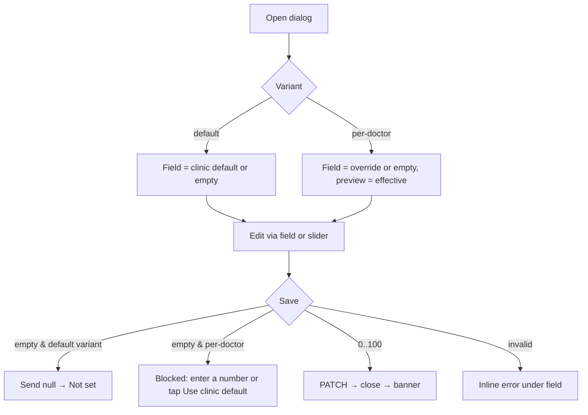

# Edit revenue share dialog (clinic default and per-doctor)

| | |
|---|---|
| Area | Clinic workspace |
| Who sees it | Owner / clinic admin (or any member whose clinic summary carries the "can manage finance settings" flag). No tier gate. |
| Reached from | Doctors list: "Default share" button (default variant) or a doctor's share text / percent icon (per-doctor variant); Settings tab shows the default value read-only |
| Screen type | Dialog (target: bottom sheet on phones) |
| Current Flutter source | `lib/features/clinic/presentation/clinic_revenue_share_ui.dart` |
| Spec | `docs/kmp-spec/09-clinic-workspace-finance-treatment-plans.md` §3.8, ticket CLINIC-05 |

## 1. Purpose
Set how collected money is split between a doctor and the clinic. One number (the doctor's percentage); the clinic keeps the remainder. The clinic default applies to every doctor without an override. Set once at setup, changed rarely.

## 2. Entry points
- **Default variant**: Doctors list hint banner → "Default share". Context: current clinic summary (default percent may be null).
- **Per-doctor variant**: Doctors list → tap share text or percent icon on a member with role Doctor or Owner. Context: member (name, current override, effective share).
- Both open modally over the list; the list stays visible behind the scrim.

## 3. Layout, top to bottom (phone portrait)
1. **Title**: "Default doctor revenue share" (default) or "Doctor revenue share" (per-doctor).
2. **Context line**: default → helper "Used when a doctor has no individual override. Clinic keeps the remainder."; per-doctor → the doctor's name (bold) and, target, "Clinic default: 60 %" underneath.
3. **Number field** "Doctor share" with "%" suffix, numeric keyboard, whole numbers 0–100. Empty is allowed (means "use default" / "not set").
4. **Slider** 0–100 in steps of 1, synced both ways with the field.
5. **Live preview**: "Doctor 60% · Clinic 40%".
6. **Actions** (left to right): "Use clinic default" (text button; default variant: clears the clinic default → "Not set"), "Cancel", **"Save"** (filled, shows a spinner while saving). On a phone sheet the primary Save is full width at the bottom with Cancel as text above; "Use clinic default" becomes a secondary text link under the field.

## 4. Data and formats
| Field | Source | Format rule |
|---|---|---|
| Initial value | default: `defaultDoctorRevenueSharePercent`; per-doctor: `doctorRevenueSharePercent` (override) | Field empty when null; slider/preview then show the effective value (override ?? default ?? 0) |
| Preview | computed | integers only; clinic = 100 − doctor |
| Save payload | default: `PATCH /api/clinics/{id}/finance-settings {defaultDoctorRevenueSharePercent}`; per-doctor: `PATCH /api/clinics/{id}/members/{doctorProfileId}/revenue-share {doctorRevenueSharePercent}` | `null` = clear |
| After save | default: reload clinic list + finance refresh; per-doctor: reload members + finance refresh | Doctor earnings and dashboard share cards change |
| Affected doctors (target) | members without override | Count shown in the default variant |
| Validation | integer 0–100 | Same rule in both variants; server also validates (message surfaced) |

## 5. Primary flow (happy path)
1. Open → field prefilled (or empty), slider at the effective value, preview computed.
2. Drag slider or type → preview updates live; typing an out-of-range value clamps the slider but keeps the text (error shown on save).
3. Tap Save → button shows spinner, all controls disabled → 200 → sheet closes → banner "Revenue share saved" → list shows new value.

## 6. Screen states
- **First load**: n/a (opens with data already in memory).
- **Empty**: field empty = "Not set"; preview shows effective value with a note "(clinic default)" when applicable.
- **Error on load**: n/a.
- **Offline**: Save disabled with inline "You're offline".
- **Refreshing**: n/a.
- **Partial data**: member has no effective share and clinic has no default → preview "Doctor 0% · Clinic 100%" with note "No default set".
- **Permission needed**: n/a.
- **Locked by tier**: n/a.
- **Role difference**: only users with finance-settings permission reach it; a 403 from the server (flag out of date) → banner "You don't have permission to change revenue shares." and close.

## 7. Interactions and secondary flows
- **Slider drag** → field text follows (whole numbers).
- **Type** → slider follows when 0–100; otherwise slider stays, field shows error state on save.
- **"Use clinic default"** (per-doctor) → sends null → member inherits default → close → banner. Today this closes the dialog *before* the request finishes and shows no spinner — target: keep the sheet open with spinner until the response.
- **"Use clinic default"** (default variant) → clears the clinic default (semantically "Not set"); target label for this variant: "Clear default" with a confirmation line "Doctors without an override will have no share set."
- **Cancel / scrim / swipe down** → discard; no confirmation needed (single field).
- **Keyboard Done** → acts as Save.

## 8. Edge cases
- 0 % → valid (clinic keeps all). 100 % → valid (doctor keeps all). Preview must not show "-0".
- 101, −5, "60.5", "abc", "" (per-doctor) → inline error "Enter a whole number from 0 to 100".
- Pasting "60 %" → strip non-digits before validating.
- Double tap Save → second tap ignored (button disabled while saving).
- Save fails (5xx/network) → stay open, controls re-enabled, banner with server message or "Couldn't save revenue share."
- 401 mid-save → logout flow; dialog closes.
- Owner changes the default while another owner has the per-doctor dialog open → no conflict detection; last write wins; list reload shows final values.
- Member removed meanwhile → 404 → "This doctor is no longer a member." and close.
- Rotation while open → values preserved.
- 200 % font → slider labels may clip; sheet scrolls; Save stays pinned.
- Language switch → not possible while modal; labels on reopen.
- Screen reader: field announced "Doctor share, percent, 60"; slider "Doctor share slider, 60 percent"; preview as live region.
- Slider at 0 while the field is empty (per-doctor variant) → Save must be blocked, not interpreted as 0 %; make the empty state explicit ("Using clinic default").
- Changing the default from 60 to 70 while 12 doctors have no override → all 12 change at once; the default dialog should say "Applies to {{n}} doctors without an override" (count from the members list).
- Share saved during an open month → earnings for already-collected visits are recomputed by the server or not? UNVERIFIED — show "Changes apply to future calculations" only if backend confirms.

## 9. Validation and messages
| Field/action | Rule | When checked | Message (EN) | Where shown |
|---|---|---|---|---|
| Doctor share | integer 0–100; empty allowed only in default variant (= clear) | on Save (and live clamp for slider) | "Enter a whole number from 0 to 100" | inline under field (today: bottom toast) |
| Save | HTTP 200 | on response | "Revenue share saved" (**NEW**) / server message or "Couldn't save revenue share." (**NEW**) | top banner |
| Permission | 403 | on response | "You don't have permission to change revenue shares." (**NEW**) | banner, dialog closes |

## 10. Navigation out
- Close on success → Doctors list (refreshed); Finance data refreshed in background.
- Cancel → Doctors list unchanged.

## 11. Copy
- Titles: `clinicFinanceDefaultRevenueShare` "Default doctor revenue share", `clinicDoctorRevenueShareDialogTitle` "Doctor revenue share"
- Helper: `clinicFinanceDefaultRevenueShareHint` "Used when a doctor has no individual override. Clinic keeps the remainder."
- Field: `clinicDoctorRevenueShareDoctorLabel` "Doctor share"
- Preview: `clinicDoctorRevenueSharePreview` "Doctor {{doctor}}% · Clinic {{clinic}}%"
- Buttons: `clinicDoctorRevenueShareClear` "Use clinic default", `cancel` "Cancel", `clinicDoctorRevenueShareSave` "Save"
- Error: `clinicDoctorRevenueShareInvalid` "Enter a whole number from 0 to 100"
- **NEW**: "Revenue share saved", "Couldn't save revenue share.", "Clear default", "Doctors without an override will have no share set.", "Clinic default: {{percent}} %", "No default set"

## 12. Known problems in the current app (do not carry over)
- Two 150-line copies of the same dialog differing only in the request; design one component with a variant.
- "Use clinic default" closes before the request completes and ignores the saving state; errors then appear over the list.
- Validation error is a bottom toast, not inline.
- In the default variant the Clear action is labelled "Use clinic default", which makes no sense for the default itself.
- No success feedback at all.

## 13. Open questions for design
- Slider + field, or a stepper/segmented presets (50/60/70/80) + field?
- Show a tiny preview of money impact ("On 1 000 000 UZS the doctor gets 600 000")?
- Should the per-doctor sheet show the current default prominently so owners understand inheritance?
