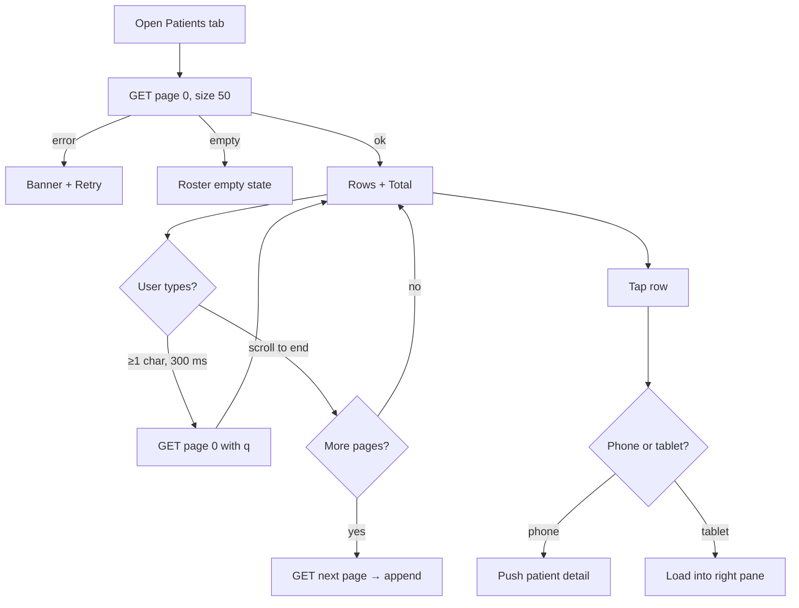

# Clinic patients list

| | |
|---|---|
| Area | Clinic workspace |
| Who sees it | All members (doctor, staff). Content is filtered by the server to the user's access level. No tier gate. |
| Reached from | Clinic workspace root → "Patients" sub-tab; Overview quick action "Patients"; patient detail inside the workspace returns here |
| Screen type | Sub-tab (list; pushes the patient detail on phones, side pane on tablets) |
| Current Flutter source | `lib/features/clinic/presentation/clinic_workspace_screen.dart` (`_PatientsTab`), `lib/state/clinic/clinic_providers.dart` (`clinicPatientsFirstPageProvider`), `lib/features/patients/presentation/patients_screen.dart` (`PatientDetailPanel`) |
| Spec | `docs/kmp-spec/09-clinic-workspace-finance-treatment-plans.md` §2 row 3, ticket CLINIC-06; patient detail in doc 06 |

## 1. Purpose
Find a patient of the clinic (not only the doctor's own patients) and open their record in a clinic context: uploads, forms and treatment plans created from here are attributed to the clinic. Receptionists use it all day; doctors occasionally.

## 2. Entry points
- Workspace sub-tab "Patients".
- Overview quick action "Patients".
- Back from a patient detail opened from here (phone) returns to the list with search intact.
- Treatment-plan wizard has its own patient search (file 15) and does not use this list.

## 3. Layout, top to bottom (phone portrait)
1. **Search field** "Search by name, phone or email…" — target: server search (`q`) with 300 ms debounce; today it filters the first 50 rows in memory.
2. **Total line**: "Total: 1 284" (from the server page metadata).
3. **Patient list**: one row per patient — avatar with initial, full name (bold), phone (or "—"), email in a second small line (hidden in the table on phones today — target: show when present). Row tap opens the patient. A trailing "open" icon exists today (redundant — drop).
4. Sort: name A→Z by default (table allowed id/name/phone/email; on phones none needed).
5. **Infinite scroll**: page size 50, "loading more" footer; today only the first page exists.
6. No add button: new patients are created from the Patients tab / wizard flows of area 06 (open question whether to add "New patient" here for receptionists — the staff shell has no Patients tab).
7. **Patient detail** (phone): pushed full screen with a back button labelled "Patients"; it is the shared patient detail panel (area 06) with clinic context: upload documents, create form, "Create treatment plan" (opens the wizard with this patient preselected). **Tablet (≥ ~1 100 dp)**: list left (2/5), detail right (3/5), first patient auto-selected.

## 4. Data and formats
| Field | Source | Format rule |
|---|---|---|
| Page | `GET /api/clinics/{id}/patients?page=0&size=50[&q=]` → {content[{patientId, fullName, phone?, email?}], totalElements, totalPages, number, size} | Target: real paging, server search |
| Name | fullName | Fallback "Patient #{{id}}" when empty |
| Phone | phone | Local display format; "—" when empty |
| Email | email | lowercase as stored; "—"/hidden when empty |
| Total | totalElements | Grouped integer |
| Detail | `GET /api/patients/{id}?clinicId=` (UNVERIFIED path, lives in area 06) | Dates inside the detail formatted dd.MM.yyyy |

## 5. Primary flow (happy path)
1. Tap "Patients" → search field + total skeleton + 8 skeleton rows.
2. First page arrives → rows render; total shows.
3. Receptionist types "Kar" → after 300 ms the list is replaced by server results (skeleton shimmer over the list while loading).
4. Tap "Karimova Dilnoza" → detail pushed; skeleton → patient card, tabs, actions.
5. Back → list with "Kar" still in the field.

## 6. Screen states
- **First load**: search field enabled, "Total: —", 8 skeleton rows.
- **Empty (clinic has no patients visible to me)**: "No patients match this clinic roster for your access level." (keep; it explains server filtering) + illustration.
- **Empty search**: "Nothing matches your search or filters." + Clear.
- **Error on load**: banner "Couldn't load patients." + Retry.
- **Offline**: cached first page browsable; search disabled with hint; detail from cache if visited before.
- **Refreshing**: pull-to-refresh resets to page 0; rows keep height.
- **Partial data**: list ok, detail fails → detail screen shows error with Retry; list unaffected.
- **Permission needed**: n/a (camera for uploads lives in area 06).
- **Locked by tier**: n/a.
- **Role difference**: identical list for doctor and staff; the server decides which patients are visible. Inside the detail, staff may not see clinical tabs (area 06 decides).

## 7. Interactions and secondary flows
- **Type** → server search after 300 ms (≥ 1 char; empty query returns the unfiltered list).
- **Scroll to end** → next page appended; footer spinner; stop at totalPages.
- **Tap row** → push patient detail (clinic context).
- **Pull-to-refresh** → reload page 0 with the current query.
- **Tablet**: tap row → right pane updates; selected row highlighted; first row auto-selected on entry.
- **Detail → "Create treatment plan"** → wizard (file 15) with patient preselected; on save, return to the detail which refreshes its plans section.
- **Detail → upload / form** → area 06 sheets; after upload the detail refreshes.

## 8. Edge cases
- 0 / 1 / 1 000+ patients → paging makes 1 000+ fine; show "Total" so staff trust the count.
- Search for a phone with spaces or "+998" → normalise digits before sending (server behaviour UNVERIFIED).
- Two patients with the same name → phone line disambiguates; never dedupe.
- Patient without phone and email → name only, no "—" clutter (open question).
- Very long name → 2 lines max.
- Patient deleted/unlinked between list and tap → 404 → banner "Patient not found in this clinic." and remove row on refresh.
- Slow network → skeleton; typing during a pending search cancels the previous request.
- 401 → logout.
- Deep link to a patient while the detail is open → replace the detail content, keep the list.
- Rotation on a tablet switches between single-pane and split; keep the selected patient.
- 200 % font → rows 3 lines; total line wraps.
- Language switch → labels only.
- Screen reader: row "Karimova Dilnoza, +998 90 …, button"; total announced after load.
- Switching clinic in the identity bar while a patient is open on a tablet → close the pane and reload the list for the new clinic.
- Receptionist opens a patient, uploads a document, comes back → list unchanged, detail refreshed (upload callback exists today — keep).

## 9. Validation and messages
| Field/action | Rule | When checked | Message (EN) | Where shown |
|---|---|---|---|---|
| Load page | HTTP 200 | on load / page | "Couldn't load patients." (**NEW**) | banner + Retry |
| Open patient | HTTP 200 | on tap | "Patient not found in this clinic." (**NEW**) | banner |
| Search | min 1 char; trimmed | on debounce | — | — |

## 10. Navigation out
- → Patient detail (push on phone; pane on tablet). Returning keeps query and scroll position.
- → Wizard from the detail; on close the detail refreshes.
- Workspace sub-tab switch keeps the query while mounted.

## 11. Copy
- `clinicWorkspacePatients` "Patients", `clinicPatientsSearchHint` "Search by name, phone or email…", `clinicPatientsTotal` "Total: {{count}}", `clinicPatientsOpenTooltip` "Open patient", `clinicPatientNumber` "Patient #{{id}}"
- Columns: `clinicPatientsColId` "ID", `clinicPatientsColName` "Full name", `clinicPatientsColPhone` "Phone", `clinicPatientsColEmail` "Email", `clinicPatientsColActions` "Actions"
- Empty: `clinicPatientsEmpty` "No patients match this clinic roster for your access level.", `clinicTableNoFilteredResults` "Nothing matches your search or filters."
- Detail action: `createTreatmentPlan` "Create treatment plan"
- **NEW**: "Couldn't load patients.", "Patient not found in this clinic.", "Loading more…"

## 12. Known problems in the current app (do not carry over)
- Only the first 50 patients are ever loaded; search filters those 50 in memory, so patient #51+ is unfindable (verified bug 7 in the spec README). Target: server paging + server `q`.
- Table layout with hidden email column on phones; redundant "open" icon per row.
- Date formatting inside the clinic detail uses a local helper (dd.MM.yyyy) different from the rest of the app.
- Raw exception text on error; centred spinner on load.

## 13. Open questions for design
- Should receptionists get a "New patient" action here (they have no Patients tab)?
- Show recent/favourite patients at the top for the receptionist use case?
- Tablet split pane: keep the 2:3 ratio?
