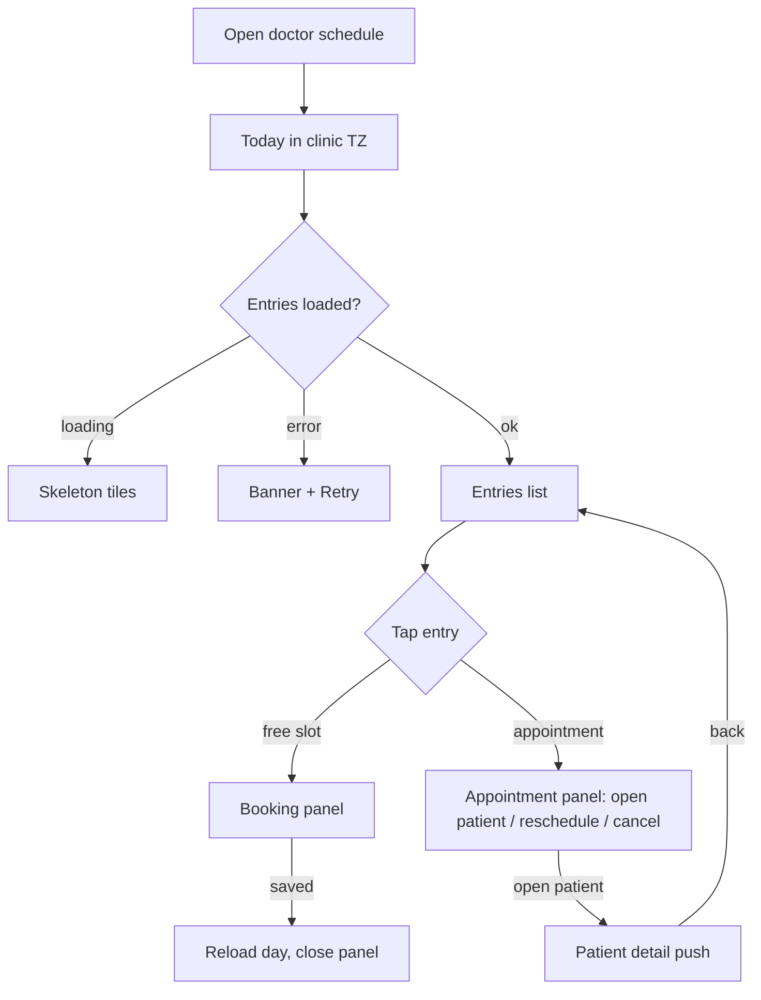

# Book on behalf of a doctor (clinic doctor schedule)

| | |
|---|---|
| Area | Clinic workspace |
| Who sees it | All members; designed for receptionists / owners booking for a colleague. A doctor can also open their own entry. No tier gate. |
| Reached from | Doctors list → calendar icon / row; Calendar sub-tab → "Calendar for: Dr Name"; back from a patient detail opened from this screen |
| Screen type | Full screen (root-level push over the shell, own app bar) |
| Current Flutter source | `lib/features/clinic/presentation/clinic_doctor_schedule_page.dart`, `lib/features/clinic/presentation/clinic_schedule_return_info.dart`; reuses calendar widgets from `lib/features/calendar/presentation/calendar_screen.dart` |
| Spec | `docs/kmp-spec/09-clinic-workspace-finance-treatment-plans.md` §5, ticket CLINIC-09; booking sheets in doc 03 / area 04 |

## 1. Purpose
Look at one colleague's day in the **clinic's time zone**, see free slots and existing appointments, and book, reschedule or cancel for that doctor without touching the receptionist's own calendar state. Daily, many times, for a receptionist.

## 2. Entry points
- Doctors list → calendar icon or row → pushed full screen with: doctor profile id, display name, clinic time zone (fallback "UTC"), clinic street address (venue label).
- Calendar sub-tab → per-doctor button.
- Returning from a patient detail / document opened from a slot (today the schedule screen is destroyed and re-created after the patient screen pops — §12; target: a normal back stack).

## 3. Layout, top to bottom (phone portrait)
1. **App bar**: back, title = doctor's display name (ellipsis).
2. **Doctor hint**: name (grey, bold) and the sentence "Book and manage this doctor's appointments. Times use this clinic timezone." Target: show the zone explicitly, e.g. "Times in Asia/Tashkent (UTC+5)".
3. **Header row**: "Calendar" title with the selected date underneath ("24 October 2026"); trailing filter icon (tonal) that opens the filter dialog (Show appointments / Show free slots); a small spinner replaces nothing but appears beside the filter while a day loads. Tapping the date opens a date picker (2020–2030).
4. **Month grid** (compact table calendar) — same component as the main Calendar; dots for days with entries.
5. **Day entries list** (fills the rest): appointments and free slots for the selected day, same tile styles as the main calendar; loading state shows skeleton tiles.
6. **Slot details** (phone): tapping an entry replaces the whole body with the slot details panel (book / view / reschedule / cancel), with its own close control; closing returns to the month + list. Tablet/desktop: entries left (3/5), month grid or slot details right (2/5) with a cross-fade.

## 4. Data and formats
| Field | Source | Format rule |
|---|---|---|
| Day / month data | calendar controller with `resourceDoctorId` = this doctor, scoped to this screen (no shared cache) | All instants rendered in the **clinic time zone**; "today" computed in the clinic zone |
| Date label | selected day | "{d} {Month name} {yyyy}" localised |
| Venue | clinic street address | passed to the booking sheet as the primary venue label |
| Filter | local | appointments on/off, free slots on/off; both on by default |
| Booking endpoints | area 04 (calendar) with `resourceDoctorId` — UNVERIFIED here | — |

## 5. Primary flow (happy path)
1. Receptionist taps a doctor → screen pushes; month grid renders instantly on today (clinic zone); entries skeleton.
2. Day loads → free-slot and appointment tiles.
3. Tap a free slot → slot details → choose patient, confirm booking (area 04 sheet) → success → panel closes, day reloads, new appointment tile visible, banner "Appointment booked".
4. Back → Doctors list.

## 6. Screen states
- **First load**: month grid immediate; entries skeleton (4 tiles).
- **Empty (no entries for the day)**: "No appointments or free slots on this day" + hint to pick another day (today the shared calendar list copy is used).
- **Error on load**: banner with Retry; month grid stays usable.
- **Offline**: grid usable, cached day if visited; booking disabled.
- **Refreshing**: day reload after save/filter; small spinner in header; tiles keep positions.
- **Partial data**: month dots fail but day works → no dots, no error (silent).
- **Permission needed**: n/a.
- **Locked by tier**: n/a.
- **Role difference**: none in layout; the server rejects bookings a role may not make (403 → banner).

## 7. Interactions and secondary flows
- **Tap day in grid** → reload that day; selected entry cleared.
- **Swipe month** → month changes; dots load for the new month.
- **Tap date label** → date picker → jump.
- **Filter icon** → dialog with two checkboxes → Apply reloads the day.
- **Tap entry** → details panel replaces body (phone).
- **Panel actions** → booking / reschedule / cancel sheets from area 04 with this doctor + clinic venue preselected; on success day reloads.
- **Open patient / document from the panel** → push patient detail; back returns to this screen on the same day (target). Today it pops the whole schedule and re-pushes it afterwards.
- **System back** with panel open → closes the panel first; second back leaves the screen.

## 8. Edge cases
- Doctor with no availability configured → every day empty; show a hint "This doctor has no working hours set" (needs availability info — UNVERIFIED; otherwise generic empty).
- Clinic time zone differs from the receptionist's phone zone → all times must still be clinic times; add the explicit zone line so nobody books 9:00 in the wrong zone. Midnight boundary: a slot at 23:30 clinic time belongs to that clinic day even if the phone's day differs.
- Clinic time zone missing → "UTC" fallback today; show a warning chip "Clinic time zone not set".
- 40 doctors → entry list from the Doctors tab is searchable (file 02); this screen is per doctor.
- Slot booked by someone else between load and tap → booking fails with 409 → banner "This slot was just taken." + reload day.
- Appointment cancelled meanwhile → panel action returns 404 → banner + reload.
- Slow network → skeleton tiles; filter button disabled while loading.
- Double tap on a slot → one panel.
- 401 → logout.
- Rotation → tablet layout with side pane; keep selection.
- 200 % font → month grid cells show numbers only; entries wrap.
- Language switch while open → month and labels re-render (calendar locale).
- Screen reader: app bar announces doctor name; grid cells "24 October, 3 entries"; tiles "Free slot 09:00 to 09:30, button".

## 9. Validation and messages
| Field/action | Rule | When checked | Message (EN) | Where shown |
|---|---|---|---|---|
| Load day | HTTP 200 | on load | "Couldn't load this day." (**NEW**; today raw error toast) | banner + Retry |
| Book | server accepts | on save | "Appointment booked" (area 04 copy) / "This slot was just taken." (**NEW**) | banner |
| Permission | 403 | on save | "You can't book for this doctor." (**NEW**) | banner |

## 10. Navigation out
- Back → Doctors list or Calendar sub-tab (wherever it came from); nothing to save.
- → Patient detail / document viewer: push; returning restores this screen (same doctor, same day, panel closed).
- → Booking sheets: modal; day reloads after.

## 11. Copy
- `clinicSchedulePreviewHint` "Book and manage this doctor's appointments. Times use this clinic timezone.", `clinicDoctorOpenSchedule` "Open this doctor's schedule", `calendarForDoctor` "Calendar for" (Dart map only; add to en.json)
- Header: `calendar` "Calendar" (missing from en.json; exists in app), `filter` "Filter", `showAppointments` "Show Appointments", `showFreeSlots` "Show Free Slots", `apply` "Apply", `cancel` "Cancel"
- **NEW**: "Times in {{zone}}", "Couldn't load this day.", "This slot was just taken.", "You can't book for this doctor.", "Clinic time zone not set", "No appointments or free slots on this day"

## 12. Known problems in the current app (do not carry over)
- Opening a patient from a slot pops this screen and re-creates it afterwards via a serialised "return info" map; the day and scroll position are lost. Use a normal back stack.
- Isolation from the main calendar is done by overriding the global calendar state for this screen; the rewrite should give this screen its own view model instance.
- Errors are raw toasts; loading is a spinner.
- Time zone is described in a sentence but never shown.
- Date picker limited to 2020–2030 (fine, but make it relative: today −1 y … +2 y).

## 13. Open questions for design
- Week strip instead of a full month grid on phones (more room for the entries)?
- Should the receptionist be able to switch doctor from this screen (doctor chips at the top) instead of going back to the list?
- Colour-code entries per doctor when several doctors share a room?
