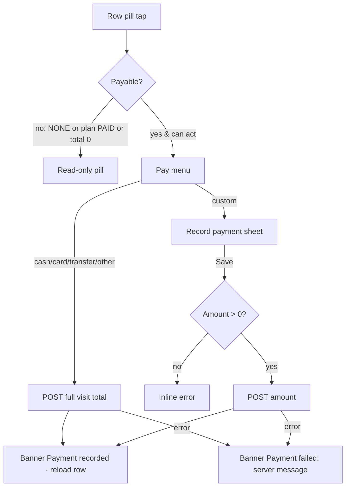

# Finance · By appointment (ledger) + Record payment sheet

| | |
|---|---|
| Area | Clinic workspace · Finance |
| Who sees it | All members see the ledger. The payment menu/sheet only for owner, clinic admin, receptionist and doctor (nurse read-only). No tier gate. |
| Reached from | Finance chips → "By appointment"; target: dashboard drill-down rows |
| Screen type | Finance inner view (paged list) + payment bottom sheet (dialog today) |
| Current Flutter source | `lib/features/clinic/presentation/finance_appointment_ledger_view.dart`, `lib/state/clinic/clinic_finance_actions.dart` (`fetchAppointmentLedgerPage`, `recordClinicPayment`) |
| Spec | `docs/kmp-spec/09-clinic-workspace-finance-treatment-plans.md` §3.5, §7 (payments POST), ticket FIN-04 |

## 1. Purpose
The visit-level cash desk: every appointment that has linked charges, what it cost, what was collected, and a quick way to mark it paid (cash/card/transfer/other, full or custom amount). Receptionists use it after each visit; owners scan it for unpaid visits.

## 2. Entry points
- Finance chip "By appointment" (month filter shared).
- Target: Dashboard → Revenue/Outstanding month drill-down row → this view scrolled to the visit.
- Target: appointment detail / end-visit flow may deep link here (area 05 owns the in-visit payment card).

## 3. Layout, top to bottom (phone portrait)
1. **Month filter** (shared control, see file 07).
2. **Meta row**: "Showing 20 of 134" (left), refresh icon, export icon (CSV/PDF of the *filtered, loaded* rows — file 13).
3. **Search** "Search patient, doctor, treatment plan #…" (client-side on loaded rows today; target: server `q`).
4. **Status chips**: All · Paid · Partial · Unpaid (on the plan's simple payment status).
5. **Visit list** (today 8 columns: Date, Patient, Doctor, Treatment plan, Services count, Total, Payment pill, Actions). Target card row:
   - Line 1: date "24.10.2026" (clinic zone) · doctor name.
   - Line 2: patient name (bold).
   - Line 3: "3 services · Plan #412" (tap "services" opens the services sheet).
   - Right: visit total (bold) and the **payment pill** (Paid green / Partial orange / Unpaid red / None grey). When the user may act and the visit is payable, the pill has a caret and opens the **pay menu**: Paid by cash · Paid by card · Paid by transfer · Paid (other) · divider · Custom amount….
6. **Load more** button at the end (page size 20) with a spinner while loading; target: infinite scroll.
7. **Services sheet** (from the row): title "Patient · date", subtitle "Services on visit · Dr Name", list of service title + line total, divider, "Total" row. Close.
8. **Record payment sheet** (Custom amount…): title "Record payment"; Amount field prefilled with the visit total (major units, decimal keyboard); "Method" label + choice chips Paid by cash / card / transfer / other (cash preselected); "Memo (optional)"; actions Cancel · **Save payment**. Target additions: a context line "Visit 24.10.2026 · Dr Name · Patient", "Outstanding on plan: 450 000 UZS", and the amount prefilled with the **visit's unpaid remainder**, not the full total.

## 4. Data and formats
| Field | Source | Format rule |
|---|---|---|
| Ledger page | `GET /api/clinics/{id}/finance/appointment-ledger?page&size=20[&from&to]` → {content[], totalElements} | Server month range (correct today); search/status client-side (target: server) |
| Row | appointmentId, startAt, patientId/Name, doctorProfileId/Name, treatmentPlanId, services[{title, lineTotalMinor}], visitTotalMinor, visitCollectedMinor, currency, planPaymentStatus, planSimplePaymentStatus | Pill uses `planSimplePaymentStatus` (plan level, not visit level — §12) |
| Date | startAt | dd.MM.yyyy in clinic zone; add time "09:30" on the card (target) |
| Money | minor + currency | shared formatter (UZS no decimals, grouped) |
| Quick pay | `POST /api/clinics/{id}/finance/payments {treatmentPlanId, amountMinor: visitTotalMinor, currency, method, linkedAppointmentId}` | Memo omitted |
| Custom pay | same with `amountMinor` from the field, `memo?` | Amount parsed from "1 500,50" style input |
| Methods | CASH, CARD_EXTERNAL, TRANSFER, OTHER (UI); CLICK, STRIPE display-only elsewhere | Labels: Paid by cash / card / transfer / (other) |

## 5. Primary flow (happy path)
1. Chip "By appointment" → skeleton rows (6) under the toolbar.
2. Page 0 arrives → 20 rows, "Showing 20 of 134".
3. Receptionist finds today's visit (Unpaid), taps the pill → menu → "Paid by cash" → request → banner "Payment recorded" → row pill becomes Paid; dashboard, plans and payments refresh in background.
4. For a partial payment: pill → "Custom amount…" → sheet prefilled → types 200 000 → cash → Save payment → banner → pill Partial.

## 6. Screen states
- **First load**: toolbar immediate; 6 skeleton rows; meta row "Showing — of —".
- **Empty**: "No linked visit charges yet." (+ hint that charges come from treatment plans / visit services).
- **Empty after filter**: "Nothing matches your search or filters." + Clear.
- **Error on load**: banner "Couldn't load visits." + Retry button in body (exists today, keep).
- **Offline**: loaded rows visible; pay actions disabled; "Load more" disabled.
- **Refreshing**: refresh icon spins; rows stay; after a payment only the affected row needs to change (today the whole list reloads from page 0).
- **Partial data**: a page fails on "Load more" → inline "Couldn't load more · Retry" at the bottom; loaded rows stay.
- **Permission needed**: n/a.
- **Locked by tier**: n/a.
- **Role difference**: owner / clinic admin / receptionist / doctor: pay menu + sheet. Nurse: pills read-only, no caret. Server 403 on POST → banner "You can't record payments." (UNVERIFIED mapping).

## 7. Interactions and secondary flows
- **Month change** → list resets to page 0 for that month.
- **Type search** → filters loaded rows (target: server search with debounce and reset).
- **Status chip** → filter.
- **Tap row body / "services"** → services sheet.
- **Tap pill** (enabled) → pay menu; quick options post immediately (no confirmation — consider a 5-second "Undo" banner, open question).
- **Custom amount…** → record payment sheet → Save → close → banner.
- **Load more** → appends next page; disabled when all loaded.
- **Refresh icon / pull-to-refresh** → reload page 0.
- **Export** → CSV/PDF of currently loaded + filtered rows (file 13) — label the export "loaded rows only".
- **Swipe row** (target, optional): swipe left reveals "Mark paid (cash)".

## 8. Edge cases
- 1 000+ visits: paging 20 at a time with "Load more" is tedious — infinite scroll; totals in the meta row come from the server.
- Visit total 0 (free visit) → pill read-only "None"; no pay menu.
- Plan fully paid but this particular visit unpaid (payments are plan-level) → today the pill is disabled because the plan says PAID; target: compute per visit from visitCollected vs visitTotal, and show plan-level status as a secondary tag.
- Payment larger than the visit total or than the plan's outstanding → server accepts? UNVERIFIED. Client: warn inline "More than the outstanding amount ({{amount}})" but allow (overpayment/credit) unless the server rejects (then show its message).
- Partial payments: several payments against one visit → collected accumulates; pill Partial until equal.
- Refund: not supported anywhere in the app (no negative payments, no refund endpoint) — document as not designed.
- Mixed currency: the sheet uses the row's currency; the amount field shows the currency suffix.
- Month boundary: visit at 23:45 on 31 Oct clinic time is October; the month range is built in the clinic zone and sent as UTC — correct today, keep.
- Double tap on a quick-pay item → second request blocked while the first is pending (today two payments could be posted).
- Payment posted by another receptionist meanwhile → our POST still succeeds (double payment risk) — show the current outstanding in the sheet (fetched fresh) to reduce it.
- Appointment cancelled meanwhile → server 409/404 → banner with message; reload.
- Slow network → quick-pay pill shows a small spinner inside; row stays.
- 401 → logout, sheet closes.
- Rotation → sheet keeps input; tablet shows the table layout.
- 200 % font → card rows 4 lines; pay menu items wrap.
- Language switch → method labels re-render.
- Screen reader: pill "Unpaid, button, mark payment"; sheet amount field announces currency.

## 9. Validation and messages
| Field/action | Rule | When checked | Message (EN) | Where shown |
|---|---|---|---|---|
| Amount | number > 0 after normalising spaces/commas | on Save | `clinicFinanceInvalidAmount` "Enter a valid amount" | inline under field (today toast) |
| Amount > outstanding | soft warning | live | "More than the outstanding amount ({{amount}})" (**NEW**) | inline helper, orange |
| Payment POST | HTTP 200 | on response | `clinicFinancePaymentRecorded` "Payment recorded" / `clinicFinancePaymentFailed` "Payment failed" + server message | banner |
| Load page | HTTP 200 | on load | "Couldn't load visits." (**NEW**) | banner + Retry |
| Export empty | ≥ 1 row | on tap | `clinicFinanceExportNoRows` "Nothing to export for the current filters." | banner |

## 10. Navigation out
- Services sheet / payment sheet → back to the list; after a payment the row, dashboard, payments list, plan lists and plan detail must refresh (today plan detail is not refreshed — file 16 §12).
- Tap "Plan #412" → target: plan detail (file 16).
- Chips → other finance views with the month kept.

## 11. Copy
- `clinicFinanceByAppointment` "By appointment", `clinicFinanceShowingRows` "Showing {{shown}} of {{total}}", `clinicFinanceLoadMore` "Load more", `clinicLedgerSearchHint` "Search patient, doctor, treatment plan #…", `refresh` (missing from en.json; "Refresh")
- Chips: `clinicTreatmentPlansAll` "All", `clinicPaymentStatusPaid` "Paid", `clinicPaymentStatusPartial` "Partial", `clinicPaymentStatusUnpaid` "Unpaid", `clinicPaymentStatusNone` "None"
- Columns: `clinicLedgerColDate` "Date", `clinicLedgerColPatient` "Patient", `clinicLedgerColDoctor` "Doctor", `clinicLedgerColPlanId` "Treatment plan", `clinicLedgerColPlanTooltip` "Treatment plan ID (your plan or automated visit-charges plan linked to this appointment).", `clinicLedgerColServices` "Services", `clinicLedgerColTotal` "Total", `clinicLedgerColStatus` "Payment", `clinicLedgerColActions` "Actions", `clinicLedgerViewServices` "View services"
- Pay menu: `clinicLedgerPayMenu` "Mark payment", `clinicFinancePayByCash` "Paid by cash", `clinicFinancePayByCard` "Paid by card", `clinicFinancePayByTransfer` "Paid by transfer", `clinicFinancePayByOther` "Paid (other)", `clinicFinancePayCustomAmount` "Custom amount…"
- Sheet: `clinicFinancePaymentDialogTitle` "Record payment", `clinicFinancePaymentAmountLabel` "Amount", `clinicPaymentsColMethod` "Method", `clinicFinancePaymentMemoLabel` "Memo (optional)", `clinicFinancePaymentConfirm` "Save payment", `cancel` "Cancel"
- Services sheet: `clinicFinanceVisitServices` "Services on visit", `clinicTreatmentPlansTotal` "Total", `close` "Close"
- Empty: `clinicFinanceNoLedgerRows` "No linked visit charges yet."
- **NEW**: "Couldn't load visits.", "Couldn't load more · Retry", "Outstanding on plan: {{amount}}", "More than the outstanding amount ({{amount}})", "You can't record payments.", "Undo"

## 12. Known problems in the current app (do not carry over)
- Payment pill is disabled by the **plan's** status, so an unpaid visit on a fully paid plan cannot be paid here, and a paid visit on a partially paid plan looks payable.
- Quick pay always posts the **full visit total**, even if part was already collected → overpayment.
- Custom sheet prefills the full total, not the remainder; no outstanding shown; amount error is a toast.
- Search and status filters apply only to loaded pages.
- The view loads on mount even when hidden behind another chip.
- Raw exception text in failure toasts; red toast colour instead of the standard error banner.

## 13. Open questions for design
- Quick pay without confirmation + Undo, or always open the sheet with the method preselected?
- Should the row show time of day and location (video vs in person)?
- Swipe-to-pay gesture for receptionists?
