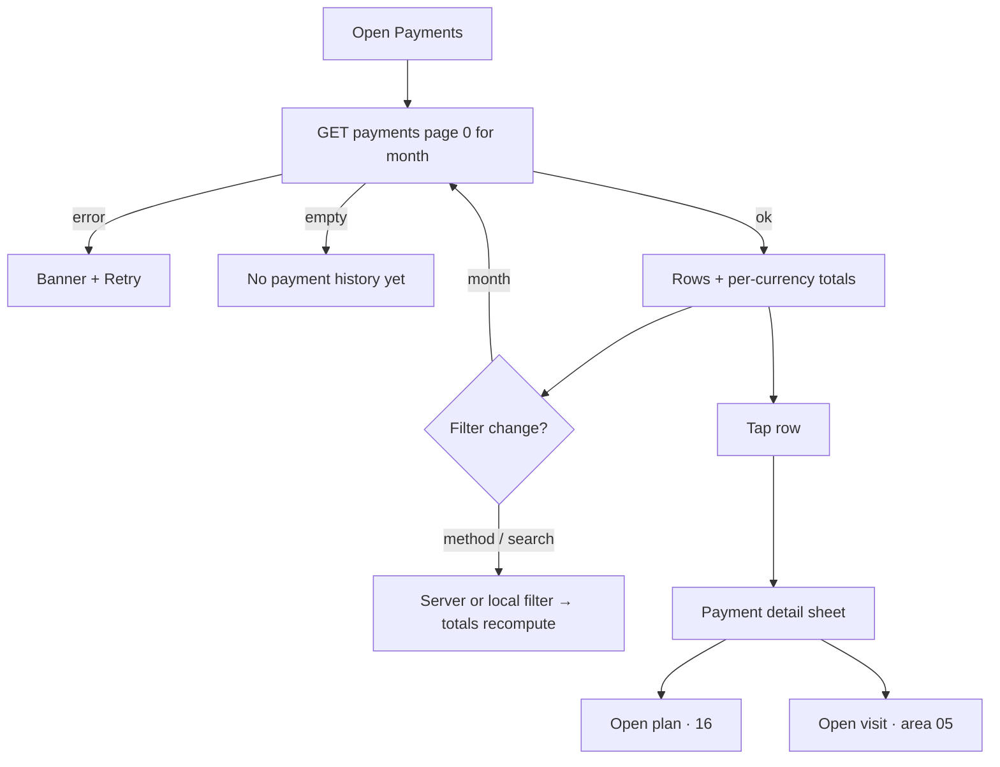

# Finance · Payments list

| | |
|---|---|
| Area | Clinic workspace · Finance |
| Who sees it | All members. Read-only (payments are recorded from the ledger, plan wizard, installments and the in-visit card). No tier gate. |
| Reached from | Finance chips → "Payments"; target: Dashboard → Revenue (all time) drill-down "Open Payments" |
| Screen type | Finance inner view (list with toolbar) |
| Current Flutter source | `lib/features/clinic/presentation/finance_payments_view.dart`, `lib/state/clinic/clinic_finance_providers.dart` (`clinicPaymentHistoryProvider`) |
| Spec | `docs/kmp-spec/09-clinic-workspace-finance-treatment-plans.md` §3.3, ticket FIN-03 |

## 1. Purpose
The cash book: every recorded payment with who paid, for which plan, by which method, how much and any memo. Used for reconciliation at the end of the day/month and to answer "did this patient pay?". Daily for receptionists, monthly for owners.

## 2. Entry points
- Finance chip "Payments" (month filter shared).
- Target: links from the dashboard revenue drill-down and from a plan detail ("Payments" section → "See all").

## 3. Layout, top to bottom (phone portrait)
1. **Month filter** (shared).
2. **Search** "Search patient, doctor, treatment plan, method or memo…" and, when rows exist, a **totals chip** "27 · 4 350 000 UZS" (count · sum of the filtered rows; tooltip "payments · total").
3. **Method chips**: All · Cash · Card · Transfer · Other.
4. **Payment list** (today 8 columns: ID, Date, Patient, Doctor, Treatment plan, Method, Amount, Memo). Target card row:
   - Leading method icon in its colour (cash green, card blue, transfer purple, Click teal, Stripe indigo, other grey).
   - Line 1: patient name (bold) · amount right-aligned (green, bold).
   - Line 2: "24.10.2026 · Cash · Dr Name".
   - Line 3: "Plan title (#412)" and memo (grey, 2 lines max) when present.
   - Long-press/overflow: copy payment id "#981" (ids matter for support).
5. Sort: newest first; table allowed sorting by any column — on phones offer Date / Amount.
6. Infinite scroll, page size 50 (today only page 0 exists).

## 4. Data and formats
| Field | Source | Format rule |
|---|---|---|
| Payments | `GET /api/clinics/{id}/finance/payments?page=0&size=50` → bare array of {id, treatmentPlanId, patientId?, patientName?, doctorProfileId?, doctorName?, treatmentPlanTitle?, amountMinor, currency, method, memo?, financialRecordId?, linkedAppointmentId?, recordedAt} | Target: `from/to` + paging on the server (ask backend if `from/to` is missing — UNVERIFIED) |
| Date | recordedAt (UTC instant) | dd.MM.yyyy in clinic zone; add "HH:mm" (target) |
| Amount | minor + currency | shared formatter |
| Totals chip | sum of filtered rows | Only sum rows in one currency; if mixed, show per-currency chips ("27 · 4 350 000 UZS · 120.00 USD") — today everything is summed and labelled with the first row's currency |
| Method label | CASH / CARD_EXTERNAL / TRANSFER / OTHER / CLICK / STRIPE | Cash / Card / Transfer / Other / Click / Stripe; unknown shown raw |
| Patient / doctor | name ?? "Patient #id" / "Doctor #id" ?? "—" | — |
| Plan | "title (#id)" or "#id" | — |

## 5. Primary flow (happy path)
1. Chip "Payments" → skeleton rows (8).
2. Rows render newest first; totals chip appears.
3. Owner picks "September 2026" → server reload for that month (target) → rows + totals for September.
4. Taps "Cash" chip → list and totals narrow to cash.
5. Scrolls down → next page appends.

**Payment detail sheet (target)**: amount (large), method with icon, date and time (clinic zone), patient, doctor, plan "title (#id)" (link), linked visit "#881" (link, when present), financial record "INV-…" (when present), memo (full), payment id with copy. No edit or delete.

## 6. Screen states
- **First load**: toolbar; 8 skeleton rows; no totals chip.
- **Empty**: "No payment history yet." + hint "Payments appear here when you mark visits paid or record plan payments."
- **Empty after filter**: "Nothing matches your search or filters." + Clear; totals chip hidden.
- **Error on load**: banner "Couldn't load payments." + Retry.
- **Offline**: cached page; filters work on it; a banner says totals may be incomplete.
- **Refreshing**: pull-to-refresh; keep rows until the new page arrives.
- **Partial data**: next page fails → inline Retry at the bottom.
- **Permission needed**: n/a.
- **Locked by tier**: n/a.
- **Role difference**: none (nurse sees it too; confirm with product whether a member doctor should see other doctors' payments — open question).

## 7. Interactions and secondary flows
- **Month change** → reload (target server-side).
- **Search** → debounced; today client-side over method, memo, id, plan id/title, names, "#ids"; target server `q` with the same fields.
- **Method chip** → filter; totals recompute.
- **Tap row** → target: plan detail (file 16) scrolled to payments; or a small payment detail sheet with all fields + "Open plan" + "Open visit" when linked.
- **Long-press** → copy id.
- **Pull-to-refresh** → reload.
- No edit/delete/refund of a payment anywhere (not designed; see README).

## 8. Edge cases
- 1 000+ payments → paging; totals chip must come from the server for the filtered range, otherwise label it "of loaded rows".
- Month filter today is applied in memory to the latest 50 rows → a month older than those 50 shows empty even though payments exist. Target fixes this with server ranges.
- Mixed currencies → per-currency totals; never add across.
- Memo very long (280 px cap today) → 2 lines + ellipsis; full memo in the detail sheet.
- Payment without patient (plan deleted?) → "—"; without doctor → "—".
- Payment with method CLICK/STRIPE (online, from the patient app) → icon + label, not filterable by chips today — add "Online" chip (open question).
- Same second timestamps → stable secondary sort by id desc.
- Month boundary in clinic zone vs phone zone: handled by server range; the displayed date must also be clinic zone so a 00:10 payment shows the 1st, not the 31st.
- 401 → logout.
- Rotation/tablet → table layout allowed.
- 200 % font → rows 4–5 lines; totals chip wraps under the search.
- Language switch → method labels and month labels re-render.
- Screen reader: row "Karimova, 450 000 UZS, cash, 24 October 2026, Dr Rahimov, plan Dental restoration".
- Payment created from the visit screen with no memo → memo line hidden (no "—" row).
- Payment for a plan the current user cannot open (another doctor's, if the server restricts) → sheet shows the plan title without a link.

## 9. Validation and messages
| Field/action | Rule | When checked | Message (EN) | Where shown |
|---|---|---|---|---|
| Load | HTTP 200, JSON array | on load | "Couldn't load payments." (**NEW**) | banner + Retry |
| Search | trimmed, lowercase compare | live | — | — |

## 10. Navigation out
- Chips → other finance views; month kept.
- Row → plan detail (target). Back returns with filters.

## 11. Copy
- `clinicFinancePayments` "Payments", `clinicPaymentsSearchHint` "Search patient, doctor, treatment plan, method or memo…", `clinicPaymentsTotals` "payments · total"
- Chips: `clinicTreatmentPlansAll` "All", `clinicPaymentMethodCash` "Cash", `clinicPaymentMethodCard` "Card", `clinicPaymentMethodTransfer` "Transfer", `clinicPaymentMethodOther` "Other", `clinicPaymentMethodClick` "Click", `clinicPaymentMethodStripe` "Stripe"
- Columns: `clinicPaymentsColId` "ID", `clinicPaymentsColDate` "Date", `clinicPaymentsColPatient` "Patient", `clinicPaymentsColDoctor` "Doctor", `clinicPaymentsColPlan` "Treatment plan", `clinicPaymentsColMethod` "Method", `clinicPaymentsColAmount` "Amount", `clinicPaymentsColMemo` "Memo"
- Fallbacks: `patient` "Patient", `doctor` "Doctor"
- Empty: `clinicFinanceNoPayments` "No payment history yet.", `clinicTableNoFilteredResults` "Nothing matches your search or filters."
- **NEW**: "Couldn't load payments.", "Payments appear here when you mark visits paid or record plan payments.", "Copy ID", "of loaded rows"

## 12. Known problems in the current app (do not carry over)
- Hard-coded first 50 payments; month filter applied in memory → older months look empty (verified bug 7).
- Totals chip sums across currencies and labels the sum with the first row's currency.
- Dates printed from the ISO string without zone conversion.
- 8-column table; memo column capped at 280 px; ids shown as a column.
- No way to open the related plan or visit from a payment.

## 13. Open questions for design
- Payment detail sheet vs. direct jump to the plan?
- Group rows by day with sticky day headers and day subtotals (cash-desk style)?
- Add "Online" (Click/Stripe) to the method chips?
