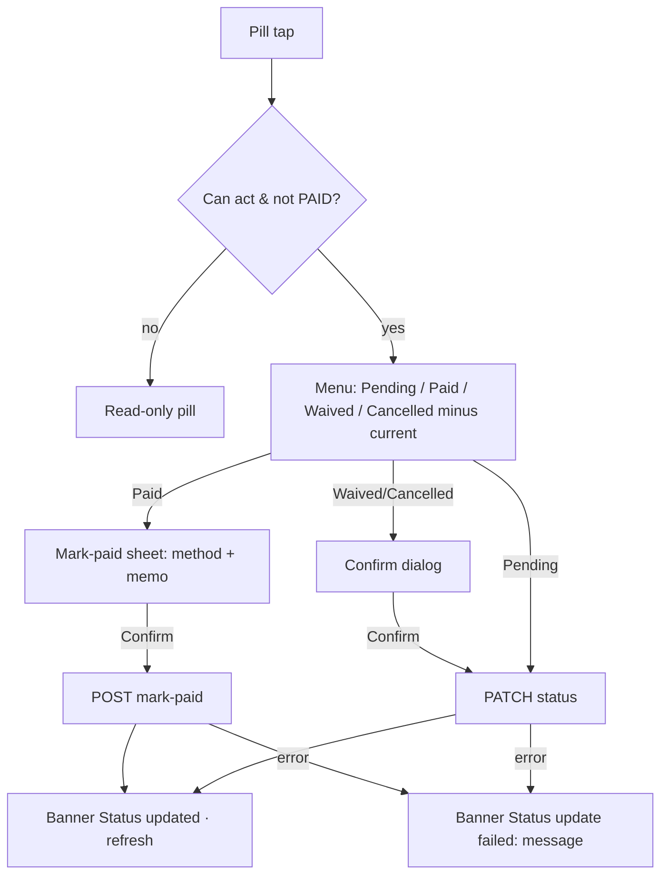

# Finance · Installments & outstanding (debts per patient)

| | |
|---|---|
| Area | Clinic workspace · Finance |
| Who sees it | All members see the list. Status change and "Notify patient" only for owner, clinic admin, receptionist, doctor (nurse read-only). No tier gate. |
| Reached from | Finance chips → "Installments"; Dashboard → Overdue / Outstanding drill-downs (target links) |
| Screen type | Finance inner view (list with filters) + small status menu / mark-paid sheet |
| Current Flutter source | `lib/features/clinic/presentation/finance_installments_view.dart`, `finance_shared.dart` (`FinanceStatusPill`), `lib/state/clinic/clinic_finance_actions.dart` (`fetchClinicInstallmentItems`, `markInstallmentItemPaid`, `patchInstallmentItem`, `notifyInstallmentItem`) |
| Spec | `docs/kmp-spec/09-clinic-workspace-finance-treatment-plans.md` §3.7, §3.2 (outstanding drill-down), ticket FIN-05 |

## 1. Purpose
Chase money that is owed: every installment of every payment schedule (created in the treatment-plan wizard), who owes it, when it is due, whether it is paid, overdue, waived or cancelled; mark one paid, waive/cancel it, or ping the patient. The "debts per patient" question is answered here (filter by patient) and on the dashboard's Outstanding drill-down (plans and invoices with remaining balances). Receptionists check it daily; owners weekly.

## 2. Entry points
- Finance chip "Installments" (month filter shared, applied to **due date**).
- Target: Dashboard → Overdue drill-down row → this view with filter Overdue and the item highlighted; Outstanding drill-down plan row → plan detail (file 16).
- Installment schedules are created only by the wizard (file 15 Payment step); there is no "new installment plan" action here.

## 3. Layout, top to bottom (phone portrait)
1. **Month filter** (shared; filters by due date, client-side today).
2. **Search** "Search patient or treatment plan…" with clear icon, and a **due-date range** outlined button ("Any due date" or "01.10.2026 → 31.10.2026") + clear icon when set. Target: fold month, range and status into one "Filters" sheet with a badge count.
3. **Status chips** (server filter): All · Upcoming · Overdue · Paid.
4. **Totals strip** (chips): "Installments: 12 · Totals reflect the current filters.", "Scheduled: 6 000 000 UZS", "Paid: 2 000 000 UZS", "Outstanding: 4 000 000 UZS" (outstanding = scheduled − paid over the filtered rows).
5. **Installment list** (today a raw 7-column table with an info tooltip on every header). Target card row:
   - Line 1: patient name (bold) · amount right (bold).
   - Line 2: "Plan title" (or "#412") · "#2 of schedule" (sequence number).
   - Line 3: "Due 15.11.2026" (red when overdue) · **status pill** (Pending orange, Paid green, Overdue red, Waived blue, Cancelled grey). The pill has a caret when the user may act and the item is not Paid; tapping opens a menu of the other selectable statuses: Pending · Paid · Waived · Cancelled (Overdue is never selectable — the server computes it).
   - Trailing: bell icon "Notify patient" (permitted roles, not Paid).
6. Sort: due date ascending by default.
7. **Mark paid** (target sheet, today immediate with method hard-coded to cash): "Mark installment #2 as paid — 500 000 UZS"; method chips Cash / Card / Transfer / Other; memo optional; Confirm. Waived/Cancelled: confirmation dialog with the reason optional (server supports only status today).

## 4. Data and formats
| Field | Source | Format rule |
|---|---|---|
| Items | `GET /api/clinics/{id}/finance/installment-items?filter=all|pending|overdue|paid` → array of {id, sequenceNumber, dueDate (YYYY-MM-DD), amountMinor, currency, status, paidAt?, notes?, installmentPlanId, treatmentPlanId, treatmentPlanTitle?, patientId, patientName} | Server filter by status; everything else client-side today (target: server `q`, `dueFrom/dueTo`, paging) |
| Due date | calendar date | dd.MM.yyyy, no zone math; "overdue" is server-computed daily |
| Status | PENDING / PAID / OVERDUE / WAIVED / CANCELLED | Pending / Paid / Overdue / Waived / Cancelled |
| Mark paid | `POST .../installment-items/{id}/mark-paid {method, memo?}` | Creates a payment (and receipt) server-side (UNVERIFIED) |
| Other status | `PATCH .../installment-items/{id} {status}` | — |
| Notify | `POST .../installment-items/{id}/notify {}` → 200 | Sends a push/SMS to the patient (channel UNVERIFIED) |
| Totals | client sums of filtered rows | Per currency; label "of loaded rows" if paged |

## 5. Primary flow (happy path)
1. Chip "Installments" → skeleton rows (6) + totals skeleton.
2. Receptionist taps "Overdue" → server reload → 3 rows; totals update.
3. Taps the bell on one → request → banner "Done" (target: "Reminder sent to the patient").
4. Patient pays at the desk → pill → "Paid" → mark-paid sheet → Cash → Confirm → banner "Status updated: Paid" → row leaves the Overdue filter; dashboard/plans refresh.

## 6. Screen states
- **First load**: filters visible; totals strip skeleton; 6 skeleton rows.
- **Empty**: "No installments in this view." + hint "Installment schedules are created in the treatment-plan wizard." Totals strip shows zeros.
- **Empty after filter**: same text today; target "Nothing matches your search or filters." + Clear.
- **Error on load**: banner "Couldn't load installments." + Retry.
- **Offline**: cached rows; actions disabled.
- **Refreshing**: pull-to-refresh; after an action only the row changes (today everything reloads).
- **Partial data**: n/a (single request).
- **Permission needed**: n/a.
- **Locked by tier**: n/a.
- **Role difference**: nurse: read-only pills, no bell. Others: full. Server 403 → banner.

## 7. Interactions and secondary flows
- **Status chip** → server reload with that filter (chips are the only server-side filter today).
- **Month** → filters by due date within the clinic-zone month (client-side today).
- **Due range** → date-range picker (today −3 y … +5 y); inclusive; clear icon resets.
- **Search** → patient name / plan title / "plan #id".
- **Pill menu** → Paid opens the mark-paid sheet; Waived/Cancelled ask for confirmation; Pending (re-open) immediate.
- **Bell** → notify; banner; today no cooldown — target: disable for 24 h after sending with "Reminded today" caption (needs server timestamp — UNVERIFIED).
- **Tap row** → target: plan detail (file 16) scrolled to the schedule.
- **Pull-to-refresh** → reload.

## 8. Edge cases
- 1 installment vs 500 across the clinic → paging needed (today bare array; confirm server paging — UNVERIFIED).
- Partial payment of an installment → not supported: an item is either Paid or not. If the patient pays part, the receptionist records a plan payment (file 08/16) and leaves the item Pending; document this clearly in the sheet ("Pay a different amount → Record payment on the plan").
- Payment larger than the installment → mark-paid posts the item amount only; excess must be recorded separately.
- Overdue item marked Waived → outstanding drops; collection rate changes; fine.
- Cancelled plan → its items should be Cancelled by the server (UNVERIFIED); if still Pending, show the plan status tag "Plan cancelled".
- Patient with 3 open plans → rows show plan title so debts can be told apart; the "debts per patient" view = search by patient, totals strip gives the sum.
- Due date on 31st in the clinic zone vs the phone a day behind → due dates are calendar dates; "overdue" comes from the server, never computed on the phone.
- Month filter + range + status all set → intersect; the totals note says so.
- Mixed currencies in totals → per-currency chips.
- Double tap on a menu item → one request.
- Two staff act on the same item → second gets 409/400 → banner with message, reload.
- 401 → logout.
- Rotation/tablet → table layout allowed.
- 200 % font → totals chips wrap to 2 rows; card rows 4 lines.
- Language switch → status labels, month labels.
- Screen reader: row "Karimova, 500 000 UZS, installment 2, due 15 November 2026, overdue, button change status, button notify patient".

## 9. Validation and messages
| Field/action | Rule | When checked | Message (EN) | Where shown |
|---|---|---|---|---|
| Status change | HTTP 200 | on response | `clinicFinanceInstallStatusUpdated` "Status updated" + ": Paid" / `clinicFinanceInstallStatusUpdateFailed` "Status update failed" + message | banner |
| Notify | HTTP 200 | on response | `clinicActionSuccess` "Done" / `clinicActionFailed` "Failed" (target: "Reminder sent to the patient" / "Couldn't send the reminder") | banner |
| Load | HTTP 200 | on load | "Couldn't load installments." (**NEW**) | banner + Retry |
| Waive/Cancel | confirmation | on tap | "Waive this installment? The amount will no longer be expected." / "Cancel this installment?" (**NEW**) | dialog, destructive red right |

## 10. Navigation out
- Row → plan detail (target).
- Chips → other finance views; month kept.
- After any action: dashboard, plans list, plan detail and payments must refresh.

## 11. Copy
- `clinicFinanceInstallments` "Installments", `clinicFinanceInstallSearchHint` "Search patient or treatment plan…", `clinicFinanceInstallDateRangeAny` "Any due date", `clinicFinanceInstallClearDates` "Clear date range"
- Chips: `clinicFinanceInstallFilterAll` "All", `clinicFinanceInstallFilterPending` "Upcoming", `clinicFinanceInstallFilterOverdue` "Overdue", `clinicFinanceInstallFilterPaid` "Paid"
- Totals: `clinicFinanceInstallTotalsItems` "Installments", `clinicFinanceInstallTotalsFilteredNote` "Totals reflect the current filters.", `clinicFinanceInstallTotalsScheduled` "Scheduled", `clinicFinanceInstallTotalsPaidSum` "Paid", `clinicFinanceInstallTotalsOutstanding` "Outstanding"
- Columns + hints: `clinicFinanceInstallColSeq` "#", `clinicFinanceInstallColPatient` "Patient", `clinicFinanceInstallColPlan` "Treatment plan", `clinicFinanceInstallColDue` "Due date", `clinicFinanceInstallColAmount` "Amount", `clinicFinanceInstallColStatus` "Status", `clinicFinanceInstallColActions` "Actions", `clinicFinanceInstallHintSeq` "Installment number in this payment schedule.", `clinicFinanceInstallHintPatient` "Patient owing this installment.", `clinicFinanceInstallHintPlan` "Treatment plan this schedule belongs to.", `clinicFinanceInstallHintDue` "Date the installment is due.", `clinicFinanceInstallHintAmount` "Amount scheduled for this installment.", `clinicFinanceInstallHintStatus` "PENDING, PAID, OVERDUE, WAIVED or CANCELLED. OVERDUE is set automatically after the due date when the item is still unpaid.", `clinicFinanceInstallHintActions` "Notify patient or change status."
- Status: `clinicFinanceInstallStatusPending` "Pending", `clinicFinanceInstallStatusPaid` "Paid", `clinicFinanceInstallStatusOverdue` "Overdue", `clinicFinanceInstallStatusWaived` "Waived", `clinicFinanceInstallStatusCancelled` "Cancelled", `clinicChangeStatus` "Change status"
- Actions: `clinicFinanceMarkInstallmentPaid` "Mark paid", `clinicFinanceNotifyInstallment` "Notify patient", `clinicFinanceInstallDue` "Due"
- Empty: `clinicFinanceNoInstallments` "No installments in this view."
- **NEW**: "Couldn't load installments.", "Reminder sent to the patient", "Couldn't send the reminder", "Reminded today", "Waive this installment? The amount will no longer be expected.", "Cancel this installment?", "Installment schedules are created in the treatment-plan wizard.", "Pay a different amount → Record payment on the plan", "Filters"

## 12. Known problems in the current app (do not carry over)
- "Mark paid" hard-codes method **cash** and no memo; card/transfer payments are mis-recorded.
- Raw table bypassing the shared table shell; hover tooltips on every column header (useless on touch).
- Month filter and date range are applied in memory to the server-filtered array; no paging.
- Status update reloads all finance data; success message concatenates "Status updated: Paid".
- Notify feedback is a generic "Done"/"Failed".
- Overdue is excluded from the menu correctly — keep that.

## 13. Open questions for design
- One "Filters" sheet (status, month, due range) with a badge, or keep three controls inline?
- Group rows by patient with a per-patient subtotal ("debts per patient" literally)?
- Should Waived/Cancelled require a reason text?
