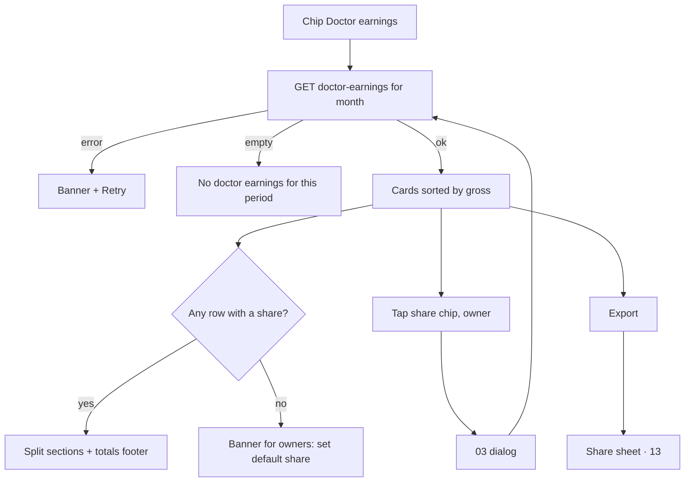

# Finance · Doctor earnings

| | |
|---|---|
| Area | Clinic workspace · Finance |
| Who sees it | All members today. Target: owner / clinic admin see all doctors; a member doctor sees only their own row (open question, server UNVERIFIED). No tier gate. |
| Reached from | Finance chips → "Doctor earnings"; Dashboard → "Top doctors" row (target) |
| Screen type | Finance inner view (list) |
| Current Flutter source | `lib/features/clinic/presentation/finance_doctor_earnings_view.dart`, `lib/state/clinic/clinic_finance_actions.dart` (`fetchDoctorEarnings`) |
| Spec | `docs/kmp-spec/09-clinic-workspace-finance-treatment-plans.md` §3.6, ticket FIN-06 |

## 1. Purpose
Per doctor: how many billable visits, gross charges, collected, outstanding, and — when revenue sharing is configured — the doctor/clinic split, gross and collected. Owners use it monthly to pay doctors; doctors to check their own numbers.

## 2. Entry points
- Finance chip "Doctor earnings" (loads only when the chip is active; month filter shared).
- Target: Dashboard "Top doctors" row → this view scrolled to the doctor; Doctors list hint → revenue-share dialog (file 03).

## 3. Layout, top to bottom (phone portrait)
1. **Month filter** (shared).
2. **Hint line**: all time "Gross / collected / outstanding · all billable visits with linked charges (by visit date)"; month variant "…billable visits in the selected month (by visit date)". Plus a one-line banner for owners: "Set the clinic default share or tap a doctor's share % to override per doctor." with a link to the revenue-share dialog.
3. **Toolbar**: refresh icon, export (CSV/PDF — file 13), search "Search doctor by name or #…".
4. **Doctor list** (today a 10-column table). Target card per doctor:
   - Avatar + name (resolved from members; fallback "#id") · visits count chip.
   - Row of three numbers: Gross · Collected (green) · Outstanding (red when > 0).
   - If share set: "Share 60%" chip (tappable for owners → file 03) and an expandable "Split" section: Doctor (gross) · Clinic (gross) · Doctor (collected) · Clinic (collected); "—" when null.
5. **Totals footer card** "Revenue share totals": the four split sums over doctors with a share; hidden when no doctor has a share.
6. Sort: gross descending by default; sort menu: Name · Visits · Gross · Collected · Outstanding.

## 4. Data and formats
| Field | Source | Format rule |
|---|---|---|
| Rows | `GET /api/clinics/{id}/finance/doctor-earnings[?from&to]` → {doctorProfileId, visitCount, grossMinor, collectedMinor, outstandingMinor, revenueSharePercent?, doctorShareGrossMinor?, clinicShareGrossMinor?, doctorShareCollectedMinor?, clinicShareCollectedMinor?} | One request; names from the members list |
| Currency | clinic currency (clinic summary ?? dashboard ?? UZS) | The endpoint has no per-row currency; mixed-currency clinics show wrong totals (UNVERIFIED) |
| Money | shared formatter | — |
| Share % | integer | "60%"; null → "—" |
| Totals | client sum of rows with a share | Per the shared currency |

## 5. Primary flow (happy path)
1. Chip → skeleton cards (4).
2. Rows render sorted by gross.
3. Owner picks "September 2026" → reload → September numbers.
4. Taps export → CSV → share sheet (file 13).

## 6. Screen states
- **First load**: hint + toolbar; 4 skeleton cards.
- **Empty**: "No doctor earnings for this period." (**NEW**; today the generic table empty text would be used — the view shows an empty table).
- **Empty after search**: "Nothing matches your search or filters."
- **Error on load**: banner "Couldn't load doctor earnings." + Retry.
- **Offline**: cached rows; export disabled.
- **Refreshing**: refresh icon spins; cards stay.
- **Partial data**: members list fails → names fall back to "#id"; show a subtle "Names unavailable" note.
- **Permission needed**: n/a.
- **Locked by tier**: n/a.
- **Role difference**: banner + share chips tappable only for finance-settings managers. Member doctor: target shows own row highlighted first (or only own row — product decision).

## 7. Interactions and secondary flows
- **Month change** → reload.
- **Search** → by name or profile id.
- **Tap share chip** (owner) → revenue-share dialog (file 03) → on save reload.
- **Expand split** → shows the four split values.
- **Tap card** → target: ledger (file 08) filtered to that doctor (needs server `doctorId` filter — UNVERIFIED).
- **Export** → CSV (10 columns) / PDF.
- **Pull-to-refresh** → reload.

## 8. Edge cases
- 1 doctor → one card + footer; fine.
- 40 doctors → search + sort; footer sums all.
- Share 0 % → doctor share values 0, clinic 100 %; still "has share" → appears in totals.
- Share 100 % → clinic values 0.
- No share set anywhere → no share chips, no split sections, no footer; banner for owners explains how to set it.
- Doctor who left the clinic but has historic visits → name not in members → "#id"; add "(former member)" if the server can tell (UNVERIFIED).
- Outstanding negative (overpayment) → show "0 UZS" and a tooltip? Server shouldn't send negatives; clamp display and log.
- Month with no visits → empty state; footer hidden.
- Mixed currency clinic → wrong sums; flag to backend (per-currency rows).
- Slow network → skeleton; 401 → logout.
- Rotation/tablet → 10-column table allowed.
- 200 % font → numbers stack vertically.
- Language switch → labels; names untouched.
- Screen reader: card "Dr Rahimov, 12 visits, gross 6 000 000 UZS, collected 4 000 000, outstanding 2 000 000, share 60 percent".
- Month filter changed while a load is pending → cancel the first request; never show the previous month's numbers under the new label.
- Doctor with visits but zero gross (all free services) → row kept, amounts "0 UZS".
- Share changed mid-month → the month's split follows whatever the server computes; add a footnote "Share applied: 60 %" per row from `revenueSharePercent`.

## 9. Validation and messages
| Field/action | Rule | When checked | Message (EN) | Where shown |
|---|---|---|---|---|
| Load | HTTP 200 | on load | "Couldn't load doctor earnings." (**NEW**) | banner + Retry |
| Export | ≥ 1 row | on tap | `clinicFinanceExportNoRows` | banner |

## 10. Navigation out
- → Revenue-share dialog (file 03); → export share sheet (file 13); chips → other views.

## 11. Copy
- `clinicFinanceDoctorEarnings` "Doctor earnings", `clinicFinanceDoctorEarningsHint` "Gross / collected / outstanding · all billable visits with linked charges (by visit date)", `clinicFinanceDoctorEarningsHintMonth` "Gross / collected / outstanding · billable visits in the selected month (by visit date)", `clinicFinanceEarningsRevenueShareBanner` "Set the clinic default share or tap a doctor's share % to override per doctor.", `clinicFinanceEarningsEditShare` "Edit revenue share", `clinicEarningsSearchHint` "Search doctor by name or #…", `clinicEarningsSplitTotals` "Revenue share totals"
- Columns: `clinicEarningsColDoctor` "Doctor", `clinicEarningsColVisits` "Visits", `clinicEarningsColGross` "Gross", `clinicEarningsColCollected` "Collected", `clinicEarningsColOutstanding` "Outstanding", `clinicEarningsColSharePercent` "Share %", `clinicEarningsColDoctorShareGross` "Doctor (gross)", `clinicEarningsColClinicShareGross` "Clinic (gross)", `clinicEarningsColDoctorShareCollected` "Doctor (collected)", `clinicEarningsColClinicShareCollected` "Clinic (collected)"
- **NEW**: "No doctor earnings for this period.", "Couldn't load doctor earnings.", "Names unavailable", "Split", "former member"

## 12. Known problems in the current app (do not carry over)
- 10-column table on a phone.
- Currency assumed clinic-wide.
- Dedicated providers exist but the view keeps its own state; loads only when active (good) but reloads on every tick.
- No empty-state copy specific to the view.

## 13. Open questions for design
- Member doctors: own row only, or everyone?
- Show the split as a small stacked bar (doctor vs clinic) per card?
- Period presets (this month / last month / quarter) in addition to the month list?
