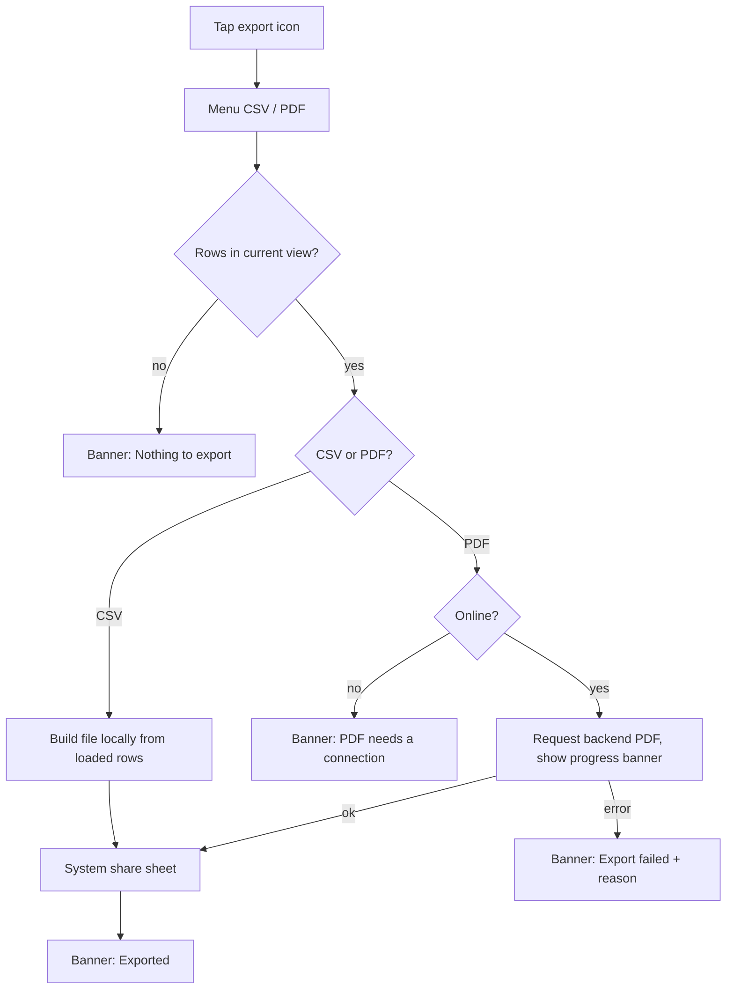

# Finance export / share (CSV, PDF)

| | |
|---|---|
| Area | Clinic workspace · Finance |
| Who sees it | Anyone who can see the view (all members). No tier gate. |
| Reached from | Export icon on Dashboard, By appointment and Doctor earnings; PDF icon on Treatment plans list / detail (plan PDF is covered in file 16) |
| Screen type | Overflow menu → system share sheet (plus a blocking progress dialog for PDFs) |
| Current Flutter source | `lib/features/clinic/application/finance_export_service.dart`, `lib/features/clinic/pdf/finance_report_pdf_service.dart`, export methods inside `finance_dashboard_view.dart`, `finance_appointment_ledger_view.dart`, `finance_doctor_earnings_view.dart` |
| Spec | `docs/kmp-spec/09-clinic-workspace-finance-treatment-plans.md` §3.10, §9, tickets FIN-06, FIN-07, TP-05 |

## 1. Purpose
Get finance numbers out of the app — to an accountant, a spreadsheet or a printout. Monthly, by owners. On a phone "download" means "share": the file goes to the system share sheet (Files, mail, messengers).

## 2. Entry points
- Dashboard header → download icon → menu "Export CSV" / "Export PDF" (metric/value table + month label).
- By appointment → download icon → CSV/PDF of the **loaded and filtered** rows (7 columns).
- Doctor earnings → download icon → CSV/PDF (10 columns).
- Treatment plan list/detail → PDF icon (file 16; web-only today).

## 3. Layout, top to bottom (phone portrait)
1. **Menu** anchored to the icon: "Export CSV" (table icon), "Export PDF" (PDF icon).
2. **Progress**: for CSV nothing visible today (instant); for PDF a small blocking dialog "Preparing…" (plan PDF) — target for all exports: a non-blocking banner with spinner "Preparing export…" and the share sheet opening when ready.
3. **System share sheet** with the file (`finance_dashboard_<timestamp>.csv`, `appointment_ledger_<timestamp>.csv`, `doctor_earnings_<timestamp>.csv`, `.pdf` equivalents). Target file names: `shifa_<clinic-slug>_<view>_<yyyy-MM>.csv`.
4. The exported **PDF** (A4 landscape, 32 pt margins, teal title, subtitle = month label, table, footer "page / count") — target: rendered by the backend; the phone only receives bytes.

## 4. Data and formats
| Field | Source | Format rule |
|---|---|---|
| CSV cells | current screen data | Quoted when they contain comma/quote/newline; UTF-8 with BOM so Excel opens Cyrillic correctly (**NEW** requirement) |
| CSV amounts | minor units | UZS as whole units (tiyin dropped — today integer division; target: same but documented), other currencies 2 decimals with a dot; **no** thousands separators in CSV |
| CSV headers | localised column labels; today "Metric", "Value", "Month" are hard-coded English | Localise all headers |
| Dashboard CSV rows | Total Revenue, Outstanding, Overdue, Collection Rate, optional four share totals, "Month,<label>" | — |
| Ledger CSV columns | Date, Patient, Doctor, Treatment plan, Services (count), Total, Payment | Only the rows currently loaded (page-limited) — label the export accordingly or export server-side |
| Earnings CSV columns | Doctor, Visits, Gross, Collected, Outstanding, Share %, Doctor (gross), Clinic (gross), Doctor (collected), Clinic (collected) | Empty cell when null |
| PDF | same tables | Target `GET /api/clinics/{id}/finance/<view>/export.pdf?from&to&lang` (backend ticket); client renderer only as fallback |
| Dates in files | — | Clinic time zone, dd.MM.yyyy; generation timestamp in the PDF footer in clinic zone |
| File name | view + clinic + period | `shifa_<clinic-slug>_<view>_<yyyy-MM or all-time>.csv/.pdf`; ASCII only |
| Encoding | UTF-8 with BOM (CSV) | Required for Cyrillic/Uzbek in Excel |
| Row scope | loaded + filtered rows (client) or server range (target) | The share sheet subject/caption names the scope: "Doctor earnings · September 2026 · 12 rows" |

## 5. Primary flow (happy path)
1. Owner taps the download icon on Doctor earnings → menu → "Export CSV".
2. Banner "Preparing export…" (≤ 1 s) → system share sheet appears with `shifa_clinic_doctor-earnings_2026-09.csv`.
3. Owner picks Mail → done; banner "Exported".

## 6. Screen states
- **First load**: n/a.
- **Empty**: no rows → banner "Nothing to export for the current filters." and no share sheet.
- **Error on load**: n/a.
- **Offline**: CSV from loaded data still works; backend PDF fails → banner "You're offline. PDF export needs a connection."
- **Refreshing**: n/a.
- **Partial data**: ledger export with more rows on the server than loaded → include a note row? No — show a dialog "Export loaded 40 of 134 rows? [Export loaded] [Load all first]" (open question) or export server-side.
- **Permission needed**: none on Android 10+/iOS for sharing; older Android storage permission is not needed with the share intent.
- **Locked by tier**: n/a.
- **Role difference**: none.

## 7. Interactions and secondary flows
- **Export CSV** → build → share sheet.
- **Export PDF** → request/render → share sheet; cancel allowed while preparing (target).
- **Share sheet dismissed** → nothing; no error.
- **Repeat export** → new timestamped file; no overwrite prompt.

## 8. Edge cases
- 1 000+ ledger rows → server-side export; client export only of loaded rows with the explicit note.
- Cyrillic names → BOM + UTF-8 for Excel; PDF font must cover Cyrillic (DejaVu today; backend font later).
- Very long memo/notes → quoted in CSV; PDF wraps.
- Mixed currencies → amounts column carries the currency per row in CSV? Today it does not; add a Currency column.
- Month label in Uzbek ("sentabr, 2026") → file name must be ASCII (use `2026-09`).
- Share target that rejects CSV mime (some messengers) → OS handles; nothing to do.
- Low storage → share fails → banner "Export failed: not enough storage" (OS message).
- 401 while fetching a backend PDF → logout.
- Rotation during preparation → continue; share sheet re-anchors.
- 200 % font → menu items wrap.
- Screen reader: menu items announced; banner with progress is a live region.
- Export tapped twice quickly → second tap ignored while preparing.
- App backgrounded while the backend PDF is generating → continue; present the share sheet on return.
- Clinic name with characters illegal in file names → slugify (ASCII, dashes).
- Two clinics → file name carries the clinic slug so accountants can tell files apart.

## 9. Validation and messages
| Field/action | Rule | When checked | Message (EN) | Where shown |
|---|---|---|---|---|
| Rows present | ≥ 1 | on tap | `clinicFinanceExportNoRows` "Nothing to export for the current filters." | banner |
| Export | success | on completion | "Exported" (**NEW**) / `clinicFinanceExportFailed` "Export failed" + reason | banner |
| Offline PDF | connection | on tap | "You're offline. PDF export needs a connection." (**NEW**) | banner |

## 10. Navigation out
- System share sheet; returns to the same view unchanged.

## 11. Copy
- `clinicFinanceExport` "Export", `clinicFinanceExportCsv` "Export CSV", `clinicFinanceExportPdf` "Export PDF", `clinicFinanceExportFailed` "Export failed", `clinicFinanceExportNoRows` "Nothing to export for the current filters."
- Column labels: the view's own keys (files 07, 08, 12); **NEW** localised keys for "Metric", "Value", "Month", "Currency"
- **NEW**: "Preparing export…", "Exported", "You're offline. PDF export needs a connection.", "Export loaded {{shown}} of {{total}} rows?"

## 12. Known problems in the current app (do not carry over)
- CSV headers "Metric", "Value", "Month" hard-coded in English; no BOM (Cyrillic breaks in Excel).
- UZS amounts silently drop tiyin; other currencies keep decimals — inconsistent, undocumented.
- PDF generated on the device with a bundled font loaded twice; on web it opens in a new tab instead of saving; the treatment-plan PDF is web-only.
- Ledger/earnings exports cover only loaded rows with no indication.
- File names use epoch milliseconds.

## 13. Open questions for design
- Keep PDF exports of finance tables at all on mobile, or CSV only (spec suggests CSV-only is acceptable)?
- Offer "Send to my email" as a one-tap option instead of the share sheet?
- Should the export menu show the row count ("Export 40 rows")?
