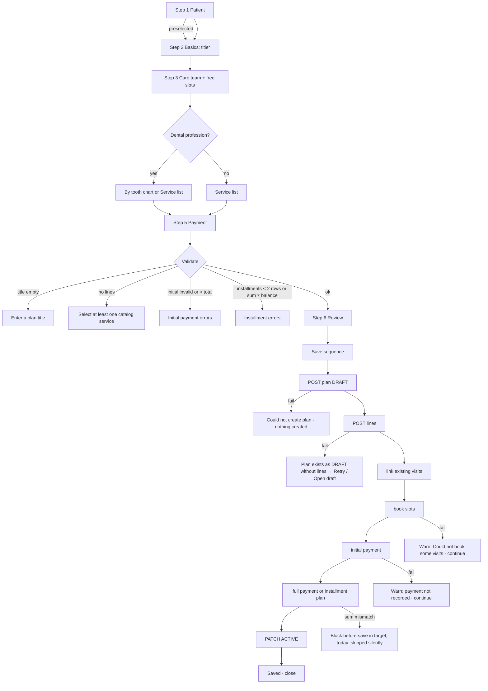

# Treatment plan wizard (create plan)

| | |
|---|---|
| Area | Clinic workspace · Treatment plans |
| Who sees it | All members (doctors, receptionists). Dental chart mode only when the signed-in user's profession is a dental one. No tier gate. |
| Reached from | Treatment plans list "New plan"; clinic patient detail → "Create treatment plan" (patient preselected); Home quick action "New treatment plan" (first clinic) |
| Screen type | Full-screen modal flow (not dismissible by scrim); today "Step 1/2" patient search then one long form; target: 5 short steps |
| Current Flutter source | `lib/features/clinic/presentation/treatment_plan_wizard_sheet.dart` (2 439 lines), `lib/features/appointments/dental/dental_plan_editor_panel.dart` (chart mode), `lib/state/clinic/clinic_treatment_plan_actions.dart`, `clinic_finance_actions.dart` |
| Spec | `docs/kmp-spec/09-clinic-workspace-finance-treatment-plans.md` §4.2, §10 quirks 6–9, 12, 19, ticket TP-04; dental editor in doc 05 §4 |

## 1. Purpose
Create a complete treatment plan for a patient in one sitting: what will be done (services, optionally per tooth), who will do it, when (book free slots now), what it costs, and how it will be paid (desk payment now, pay in full, or an installment schedule). A doctor does this after a first consultation; a receptionist may do it for the doctor. A few times a week per doctor; 5–10 minutes each.

## 2. Entry points
- Treatment plans list → "New plan": step 1 (patient search) shown.
- Clinic patient detail → "Create treatment plan": patient preselected, wizard opens on step 2.
- Home quick action: uses the doctor's first clinic (target: selected clinic; ask which clinic when there are several).
- Always opens on top of the current screen as a full-screen modal; closing with unsaved input asks for confirmation (target; today the X closes silently).

## 3. Layout, top to bottom (phone portrait)
Target structure: app bar (X close, title "Treatment plan", step indicator "Step 2 of 5"), scrollable step body, sticky footer (Back · Next / Save). Today: one header "Step 1/2", then a 2 400-line single form; keep the content, split it.

**Step 1 — Patient** (skipped when preselected): search field (autofocus) "Search patient (type to filter)"; results list after ≥ 2 characters with 250 ms debounce (name, phone or email as subtitle); "No matching patients." empty; selecting a row moves on. Target: "New patient" shortcut (open question).

**Step 2 — Plan basics**: Title (required, hint "e.g. Dental restoration"), Diagnosis (2 lines, hint "e.g. Caries on teeth 14, 15"), Notes (2 lines, optional), Payment reminder (dropdown 1–30 days; default 3; "Every day" / "Every {n} days"; helper "How often the patient is reminded about an unpaid balance."). Symptoms (comma separated) exists as a label but no field today — drop or add (open question).

**Step 3 — Care team & visits**: hint "Add every doctor involved. Pick free slots per doctor to schedule visits for this patient."; multi-select chips of clinic doctors (members with a doctor profile, sorted by name); the first selected becomes the primary attending doctor (target: explicit "Primary" marker). Under each selected doctor a **visits row**: doctor name, "Pick free slots" button, picked slot chips ("24.10.2026 14:00" with ×) or "No visits scheduled yet.". "Pick free slots" → date picker (today … +365 d) → **Free slots sheet**: doctor name + day; location dropdown when the doctor has 2+ locations (primary preselected) or a single location line; slot chips "09:00–09:30[ · Location]" multi-select (already picked starts hidden); footer Cancel · "Add (n)". Empty "No free slots on this day."; error "Could not load slots".

**Step 4 — Treatments / services**: hint "Pick from clinic catalog. Optionally assign each line to a visit." Dental professions get a segmented toggle **By tooth (FDI)** / **Service list** (chart default). *Service list*: rows from the unified catalog filtered to the selected doctors (or the whole clinic when none selected), active only; each row = checkbox, title, price ("150 000 UZS" — today "150000 UZS" without grouping), source chips ("From Dr X" / "Clinic catalog"), Qty field (enabled when ticked, default 1), and when ticked a "Link to visit (optional)" dropdown: "— no visit —", tentative slots ("NEW · 24.10.2026 14:00 · Dr X"), existing patient appointments ("12.11.2026 10:00 · Dr Y"). Empty states: "No catalog items in this clinic yet." / "No services available for the selected doctor(s). Pick more doctors or add services in Clinic → Services or in the doctor's profile." *By tooth*: the dental plan editor (area 05): permanent/primary dentition, tap a tooth → sheet with the full clinic catalog (search when > 8 items), multiple services per tooth, a plan-wide Discount % field, plan notes, "Planned total"; hint "Showing the full clinic catalog (not limited to selected doctors)." when doctors are selected.

**Step 5 — Payment**: live **summary card** (Plan total · Initial · Balance / "Over by" in red); **Initial payment at desk**: amount ("0 if none"), method (Cash / Transfer / Card), memo (default "Initial payment at desk"); **Remaining balance** radio: "Leave unpaid (activate plan)" (default) / "Pay in full now (clinic ledger)" (+ method, memo) / "Installments (custom schedule)" (+ summary Balance due · Allocated · Remaining/Over by; ≥ 2 rows of Due date (tap to pick, `yyyy-MM-dd`; today −1 d … +5 y) + Amount; "Add installment row" prefilled with the remaining; remove row allowed above 2).

**Step 6 — Review & save** (target; today there is no review): patient, title, doctors, visits, lines with total, discount, payment choice; **Save** button. Saving shows a progress list of the steps (see §5) so a partial failure is visible.

## 4. Data and formats
| Field | Source / request | Format rule |
|---|---|---|
| Patient search | `GET /api/clinics/{id}/patients?page=0&size=40&q=` | ≥ 2 chars; 250 ms debounce; 40 results max |
| Patient appointments | `GET /api/clinics/{id}/patients/{pid}/appointments` | For "Link to visit"; dates in clinic zone |
| Doctors | `GET /api/clinics/{id}/members` filtered to doctorProfileId > 0 | sorted by name |
| Locations | `GET /api/treatment-plans/doctor-locations?clinicId&doctorId` | primary preselected; legacy rows (id ≤ 0) send no location |
| Free slots | `GET /api/treatment-plans/free-slots?clinicId&doctorId&day=YYYY-MM-DD[&locationId]` → {startAt, endAt, slotMinutes (30), locationId?, locationLabel?} | Times shown in **clinic zone** (today phone zone — a Tashkent clinic viewed from Moscow shows wrong hours) |
| Services | `GET /api/treatment-plans/plan-services?clinicId[&doctorIds=1,2]` | active only; key per row |
| Line payload | {catalogItemId?, title, quantity, unitPriceMinor, discountMinor, currency, sortOrder, linkedAppointmentId?} (list) or dental lines with status PLANNED and specialtyMetadata `{fdi, dentition, source}` and the % discount spread per line, remainder on the last line | quantity ≥ 1; qty typed before ticking is kept |
| Totals | live: Σ price × qty (list) or editor total (chart) | shared money formatter; currency = first picked line's currency |
| Initial payment | major units → `round(×100)`; invalid → blocked | 0 ≤ initial ≤ total (when total > 0) |
| Installments | rows with date + amount > 0; ≥ 2 rows; Σ must equal owed after initial | first due date = schedule start; frequency sent as MONTHLY regardless |
| Reminder | 1–30 | default 3 |
| Save requests | see §5 | — |

## 5. Primary flow (happy path)
1. New plan → Step 1 → type "Kar" → tap patient → Step 2.
2. Title "Dental restoration", diagnosis → Next.
3. Select Dr Rahimov → Pick free slots → 28 Oct → 10:00–10:30 → Add (1) → chip appears → Next.
4. By tooth: tap 16 → "Composite filling" → tap 26 → "Composite filling" → discount 10 % → Next (list mode: tick services, qty, link one to the NEW slot).
5. Payment: initial 500 000 cash; remaining → Installments: 2 rows (15 Nov 700 000, 15 Dec 700 000) → summary "Remaining 0" green → Next.
6. Review → Save → progress list ticks: Create plan ✓ → Save services ✓ → Link visits ✓ → Book visits ✓ → Record initial payment ✓ → Create installment schedule ✓ → Activate ✓ → banner "Treatment plan saved" → wizard closes → list refreshed with the new ACTIVE plan; finance refreshed.

## 6. Screen states
- **First load**: Step 1 shows the search field immediately; Step 3 shows a thin progress line while members load; Step 4 shows skeleton service rows.
- **Empty**: no patients found; no doctors ("No doctors in this clinic."); no services (two variants above); no free slots on the day.
- **Error on load**: members "Could not load clinic doctors." with Retry; services error inline with Retry; slots "Could not load slots" + Retry inside the sheet.
- **Offline**: the wizard cannot start (banner "You're offline"); if it drops offline mid-way, Next still works for local steps, Save is disabled with a hint.
- **Refreshing**: n/a.
- **Partial data**: appointments for the patient fail → "Link to visit" offers only tentative slots; show "Existing visits unavailable".
- **Permission needed**: n/a.
- **Locked by tier**: n/a.
- **Role difference**: receptionist: identical; chart mode depends on the *signed-in user's* profession, so a receptionist never gets the chart even in a dental clinic (open question — should it depend on the attending doctor or the clinic?).

## 7. Interactions and secondary flows
- **X / system back** → Step 1: close; later steps with input: "Discard this plan?" dialog (target). Today: X closes silently; Back on step 2 returns to patient search and clears the patient.
- **Deselect a doctor** → their picked slots and any line links to them are dropped; services list refilters; picks no longer visible are pruned after the new list loads.
- **Remove a slot chip** → links pointing at it reset to "no visit".
- **Switch chart ↔ list** → each keeps its own state; the total follows the visible mode.
- **Change initial amount** → summary recomputes; new installment rows prefill with the remaining.
- **Add installment row** → prefilled amount = remaining; **remove** allowed while > 2 rows.
- **Pick due date** → date picker from today −1 d.
- **Keyboard Done** on the last field → Next.
- **Save** → disabled while saving; spinner in button; progress list (target).

## 8. Edge cases
- Plan with 0 lines → blocked ("Select at least one catalog service"); if the server call for lines fails after the plan was created, a DRAFT without lines exists → target: keep the wizard open with "Retry saving services" and show the plan in the list with an "Incomplete" tag (today: toast, wizard stays, nothing tells the user a draft was created).
- Tooth already planned in another open plan of the same patient → not detected today; target: the chart sheet shows "Planned in plan #412" on that tooth (needs backend data — UNVERIFIED).
- Service price 0 → allowed; total may be 0 → payment step shows no summary; installments impossible ("Balance due 0").
- Huge totals (10 000 000 UZS × qty 20) → grouping; fields wide enough.
- Qty 0 or negative or blank → line silently dropped today; target: inline "Qty must be at least 1".
- Mixed currencies among picked services → total uses the first line's currency and simply adds numbers (wrong); target: block mixing ("All services must use the same currency").
- Discount % > 100 clamped to 100; negative to 0; rounding remainder goes to the last line.
- Initial payment > total → "Initial payment cannot exceed the plan total"; = total → balance 0, radio options irrelevant (hide full/installments).
- Initial payment and "Pay in full" → two payments recorded (initial + remainder); acceptable but say so in Review.
- Installment sum ≠ balance → today the schedule is **silently skipped** and the plan still goes ACTIVE; target: block at validation with the live summary ("Over by 50 000").
- Installment due date in the past → allowed from yesterday; earlier blocked by the picker.
- Two staff create a plan for the same patient at once → two plans; fine.
- Slot taken between picking and saving → book-slots fails → warning "Could not book some visits" and the plan is still saved; target: list which slots failed and offer "Pick again" from the detail.
- Wizard step fails midway (orphan plan) → see §5 diagram; every failure after step 1 leaves a plan; the user must see it (banner + "Open plan").
- Member leaves the clinic while selected → slots booking fails for that doctor → warning as above.
- Phone zone ≠ clinic zone → free-slot times and link labels must be clinic time (today phone time).
- 401 during save → logout; plan may be half-created; on next login the DRAFT appears with "Incomplete".
- Rotation → state kept (single state object).
- 200 % font → chips wrap; slot chips 2 per row; footer buttons stack.
- Language switch → not possible while modal.
- Screen reader: step indicator announced on step change; chips "Dr Rahimov, selected"; slot chips "09:00 to 09:30, not selected".

## 9. Validation and messages
| Field/action | Rule | When checked | Message (EN) | Where shown |
|---|---|---|---|---|
| Title | non-empty | on Next from step 2 (today on Save) | `treatmentPlanTitleRequired` "Title is required" / `treatmentPlanWizardFillBasics` "Enter a plan title" | inline |
| Lines | ≥ 1 line with qty ≥ 1 | on Next from step 4 | `treatmentPlanWizardPickServices` "Select at least one catalog service" | inline + banner |
| Qty | integer ≥ 1 | on blur | "Qty must be at least 1" (**NEW**) | inline |
| Initial amount | number ≥ 0 | on blur / Next | `treatmentPlanWizardInitialPaymentInvalid` "Enter a valid initial payment amount (0 or more)" | inline |
| Initial ≤ total | when total > 0 | live | `treatmentPlanWizardInitialPaymentExceedsTotal` "Initial payment cannot exceed the plan total" | inline, summary red |
| Installments | ≥ 2 rows with date and amount > 0 | on Next | `treatmentPlanWizardNeedTwoInstallments` "Add at least 2 installment rows with valid dates and amounts" | inline |
| Installment sum | = balance after initial | on Next (target; today after plan creation, then skipped) | `treatmentPlanWizardInstallSumMismatch` "Installment total does not match plan total" + "{{sum}} vs {{owed}}" | inline summary |
| Currency mix | one currency | on Next | "All services must use the same currency" (**NEW**) | banner |
| Create plan | HTTP 200 | save | `treatmentPlanWizardCouldNotCreatePlan` "Could not create plan" | banner, stay |
| Save lines | HTTP 200 | save | `treatmentPlanWizardCouldNotSaveServices` "Could not save services" + "Retry" (**NEW**) | banner, stay |
| Book slots | HTTP 200 | save | `treatmentPlanWizardSlotBookFailed` "Could not book some visits" | banner, continue |
| Initial payment | HTTP 200 | save | `treatmentPlanWizardInitialPaymentFailed` "Could not record initial payment" | banner, continue |
| Full payment | HTTP 200 | save | `treatmentPlanWizardPaymentFailed` "Could not record payment" | banner, continue |
| Installment plan | HTTP 200 | save | `treatmentPlanWizardInstallFailed` "Plan saved but installment schedule could not be created" | banner, continue |
| Done | — | — | `treatmentPlanWizardDone` "Treatment plan saved" / `treatmentPlanCreated` "Treatment plan created" | banner |
| Discard | input present | on close | "Discard this plan?" (**NEW**) | dialog |

## 10. Navigation out
- Save → closes to the caller (list / patient detail / home) which refreshes plans and finance; target: offer "Open plan" in the success banner.
- Discard → closes; nothing saved (unless a partial save already happened — then the banner says "Draft #412 was kept").
- Free-slots sheet → back to step 3 with chips added.

## 11. Copy
- Title/steps: `treatmentPlanWizardTitle` "Treatment plan wizard", `treatmentPlanWizardStep` "Step {{current}}/{{total}}", `back` "Back", `treatmentPlanWizardFinish` "Finish" (used as Save), `cancel` "Cancel"
- Step 1: `treatmentPlanWizardSearchPatient` "Search patient (type to filter)", `treatmentPlanWizardNoPatients` "No matching patients."
- Step 2: `treatmentPlanWizardSectionBasics` "Plan basics", `treatmentPlanTitle` "Title", `treatmentPlanTitleHint` "e.g. Dental restoration", `treatmentPlanDiagnosis` "Diagnosis", `treatmentPlanDiagnosisHint` "e.g. Caries on teeth 14, 15", `treatmentPlanNotes` "Notes", `treatmentPlanNotesHint` "Additional notes (optional)", `treatmentPlanWizardReminderDays` "Payment reminder (days)", `treatmentPlanWizardReminderDaysHelp` "How often the patient is reminded about an unpaid balance.", `treatmentPlanWizardReminderDay1` "Every day", `treatmentPlanWizardReminderDaysN` "Every {n} days", `treatmentPlanWizardSymptoms` "Symptoms (comma separated)"
- Step 3: `treatmentPlanWizardSectionCareTeam` "Care team & visits", `treatmentPlanWizardSectionCareTeamHint`, `treatmentPlanWizardAttending` "Attending doctor", `treatmentPlanWizardNoDoctors` "No doctors in this clinic.", `treatmentPlanWizardMembersError` "Could not load clinic doctors.", `treatmentPlanWizardDoctorNumber` "Doctor #{{id}}", `treatmentPlanWizardPickSlots` "Pick free slots", `treatmentPlanWizardNoSlotsPicked` "No visits scheduled yet.", `treatmentPlanWizardSlotLocation` "Location", `treatmentPlanWizardNoFreeSlots` "No free slots on this day.", `treatmentPlanWizardSlotsLoadError` "Could not load slots", `treatmentPlanWizardAddSlotsBtn` "Add", `treatmentPlanWizardSlotNewBadge` "NEW"
- Step 4: `treatmentPlanWizardSectionServices` "Treatments / services", `treatmentPlanWizardSectionServicesHint`, `treatmentPlanWizardByTooth` "By tooth (FDI)", `treatmentPlanWizardByList` "Service list", `treatmentPlanWizardQty` "Qty", `treatmentPlanWizardLineAppt` "Link to visit (optional)", `treatmentPlanWizardLineApptNone` "— no visit —", `treatmentPlanWizardServiceFromDoctor` "From {{name}}", `treatmentPlanWizardServiceFromClinic` "Clinic catalog", `treatmentPlanWizardNoCatalog` "No catalog items in this clinic yet.", `treatmentPlanWizardNoServicesForDoctors`, dental: `dentalPlanEditorIntro` "Plan procedures on the teeth chart. Each tooth can have multiple catalog services.", `dentalPlanEditorCatalogHint` "Showing the full clinic catalog (not limited to selected doctors).", `dentalPlanEditorNoSearchMatches` "No services match your search.", `dentalPlanEditorNotes` "Plan notes", `dentalPlanEditorTotal` "Planned total", `dentalDiscountPercent` "Discount"
- Step 5: `treatmentPlanWizardSectionPayment` "Payment", `treatmentPlanWizardInstallTotal` "Plan total", `treatmentPlanWizardInitialPaymentSummary` "Initial", `treatmentPlanWizardBalancePreview` "Balance", `treatmentPlanWizardInstallOver` "Over by", `treatmentPlanWizardInitialPaymentSection` "Initial payment at desk", `treatmentPlanWizardInitialPaymentHint` "Optional payment collected while creating the plan.", `treatmentPlanWizardInitialPaymentAmount` "Initial payment amount", `treatmentPlanWizardInitialPaymentAmountHint` "0 if none", `treatmentPlanWizardInitialPaymentMethod` "Initial payment method", `treatmentPlanWizardInitialPaymentMemo` "Initial payment memo (optional)", `treatmentPlanWizardInitialPaymentMemoDefault` "Initial payment at desk", `treatmentPlanWizardRemainingPaymentSection` "Remaining balance", `treatmentPlanWizardPayUnpaid` "Leave unpaid (activate plan)", `treatmentPlanWizardPayFull` "Pay in full now (clinic ledger)", `treatmentPlanWizardPayInstallments` "Installments (custom schedule)", `treatmentPlanWizardMethod` "Payment method", `treatmentPlanWizardMemo` "Memo", `treatmentPlanWizardInstallAllocated` "Allocated", `treatmentPlanWizardInstallRemaining` "Remaining", `treatmentPlanWizardInstallDue` "Due date", `treatmentPlanWizardInstallTapDate` "Tap to pick", `treatmentPlanWizardInstallAmount` "Amount", `treatmentPlanWizardInstallHint` "Due date YYYY-MM-DD, amount in major currency units", `treatmentPlanWizardAddRow` "Add installment row", `treatmentPlanWizardInstallRemove` "Remove row", methods `clinicPaymentMethodCash/Transfer/Card`
- Errors/success: see §9.
- **NEW**: "Step {{n}} of 6", "Next", "Review", "Primary", "Discard this plan?", "Qty must be at least 1", "All services must use the same currency", "Retry saving services", "Draft #{{id}} was kept", "Open plan", "Existing visits unavailable", "Planned in plan #{{id}}"

## 12. Known problems in the current app (do not carry over)
- Saving is 6–9 sequential requests with no transaction: a failure after the first leaves an orphan DRAFT (or an ACTIVE plan without its schedule); the installment-sum mismatch is checked only after the plan exists and then **skipped silently** while the plan is still activated.
- Services → line ids are matched by **position** in the response; in chart mode no line is ever linked to a booked slot.
- Free-slot times, link labels and date pickers use the phone's clock and zone, not the clinic's.
- Validation surfaces as toasts at save time, not inline per step.
- About 60 strings have hard-coded English fallbacks in code; Uzbek/Russian keys exist but English relies on the fallbacks.
- One 2 400-line form; the only step boundary is the patient picker.
- "Finish" key is used for the Save button; "Symptoms" label exists without a field.
- Home quick action picks the first clinic.
- Chart mode availability depends on the signed-in user's profession, not the attending doctor's.

## 13. Open questions for design
- 5–6 short steps (recommended) or 2 long pages with anchors?
- Should booking visits be optional and moved after save ("Schedule visits" from the detail) to shorten the wizard?
- Installments: custom rows only (today) or presets (2/3/6 monthly equal splits) + custom?
- Review step: mandatory or skippable when nothing is paid?
- Who gets the dental chart: dental professions only, or any plan in a dental clinic?
