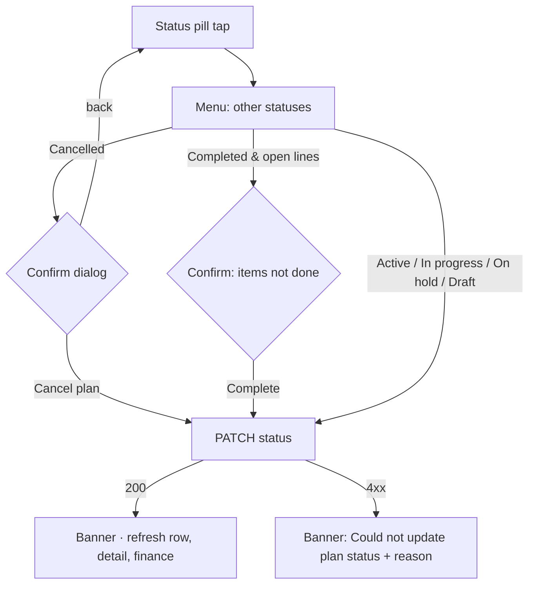
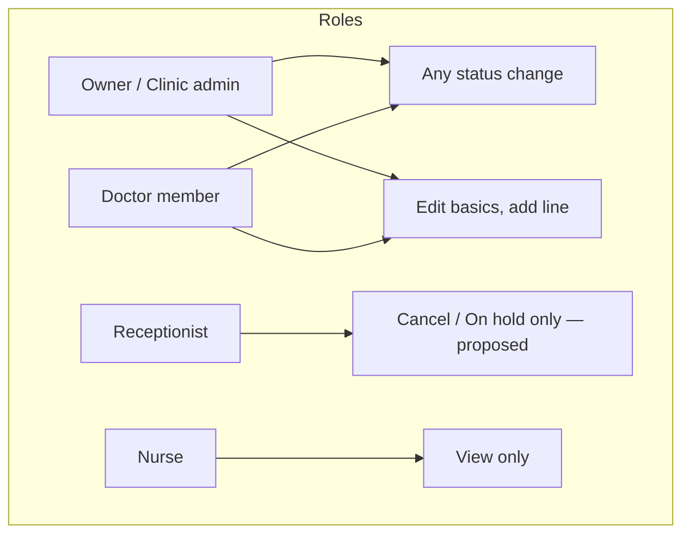

# Change plan status · Edit plan / add line / close plan

| | |
|---|---|
| Area | Clinic workspace · Treatment plans |
| Who sees it | All members today (any member may move a plan to any status). Target: doctors / owner / clinic admin; receptionist may cancel/hold only — server rules UNVERIFIED. No tier gate. |
| Reached from | Treatment plans list → status pill; plan detail overflow (target) |
| Screen type | Popup menu + confirmation dialog (status). Edit plan / add line: **not in the app today** — target sheets described here for design |
| Current Flutter source | `lib/features/clinic/presentation/clinic_treatment_plans_tab.dart` (`_changeStatus`, `_StatusPill`), `lib/state/clinic/clinic_treatment_plan_actions.dart` (`patchTreatmentPlanStatus`; `patchTreatmentPlan` and `appendTreatmentPlanLines` exist without any clinic UI) |
| Spec | `docs/kmp-spec/09-clinic-workspace-finance-treatment-plans.md` §4.5, §7 (PATCH plan, lines/append), tickets TP-02, TP-03 |

## 1. Purpose
Move a plan through its life (Draft → Active → In progress → On hold → Completed, or Cancelled), and — target — fix a plan after creation: rename, change diagnosis/notes/reminder, add a line that was forgotten, or close it. Status changes happen a few times per plan; edits are occasional.

## 2. Entry points
- **Status**: list card status pill (caret) → menu; detail overflow "Change status" (target).
- **Edit basics** (target): detail overflow "Edit plan" → sheet.
- **Add line** (target): detail Services card "Add service" → sheet; in-visit "Add extra (not in plan)" is the visit-side variant (file 18).
- **Close plan** = status Completed (manual) or Cancelled (with confirmation). The server also auto-completes a plan when a visit completes and all non-cancelled lines are Completed.

## 3. Layout, top to bottom (phone portrait)
1. **Status menu** (anchored to the pill; target bottom sheet "Change status"): the five other statuses in fixed order — Active, In progress, On hold, Completed, Draft, Cancelled — each with a coloured dot; current status omitted. Target: group as "Open" (Active · In progress · On hold), "Close" (Completed · Cancelled), "Revert to draft"; disable transitions the server rejects (UNVERIFIED) with a caption.
2. **Cancel confirmation dialog**: title "Cancel treatment plan?", body "Plan "{{title}}" will be marked CANCELLED. Recorded payments and installments will be kept but no new charges will be auto-applied. Continue?", buttons Cancel (text) · **Cancel plan** (red, right).
3. **Complete confirmation** (target): when lines are not all completed: "Mark as completed? 3 of 7 planned items are not done." · Complete.
4. **Edit plan sheet** (target): Title, Diagnosis, Notes, Payment reminder days, Symptoms; attending doctor (single, legacy field); Save. Same validation as wizard step 2.
5. **Add service sheet** (target): catalog picker (same rows as wizard step 4 list mode, search), qty, optional "Link to visit" (existing visits of the plan), optional tooth (dental plans); live "Plan total will increase by X (new total Y)"; Add. Uses the append-lines endpoint so existing lines are untouched.
6. **Remove / cancel a line** (target): line overflow → "Cancel line" (sets line status Cancelled; no delete endpoint — UNVERIFIED).

## 4. Data and formats
| Field | Source | Format rule |
|---|---|---|
| Status change | `PATCH /api/treatment-plans/{id}/status {status}` → summary | After success: refresh list row, plan detail, visits and finance |
| Statuses | DRAFT, ACTIVE, IN_PROGRESS, ON_HOLD, COMPLETED, CANCELLED | Labels sentence case (target) |
| Edit basics | `PATCH /api/treatment-plans/{id} {title?, diagnosis?, notes?, paymentReminderDays?, attendingDoctorId?, symptoms?, dentalPlanDocumentation?}` | Exists in the API layer, no UI today |
| Add lines | `POST /api/treatment-plans/{id}/lines/append {appointmentId?, lines[]}` → detail | Exists, UI only in the visit (file 18) if at all (UNVERIFIED) |
| Replace lines | `POST /api/treatment-plans/{id}/lines` (replaces all) | Wizard only; never use for edits |
| Payment reminder | 1–30 days | — |

## 5. Primary flow (happy path)
1. Doctor taps the status pill on an Active plan → menu → "On hold" → request → banner "Plan status updated: On hold" → pill amber.
2. Later → "Cancelled" → confirmation → "Cancel plan" → request → banner → pill red; outstanding stays visible but no new charges.

(Today: every member gets A1; A2 does not exist. The role split is a proposal to confirm with backend.)

## 6. Screen states
- **First load**: n/a (menu from loaded data).
- **Empty**: n/a.
- **Error on load**: n/a.
- **Offline**: pill read-only with "offline" hint on tap.
- **Refreshing**: after a change the pill shows a small spinner until the row refreshes (target).
- **Partial data**: n/a.
- **Permission needed**: n/a.
- **Locked by tier**: n/a.
- **Role difference**: see diagram; nurse never sees the caret.

## 7. Interactions and secondary flows
- **Select a status** → immediate request except Cancelled (confirm) and Completed with open lines (confirm, target).
- **Revert to Draft** → allowed today from any status; keep but under "More".
- **Edit plan** (target) → sheet → Save → detail refresh; title change propagates to the list.
- **Add service** (target) → sheet → Add → detail refresh; finance refresh (total changed → outstanding changed; installment schedule no longer matches → banner "Installment schedule no longer matches the plan total" with "Adjust" → file 11).
- **Cancel line** (target) → confirmation → line pill Cancelled; progress recalculated.

## 8. Edge cases
- Cancelling a plan with an installment schedule → items remain (server may cancel them — UNVERIFIED); dialog copy already says payments/installments are kept.
- Completing a plan with unpaid outstanding → allowed; payment pill stays Partial; warn in the confirmation ("Outstanding 400 000 UZS remains").
- Cancelled → Active (reopen) → allowed today; warn "Reopening a cancelled plan" (target).
- Status changed by another user meanwhile → our PATCH overwrites; show the server's returned status; if 409 → banner + refresh.
- Plan auto-completed by the server while the menu is open → PATCH to In progress would reopen it — acceptable but refresh first (target: re-fetch summary before showing the menu).
- Adding a line to a Completed plan → server may reject; show message; suggest reopening.
- Adding a line in another currency → block (same rule as wizard).
- Tooth already planned on the same plan → allowed (multiple services per tooth).
- Edit title to empty → blocked "Title is required".
- Member leaves the clinic with open plans → plans stay; attending doctor name stays; cannot pick them for new lines.
- Double tap on a menu item → one request.
- 401 → logout.
- 200 % font → menu items wrap; dialog scrolls.
- Screen reader: menu items "Active, menu item"; dialog focus on body then destructive button.

## 9. Validation and messages
| Field/action | Rule | When checked | Message (EN) | Where shown |
|---|---|---|---|---|
| Cancel | confirmation | on select | `clinicPlanCancelConfirmTitle` "Cancel treatment plan?", `clinicPlanCancelConfirmBody`, `clinicPlanCancelConfirm` "Cancel plan", `cancel` "Cancel" | dialog |
| Complete with open lines | confirmation (target) | on select | "Mark as completed? {{open}} of {{total}} planned items are not done." (**NEW**) | dialog |
| PATCH status | HTTP 200 | on response | `clinicPlanStatusUpdated` "Plan status updated" + ": {{status}}" / `clinicPlanStatusUpdateFailed` "Could not update plan status" + reason | banner |
| Edit title | non-empty | on Save | `treatmentPlanTitleRequired` "Title is required" | inline |
| Add line | ≥ 1 service, qty ≥ 1, same currency | on Add | `treatmentPlanWizardPickServices`, "Qty must be at least 1", "All services must use the same currency" | inline |
| Add line result | HTTP 200 | on response | "Service added to the plan" (**NEW**) / server message | banner |

## 10. Navigation out
- Menu/dialog close → same screen; list row, detail, visits and finance refresh.
- Add service → may suggest "Adjust installments" → file 11.

## 11. Copy
- Status labels: `clinicPlanStatusDraft`, `clinicPlanStatusActive`, `clinicPlanStatusInProgress`, `clinicPlanStatusOnHold`, `clinicPlanStatusCompleted`, `clinicPlanStatusCancelled`; `clinicChangeStatus` "Change status"
- Cancel dialog: `clinicPlanCancelConfirmTitle` "Cancel treatment plan?", `clinicPlanCancelConfirmBody` "Plan "{{title}}" will be marked CANCELLED. Recorded payments and installments will be kept but no new charges will be auto-applied. Continue?", `clinicPlanCancelConfirm` "Cancel plan"
- Results: `clinicPlanStatusUpdated` "Plan status updated", `clinicPlanStatusUpdateFailed` "Could not update plan status"
- In-visit extra (reused): `appointmentPlanExtraIncrease` "Plan total will increase by {{amount}} {{currency}} (new total {{newTotal}} {{currency}})"
- **NEW**: "Edit plan", "Add service", "Cancel line", "Mark as completed? {{open}} of {{total}} planned items are not done.", "Outstanding {{amount}} remains", "Reopening a cancelled plan", "Installment schedule no longer matches the plan total", "Adjust", "Service added to the plan", "Open", "Close", "Revert to draft"

## 12. Known problems in the current app (do not carry over)
- Any member can move any plan to any status, including Completed → Draft, with no server-side transition rules confirmed.
- Status labels are upper-case constants; the cancel dialog body embeds "CANCELLED" literally.
- No way to edit a plan or add a line after creation although the API supports both; the only fix is a new plan.
- The status menu lives only in the list; the detail screen has no actions.
- Success message concatenates "Plan status updated: ON HOLD".

## 13. Open questions for design
- Bottom sheet with grouped transitions vs. a simple menu?
- Should "Completed" be manual at all, given the server auto-completes?
- Is editing lines (qty/price) needed, or only adding/cancelling lines?
