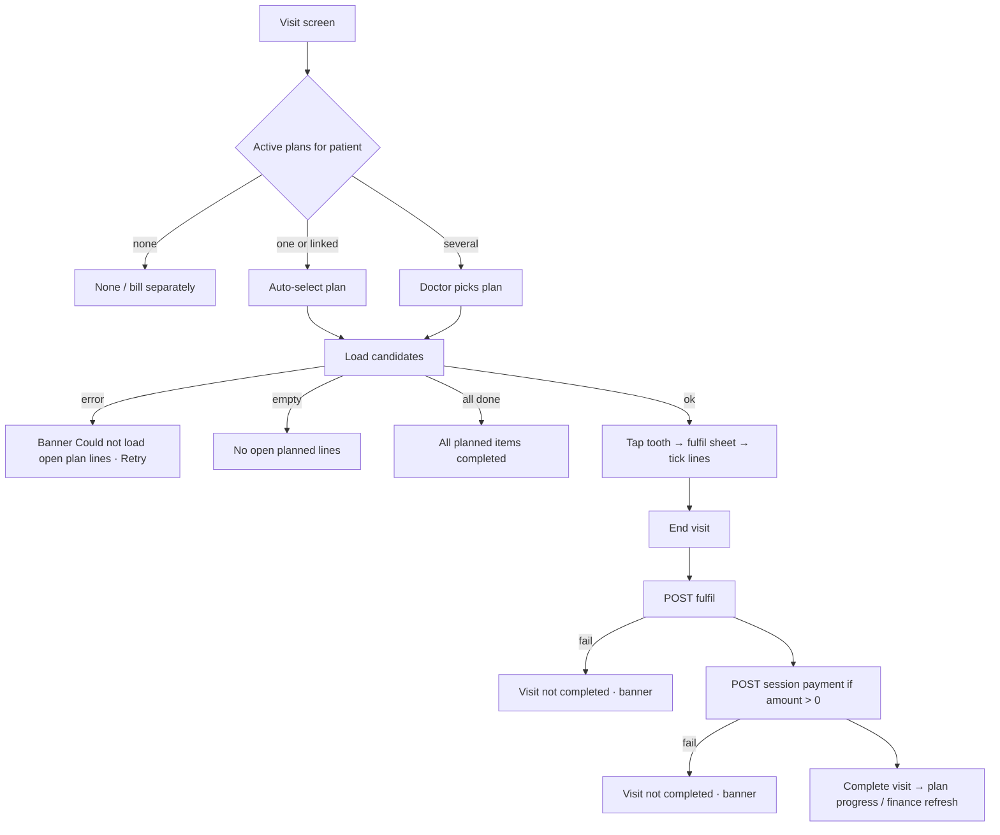

# Apply a treatment plan in a visit (fulfil planned lines) — summary

| | |
|---|---|
| Area | Clinic workspace · Treatment plans (the screen itself belongs to area 05 — in-person / video visit; this file covers only the plan side so the plan designer knows what the visit does to a plan) |
| Who sees it | The doctor running the visit (dental documentation panel in plan mode). Clinic staff do not run visits. Dental chart requires a dental profession; non-dental visits use the plan panel without a chart. |
| Reached from | In-person or video visit screen → "Treatment plan for this visit" panel → pick an active plan → tap a tooth / general services → fulfil sheet |
| Screen type | Bottom sheet inside the visit screen + banners; applied when the visit ends |
| Current Flutter source | `lib/features/appointments/dental/dental_visit_documentation_panel.dart` (`_openPlanFulfillSheet`, plan banners), `lib/features/appointments/presentation/appointment_treatment_plan_panel.dart`, `appointment_plan_finance_card.dart`, `lib/state/clinic/clinic_treatment_plan_actions.dart` (`fetchFulfillmentCandidates`, `fulfillTreatmentPlanLines`, `appendTreatmentPlanLines`) |
| Spec | `docs/kmp-spec/05-appointments-video-dental.md` §4.3 (plan mode), §5, ticket DENTAL-03; `docs/kmp-spec/09-…` §4.3, ticket TP-06. **Full flow file: see area 05 folder (`05-appointments-visit/`), dental chart / end-visit files.** |

## 1. Purpose
While treating the patient, tick which planned lines were done today (optionally per tooth), so the plan's progress, the visit's charges and the clinic finance all update when the visit ends. Also record the money taken at this visit against the plan. Every visit that belongs to a plan.

## 2. Entry points
- Visit screen loads the patient's **active comprehensive plans** (`GET /api/treatment-plans?clinicId&patientId&status=ACTIVE&planKind=COMPREHENSIVE`); a dropdown "Treatment plan for this visit" offers "None / bill separately" + plans; the only plan or the appointment's already-linked plan is auto-selected; a banner "Part of plan #412 — Dental restoration" and progress "3/7 planned items completed" appear.
- Selecting a plan loads its detail and the **fulfilment candidates** for this appointment (`GET /api/treatment-plans/{id}/fulfillment-candidates?appointmentId=`): open lines with title, tooth (FDI), price and a `toothMatch` flag.

## 3. Layout, top to bottom (phone portrait) — plan side only
1. **Plan picker** dropdown + linked-plan banner + progress line.
2. **Chart intro** "Tap a tooth to mark planned procedures as completed." and a status banner: green "All planned items on this plan are completed." / orange "Could not load open plan lines. Try again." + Retry / neutral "No open planned lines on this plan." / thin progress bar while loading.
3. **Teeth chart** in plan mode: teeth carry counts of planned services and a state colour (planned / partially completed / completed); a "General services" entry for lines without a tooth.
4. **Fulfil sheet** (tap a tooth): title "Tooth 16" (or "General services"), hint "Select the planned lines completed during this visit.", one checkbox row per candidate (title, line total), rows already fulfilled in earlier visits are checked and disabled; footer "Save" (closes the sheet; nothing is sent yet).
5. **Plan finances card**: Plan total · Paid · Outstanding; "Payment this visit": Amount + Method (Cash / Card / Transfer); recorded once at end of visit; shows "Recorded: {{amount}}" afterwards.
6. **End visit** applies everything: fulfil → payment → complete (order matters; a fulfil failure aborts the completion with "Could not apply treatment plan changes. Appointment was not completed.").

## 4. Data and formats
| Field | Source | Format rule |
|---|---|---|
| Candidates | fulfilment-candidates → {lineId, title, fdi?, dentition?, unitPriceMinor, quantity, discountMinor, currency, lineTotalMinor, status, toothMatch} | Money via the shared formatter (today "1500.00 UZS") |
| Fulfil | `POST /api/treatment-plans/{id}/appointments/{apptId}/fulfill {lineIds}` → detail | Sent at end of visit (or "Apply to plan" action); lines become COMPLETED, linked to the visit; plan auto-completes when all non-cancelled lines are done |
| Extra (not in plan) | `POST /api/treatment-plans/{id}/lines/append {appointmentId, lines}` | Strings exist ("Add extra (not in plan)", "Plan total will increase by …") but **no screen uses the mode toggle today** — the fulfil sheet is fulfil-only. Target: a second mode in the same sheet to add an unplanned service to the plan and this visit |
| Session payment | `POST /api/clinics/{id}/finance/payments {treatmentPlanId, amountMinor, currency, method, linkedAppointmentId}` | Once per visit |
| Progress | linesCompleted/linesTotal | "{{done}}/{{total}} planned items completed" |

## 5. Primary flow (happy path)
1. Doctor opens the visit → plan auto-selected → candidates load → chart shows tooth 16 and 26 as planned.
2. Taps 16 → sheet → ticks "Composite filling" → Save → tooth 16 shows partially/fully completed.
3. Enters 500 000 cash in Plan finances.
4. Ends the visit → fulfil posts → payment posts → visit completes → summary PDF includes "Treatment plan: fulfilled this visit, payment this visit".
5. Back in the clinic workspace: plan list shows 4/7, outstanding reduced, ledger row Partial/Paid, payments list has the new row, plan detail refreshed (target — today stale).

## 6. Screen states (plan side)
- **First load**: progress bar under the picker while plans/candidates load.
- **Empty**: no active plans → picker shows only "None / bill separately"; no open lines → neutral banner.
- **Error on load**: orange banner + Retry.
- **Offline**: plan panel disabled; visit can still be documented? (area 05 decides).
- **Refreshing**: after fulfil the detail is re-fetched.
- **Partial data**: plan detail ok but candidates fail → orange banner; chart shows counts without tappable fulfilment.
- **Permission needed**: n/a here.
- **Locked by tier**: none for plans (AI notes etc. are gated elsewhere in area 05).
- **Role difference**: doctors only.

## 7. Interactions and secondary flows
- **Pick plan** → loads detail + candidates; "None" clears.
- **Tap tooth with no open lines** → banner "No open planned lines for this tooth."
- **Tick / untick** → local selection; chart recolours; nothing sent until end of visit (or an explicit "Apply to plan" button where present).
- **Add extra (target)** → mode toggle in the sheet: pick a catalog service (and tooth), see "Plan total will increase by X (new total Y)", confirm → appended to the plan and linked to this visit.
- **Payment this visit** → amount + method; recorded at end; "Recorded: X" afterwards; cannot be edited after.

## 8. Edge cases (plan side)
- Patient has 2 active plans → picker; the appointment's linked plan wins when present.
- Line already fulfilled in a previous visit → checked + disabled.
- Tooth planned in another open plan of the same patient → only the selected plan's lines are shown; no cross-plan hint (target: show "Also planned in #413").
- Candidate in another currency than the clinic → shown with its currency; session payment uses the plan currency.
- Payment larger than outstanding → allowed? Server UNVERIFIED; show outstanding next to the field and warn.
- Fulfil fails at end → visit stays open, nothing else posted; doctor can retry or clear the selection.
- Payment fails after fulfil succeeded → lines are completed but no payment; visit not completed; retry posts payment only (idempotency UNVERIFIED — risk of double fulfil is nil since fulfilled lines are skipped; double payment possible if the first actually succeeded).
- Plan cancelled by staff during the visit → fulfil returns 4xx → banner; doctor bills separately.
- Two visits of the same plan on the same day by two doctors → each fulfils its own lines; conflicts only if both tick the same line (second gets "already completed" — surface the server message).
- 401 during end-visit → logout; partial state as above; on next login the plan shows what was applied.
- 200 % font → sheet rows wrap; chart stays zoomable.
- Screen reader: tooth cells "Tooth 16, 2 planned, 1 completed, button"; checkboxes with price.

## 9. Validation and messages
| Field/action | Rule | When checked | Message (EN) | Where shown |
|---|---|---|---|---|
| Candidates load | HTTP 200 | on plan select | `appointmentPlanLoadFailed` "Could not load open plan lines. Try again." + `retry` | banner in panel |
| Tooth tap | has candidates | on tap | `appointmentPlanNoLinesOnTooth` "No open planned lines for this tooth." | banner |
| Fulfil | HTTP 200 | end of visit | `appointmentPlanApplied` "Treatment plan updated for this visit." / `appointmentPlanApplyFailed` "Could not apply treatment plan changes. Appointment was not completed." | banner |
| Payment | amount > 0, HTTP 200 | end of visit | `appointmentPlanFinanceRecorded` "Recorded: {{amount}}" / `appointmentPlanPaymentFailed` "Could not record payment. Appointment was not completed." / `appointmentPlanFinanceLoadFailed` "Could not load plan finances." | banner / card |

## 10. Navigation out
- Visit completion → area 05 summary; the clinic workspace must refresh plans, plan detail, ledger, payments and dashboard (an invalidation hook exists for finance; plan detail is missing — file 16 §12).
- Back from the visit to the plan list/detail → refresh that plan.

## 11. Copy
- `appointmentTreatmentPlanTitle` "Treatment plan for this visit", `appointmentTreatmentPlanPick` "Active comprehensive plan", `appointmentTreatmentPlanNone` "None / bill separately", `appointmentLinkedPlanBanner` "Part of plan #{{id}} — {{title}}", `dentalPlanProgress` "{{done}}/{{total}} planned items completed", `appointmentTreatmentPlanChartHint` "Tick planned items on the teeth chart below."
- Chart/plan: `appointmentPlanChartIntro` "Tap a tooth to mark planned procedures as completed.", `appointmentPlanAllDone` "All planned items on this plan are completed.", `appointmentPlanLoadFailed`, `appointmentPlanNoOpenLines` "No open planned lines on this plan.", `appointmentPlanNoLinesOnTooth`, `appointmentPlanFulfillSheetHint` "Select the planned lines completed during this visit.", `save` "Save", `dentalPlanLegendPlanned/Partial/Completed`
- Modes (strings exist, no UI): `appointmentPlanModeFulfill` "Fulfill planned items", `appointmentPlanModeExtra` "Add extra (not in plan)", `appointmentPlanExtraIncrease` "Plan total will increase by {{amount}} {{currency}} (new total {{newTotal}} {{currency}})", `appointmentPlanApply` "Apply to plan"
- Finance card: `appointmentPlanFinanceTitle` "Plan finances", `appointmentPlanFinanceTotal` "Plan total", `appointmentPlanFinancePaid` "Paid", `appointmentPlanFinanceOutstanding` "Outstanding", `appointmentPlanFinanceSessionPayment` "Payment this visit", `appointmentPlanFinanceAmount` "Amount", `appointmentPlanFinanceMethod` "Method", `appointmentPlanFinanceRecorded` "Recorded: {{amount}}", `appointmentPlanFinanceLoadFailed`
- Results: `appointmentPlanApplied`, `appointmentPlanApplyFailed`, `appointmentPlanPaymentFailed`
- **NEW**: "Also planned in #{{id}}", "Outstanding: {{amount}}" (beside the payment field)

## 12. Known problems in the current app (do not carry over)
- The "Fulfill / Add extra" mode switch exists only as strings; extras cannot be added from the visit.
- Fulfilment is posted only at end of visit; a failure blocks completion with no partial-retry UI.
- Plan detail cache in the workspace is not refreshed after fulfilment or the session payment.
- Money in the sheet is "1500.00 UZS".
- Plan selection is local; the link to the appointment happens server-side on fulfil (UNVERIFIED) — a visit with a selected plan but no ticked line is never linked.

## 13. Open questions for design
- Should "Apply to plan" be an explicit button inside the visit (immediate), or stay implicit at end of visit?
- Where does "Add extra (not in plan)" live: in the tooth sheet as a second tab, or as a separate "+ service" on the chart?
- Should the plan finance card prefill the amount with the visit's own charges rather than empty?
