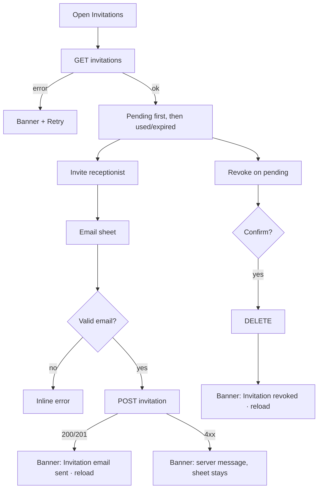

# Clinic invitations (invite receptionist)

| | |
|---|---|
| Area | Clinic workspace |
| Who sees it | All members see the tab today; target: owner / clinic admin only (server UNVERIFIED — a 403 on send confirms). No tier gate. |
| Reached from | Clinic workspace root → "Invitations" sub-tab |
| Screen type | Sub-tab (list) + small dialog (target bottom sheet) |
| Current Flutter source | `lib/features/clinic/presentation/clinic_invitations_tab.dart`, `lib/state/clinic/clinic_providers.dart` (`clinicInvitationsProvider`, `createClinicReceptionistInvitation`, `revokeClinicInvitation`) |
| Spec | `docs/kmp-spec/09-clinic-workspace-finance-treatment-plans.md` §2 row 7, ticket CLINIC-08 |

## 1. Purpose
Bring a receptionist into the clinic: send an email invitation, see which invitations are pending or used, revoke a pending one. Only receptionists can be invited from the app; doctors are added by administrators. Done once or twice a year.

## 2. Entry points
- Workspace sub-tab "Invitations".
- No deep links. The invited person registers through the invite-key flow in area 01.

## 3. Layout, top to bottom (phone portrait)
1. Full-width primary button **"Invite receptionist"** (person-add icon). Target: FAB or app-bar action, with the list taking the top.
2. **Invitation list**, one card per invitation: email (or "Email —" when missing), "Expires: {date}" (today the raw ISO string), status row with icon: hourglass + "Pending" (teal) or check + "Used" (grey); trailing revoke icon (cancel) enabled only while pending. Target: group "Pending" above "Used / expired"; show "Expired" when the date has passed and it is not used.
3. Pull-to-refresh.
4. **Invite dialog**: title "Invite by email", single Email field (autofocus, email keyboard, submit on Done), actions Cancel · "Send invitation". Target: add a one-line explanation "They'll receive an email with a link to create a receptionist account for {{clinic}}." and a role line fixed to "Receptionist".

## 4. Data and formats
| Field | Source | Format rule |
|---|---|---|
| Invitations | `GET /api/clinics/{id}/invitations` → {id, emailSentTo?, consumed, expiresAt?, pending} | Sorted by server; target: pending first, newest first |
| Email | emailSentTo | lowercase; ellipsis in the middle for long addresses |
| Expires | expiresAt (instant) | "Expires 24.10.2026 18:00" in clinic zone; past → "Expired 24.10.2026" |
| Status | pending / consumed | Pending · Used · Expired (derived) |
| Send | `POST /api/clinics/{id}/invitations {email (trimmed, lowercased), role: "RECEPTIONIST"}` → 200/201 | — |
| Revoke | `DELETE /api/clinics/{id}/invitations/{invId}` → 200/204 | — |
| Role | fixed `RECEPTIONIST` | Shown as a non-editable line in the sheet; other roles are admin-only |
| Resend (target) | no endpoint today (UNVERIFIED) | Hidden until the backend supports it |
| Clinic | selected clinic id at open time | Named in the sheet so the owner of two clinics invites to the right one |

## 5. Primary flow (happy path)
1. Owner opens the tab → skeleton cards (3).
2. Taps "Invite receptionist" → sheet → types `anna@clinic.uz` → Send → spinner → 201 → sheet closes → banner "Invitation email sent." → new Pending card on top.
3. Later the receptionist registers → card shows "Used".

## 6. Screen states
- **First load**: button visible; 3 skeleton cards.
- **Empty**: "No pending invitations." + short explanation of what invitations do (**NEW** line).
- **Error on load**: banner "Couldn't load invitations." + Retry (today raw error in the list).
- **Offline**: cached list; Invite and Revoke disabled.
- **Refreshing**: pull-to-refresh; after send/revoke the list reloads (keep rows).
- **Partial data**: n/a.
- **Permission needed**: n/a.
- **Locked by tier**: n/a.
- **Role difference**: target owner / clinic admin only; others see nothing (tab hidden) — needs server confirmation. Today everyone sees it.

## 7. Interactions and secondary flows
- **Invite** → sheet → Send → validation (§9) → request → close → banner.
- **Revoke** (pending only) → target: confirmation "Revoke invitation to {{email}}?" · Revoke (red) → request → card disappears / becomes "Revoked". Today: immediate, no confirmation, no feedback.
- **Resend** (target, if the server supports it — UNVERIFIED): overflow on a pending/expired card.
- **Pull-to-refresh** → reload.
- **Keyboard Done** in the email field → Send.
- **Tap a used card** → target: shows who accepted (name) and when, if the server returns it (UNVERIFIED); otherwise nothing.
- **Tap an expired card** → target: "Resend" when supported; otherwise a hint "Ask the admin to re-invite".

## 8. Edge cases
- Invalid email ("anna", "anna@") → today only "contains @" is checked and an invalid value silently does nothing; target: proper format check with inline error.
- Email already a member or already invited → server error message surfaced in the banner (today raw body text).
- Uppercase email → lowercased before sending; show lowercased.
- Expired invitation → "Expired" state; revoke disabled; "Resend" if supported.
- 50 invitations → list scrolls; group by status.
- Invitation consumed between load and revoke → 4xx → banner "This invitation was already used." + reload.
- Double tap Send → disabled while busy.
- Slow network → spinner in the Send button; sheet stays.
- 401 → logout. 403 → "You can't invite staff for this clinic." and hide the button.
- Rotation → sheet keeps input.
- 200 % font → card text wraps; button label 2 lines.
- Language switch → labels; emails untouched.
- Screen reader: card "anna@clinic.uz, pending, expires 24 October, button revoke".
- The invited email belongs to an existing doctor account → server decides (likely rejects); show the message and suggest asking the admin to add them as a doctor instead.
- Clinic switched in the identity bar while the sheet is open → the sheet keeps the clinic it was opened for; show the clinic name in the sheet.
- Invitation list longer than the screen → the Invite action must stay reachable (FAB / app bar), not only at the top of the list.

## 9. Validation and messages
| Field/action | Rule | When checked | Message (EN) | Where shown |
|---|---|---|---|---|
| Email | non-empty, valid email format | on Send | "Enter a valid email address" (**NEW**) | inline |
| Send | HTTP 200/201 | on response | `clinicInviteInviteSent` "Invitation email sent." / server message or "Couldn't send the invitation." (**NEW**) | banner |
| Revoke | confirmation; HTTP 200/204 | on tap / response | "Revoke invitation to {{email}}?" (**NEW**) · "Invitation revoked" (**NEW**) / "This invitation was already used." (**NEW**) | dialog / banner |
| Load | HTTP 200 | on load | "Couldn't load invitations." (**NEW**) | banner + Retry |

## 10. Navigation out
- Sheet closes to the list; nothing else.

## 11. Copy
- `clinicWorkspaceInvitations` "Invitations", `clinicInviteCreateTitle` "Invite receptionist", `clinicInviteDialogTitle` "Invite by email", `clinicInviteEmailLabel` "Email", `clinicInviteSend` "Send invitation", `cancel` "Cancel", `clinicInviteExpires` "Expires", `clinicInvitePending` "Pending", `clinicInviteConsumed` "Used", `clinicInviteRevokeTooltip` "Revoke", `clinicInviteEmpty` "No pending invitations.", `clinicInviteInviteSent` "Invitation email sent."
- **NEW**: "Expired", "Revoked", "Resend", "Enter a valid email address", "Couldn't send the invitation.", "Revoke invitation to {{email}}?", "Invitation revoked", "This invitation was already used.", "Couldn't load invitations.", "They'll receive an email with a link to create a receptionist account for {{clinic}}.", "You can't invite staff for this clinic."

## 12. Known problems in the current app (do not carry over)
- Expiry shown as a raw ISO timestamp.
- Revoke has no confirmation and no success/error feedback; errors show raw response bodies.
- Email validation is "contains @"; an invalid entry does nothing visible.
- Everyone sees the tab and the Invite button regardless of role.
- Centred spinner; error rendered inside the list.

## 13. Open questions for design
- Keep Invitations as its own sub-tab, or fold it into Doctors/Team as a "Pending invitations" section with the invite action?
- Show the invite link / QR for in-person onboarding?
