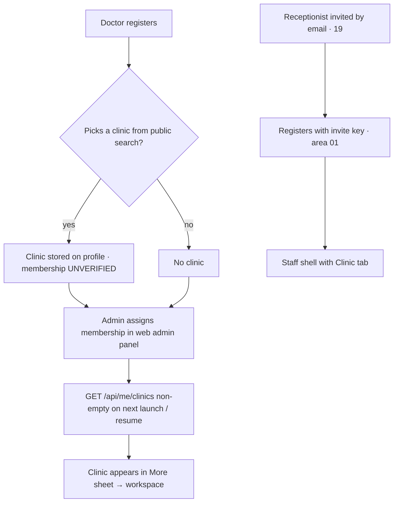

# Clinic settings · create / set up clinic · leave / delete clinic

| | |
|---|---|
| Area | Clinic workspace |
| Who sees it | All members (read-only). Owner sees the default revenue share value. No tier gate. |
| Reached from | Clinic workspace root → "Settings" sub-tab |
| Screen type | Sub-tab (static list). **Create clinic, edit clinic details, leave clinic and delete clinic do not exist in the app** — clinics are created and edited by administrators in the web admin panel; this file records what is shown and what is missing |
| Current Flutter source | `lib/features/clinic/presentation/clinic_workspace_screen.dart` (`_SettingsTab`); signup clinic picker `lib/features/auth/presentation/create_account/searchable_clinic_dropdown.dart` (`GET /api/public/clinics?search=`) |
| Spec | `docs/kmp-spec/09-clinic-workspace-finance-treatment-plans.md` §2 row 8, ticket CLINIC-04; admin side parked in doc 10 |

## 1. Purpose
Let any member check the clinic's identity data (name, time zone, phone, email, address) and the default revenue share, and understand that changes go through the clinic administrator. Rarely opened.

## 2. Entry points
- Workspace sub-tab "Settings".
- At registration a doctor can **pick an existing clinic** from a public search list ("Clinic / Workplace Name") — that is the only self-service link between a doctor and a clinic; membership itself is granted by an admin (UNVERIFIED whether the signup choice creates a membership automatically).

## 3. Layout, top to bottom (phone portrait)
1. **Read-only notice** (small grey text): "Clinic details are managed by administrators. Contact your clinic admin to request changes." Target: a proper info banner with a "Contact admin" action if the clinic email/phone is known.
2. **Details list** (label over value): Clinic name · Time zone · Phone (if any) · Email (if any) · Address (if any).
3. Divider.
4. **Default doctor revenue share**: value "60% doctor / 40% clinic" or "Not set". Target: for finance-settings managers, tapping opens the default revenue-share dialog (file 03) — today it is static here and editable only from the Doctors tab.
5. Target additions (all **not designed today**, listed for completeness and decision):
   - "Primary practice" toggle (the flag exists in the data as read-only).
   - "Leave clinic" (destructive, confirmation) — no endpoint today.
   - "Delete clinic" (owner, destructive) — no endpoint today; admin panel only.
   - "Edit clinic details" (owner) — no endpoint for doctors today; admin panel only.

## 4. Data and formats
| Field | Source | Format rule |
|---|---|---|
| Name, time zone, phone, email, address | membership summary (`GET /api/me/clinics`) | Time zone: IANA id + offset ("Asia/Tashkent · UTC+5"); phone in local display format; email lowercase |
| Default share | `defaultDoctorRevenueSharePercent` | "{{doctor}}% doctor / {{clinic}}% clinic" / "Not set" |
| Currency (target) | `currency` (default UZS) | Show "Currency: UZS" — the clinic currency drives finance formatting and is not displayed anywhere today |
| Primary practice | `isPracticeClinic` | read-only |
| Membership role | `membershipRole` | Shown in the identity bar; repeat here as "Your role: Owner" so the settings page is self-contained |
| Can manage finance settings | backend flag or role | Decides whether the share row is tappable |
| Clinic id | `clinicId` | Show as "Clinic ID #12" in small text for support calls (target) |

## 5. Primary flow (happy path)
1. Member opens Settings → values render instantly (data already loaded with the clinic list).
2. Owner taps the default share row → dialog (file 03) → Save → value updates.

How a doctor ends up with a clinic today (for context; nothing here is a screen in this area):

## 6. Screen states
- **First load**: n/a (data is already in memory); if the clinic list is reloading, show skeleton lines.
- **Empty**: missing phone/email/address rows are simply omitted; time zone "UTC" default should show "Not set — ask your admin" when the backend sent no value (cannot be distinguished today: the model defaults to "UTC"; ask backend to send null).
- **Error on load**: handled by the root (file 01).
- **Offline**: cached values; share dialog disabled.
- **Refreshing**: pull-to-refresh reloads the clinic list.
- **Partial data**: n/a.
- **Permission needed**: n/a.
- **Locked by tier**: n/a.
- **Role difference**: share row tappable only for finance-settings managers; everything else identical.

## 7. Interactions and secondary flows
- **Tap phone / email** → dial / mail (target).
- **Tap address** → maps (target).
- **Tap default share** (manager) → file 03.
- **Pull-to-refresh** → reload clinic list.
- **Long-press the clinic id** (target) → copy.
- **Tap the read-only notice "Contact admin"** (target) → mail/dialer using the clinic email/phone when present.

## 8. Edge cases
- Clinic with no phone, email or address → list of two rows; fine.
- Two clinics → settings follow the selected clinic in the identity bar.
- Time zone "UTC" default masking a missing value → see §6.
- Very long address → wraps to 3 lines.
- Default share cleared by another owner → value "Not set" after refresh.
- Member removed → root empty state.
- 401 → logout.
- Rotation / 200 % font → simple list, no issues.
- Language switch → labels re-render; values untouched.
- Screen reader: rows read as "Clinic name, Shifa Dental".
- Clinic currency changed by an admin → all finance formatting switches on next clinic-list refresh; historical amounts keep their stored currency.
- Owner expects to edit the name here (common expectation) → the read-only notice must be visible above the fold, not only as small grey text.

## 9. Validation and messages
| Field/action | Rule | When checked | Message (EN) | Where shown |
|---|---|---|---|---|
| Default share | see file 03 | — | — | — |
| Load | see file 01 | — | — | — |

## 10. Navigation out
- → Revenue-share dialog (file 03).
- → Dialer / mail / maps (target).

## 11. Copy
- `clinicWorkspaceSettings` "Settings", `clinicSettingsReadOnly` "Clinic details are managed by administrators. Contact your clinic admin to request changes."
- Labels (admin keys reused): `adminClinicNameLabel` "Clinic name", `adminClinicTimezoneLabel` "Time zone", `adminClinicPhoneLabel` "Phone", `adminClinicEmailLabel` "Email", `adminClinicAddressLabel` "Address" — target: clinic-prefixed keys
- Share: `clinicFinanceDefaultRevenueShare` "Default doctor revenue share", `clinicDoctorRevenueShareSummary`, `clinicDoctorRevenueShareNotSet` "Not set"
- Signup: `clinicOrWorkplaceName` "Clinic / Workplace Name"
- **NEW**: "Currency", "Primary practice", "Not set — ask your admin", "Contact admin"

## 12. Known problems in the current app (do not carry over)
- Settings reuses admin-panel label keys.
- Default revenue share is shown but not editable here; editing hides in the Doctors tab banner.
- Missing time zone is indistinguishable from a real "UTC".
- Clinic currency is never shown although it drives every amount.
- Phone/email/address are static text.

## 13. Open questions for design
- Should a doctor be able to **create** a clinic from the app (self-serve owner onboarding: name, address, time zone, phone, email, currency)? There is no endpoint; it would be a backend + product decision. Until then, the empty workspace state (file 01) explains that an admin assigns clinics.
- Leave clinic / delete clinic: do we want them in the mobile app at all, or keep them admin-only? If yes, both need endpoints and the open-plan rules (member with open plans cannot leave? plans reassigned?).
- Merge Settings into the Overview tab (contact rows are already duplicated there)?
- If self-serve clinic creation is approved: a 4-field wizard (name, address + map pin, time zone from the pin, phone/email) and the creator becomes Owner — reuse the location picker from area 08.
- Should "Request a change" open a prefilled email to the clinic admin or an in-app form?
