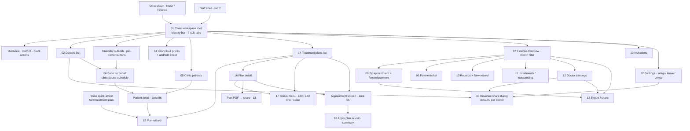

# 09 · Clinic workspace — flow map, files, rules

Area spec: `docs/kmp-spec/09-clinic-workspace-finance-treatment-plans.md` (tickets CLINIC-01…09, FIN-01…07, TP-01…06). Visit-side plan fulfilment: `docs/kmp-spec/05-appointments-video-dental.md` and the area 05 flow folder.

## 1. Flow map

## 2. Files

| File | Screen | Role | Tier | Purpose |
|---|---|---|---|---|
| `01-clinic-workspace-root.md` | Clinic workspace root (identity bar, sub-tabs, Overview, Calendar sub-tab) | Doctor (owner/member) · Staff | none (membership) | Entry hub: which clinic, your role, metrics, jump to every clinic function |
| `02-clinic-doctors-list.md` | Clinic doctors (members) list | All; share actions owner/admin | none | See team, roles, revenue split; open a colleague's schedule |
| `03-revenue-share-dialog.md` | Revenue share dialog (clinic default / per doctor) | Owner / clinic admin | none | Set the doctor/clinic percentage split |
| `04-services-price-list.md` | Services & price list + add/edit service sheet | All view; edit owner/admin (target) | none | Maintain the clinic catalog used by plans and visit charges |
| `05-clinic-patients-list.md` | Clinic patients list (+ patient detail hand-off) | All | none | Find any clinic patient; open record in clinic context |
| `06-staff-booking-on-behalf.md` | Book on behalf (clinic doctor schedule) | All; mainly receptionist/owner | none | Book/reschedule for a colleague in clinic time |
| `07-finance-overview.md` | Finance host + Dashboard + month filter | All | none | KPIs (revenue, outstanding, overdue, collection) with drill-downs |
| `08-finance-appointment-ledger-and-record-payment.md` | By appointment ledger + Record payment sheet | All view; pay owner/admin/receptionist/doctor | none | Visit-level charges; mark visits paid (full or custom) |
| `09-finance-payments-list.md` | Payments list | All | none | Cash book of recorded payments with totals |
| `10-finance-records-and-new-record.md` | Records list + Create financial record | All view; create owner/admin/receptionist/doctor | none | Invoices / receipts / estimates / credit notes |
| `11-finance-installments-outstanding.md` | Installments & outstanding (debts per patient) | All view; act owner/admin/receptionist/doctor | none | Chase installments: mark paid, waive, notify |
| `12-finance-doctor-earnings.md` | Doctor earnings | All (target: owner all, doctor own) | none | Per-doctor gross/collected/outstanding and split |
| `13-finance-export-share.md` | Export / share (CSV, PDF) | All | none | Get finance tables and plan PDFs out via the share sheet |
| `14-treatment-plans-list.md` | Treatment plans list (+ expandable visits) | All | none | All comprehensive plans with status, payment, progress |
| `15-treatment-plan-wizard.md` | Treatment plan wizard | All (chart: dental professions) | none | Create a plan: patient → basics → care team & slots → services/teeth → payment → review |
| `16-treatment-plan-detail.md` | Treatment plan detail (+ PDF) | All | none | One plan: overview, chart, lines, installments, payments, visits |
| `17-treatment-plan-status-and-edit.md` | Change status · edit plan · add line · close plan | All today; target doctors/owner | none | Lifecycle transitions and post-creation edits |
| `18-apply-plan-in-visit.md` | Apply plan in visit (fulfil) — summary, owned by area 05 | Doctor | none | How a visit ticks planned lines and records a payment against the plan |
| `19-clinic-invitations.md` | Invitations (invite receptionist) | All today; target owner/admin | none | Invite/revoke receptionist invitations |
| `20-clinic-settings.md` | Clinic settings · create / leave / delete (not in app) | All (read-only) | none | Clinic identity data, default share; records missing setup flows |

## 3. Not designed (and why)

- **Create clinic / edit clinic details / leave clinic / delete clinic** — no endpoints for doctors; clinics are created and edited in the web admin panel (doc 10, parked). The empty workspace state explains that an admin assigns clinics. Product decision needed before any design (file 20 §13).
- **Expense / income ledger** — the app has no clinic expenses; "Records" are patient-facing documents only (file 10).
- **Refunds / editing or deleting a payment** — no endpoint, no UI; a wrong payment is corrected by the backend/admin.
- **Finance audit log, overdue endpoint, "practice session"** — fetched or defined in code but never shown (dead; spec §10 item 17).
- **Visit charges catalog dialog** — no caller in the app (dead).
- **Clinic documents tab** — only a placeholder string exists (`clinicPlaceholderDocuments`).
- **"Add extra (not in plan)" mode in the visit** — strings exist, no UI; captured as target in file 18, designed by area 05.
- **Treatment plan editing of existing lines (qty/price)** — API only replaces all lines; only add/cancel is proposed (file 17).
- **Clinic staff on native phones** — blocked today by a "web only" screen; the rewrite allows it, so no separate screen.
- **Charts** — the finance dashboard has none; cards + lists are the v1 scope.

## 4. Area rules

### Permission matrix (client-side gates today; server is authoritative; UNVERIFIED where marked)

| Action | Owner | Clinic admin | Doctor (member) | Receptionist (staff shell) | Nurse |
|---|---|---|---|---|---|
| See workspace & all 9 sub-tabs | ✓ | ✓ | ✓ | ✓ (4-tab shell) | ✓ |
| Set clinic default revenue share | ✓ | ✓ | only if backend flag `canManageFinanceSettings` | flag | flag |
| Edit a member's revenue share (member must be Doctor or Owner) | ✓ | ✓ | flag | flag | flag |
| See other doctors' shares / earnings | ✓ (today everyone) | ✓ | ? (open) | ? | ? |
| Add / edit / deactivate clinic services | ✓ | ✓ | today ✓ — target UNVERIFIED | today ✓ | today ✓ |
| Open a colleague's schedule, book on behalf | ✓ | ✓ | ✓ | ✓ | ✓ (booking rights server-side) |
| "My calendar" / "My schedule" | ✓ | ✓ | ✓ | hidden | hidden |
| Record payments (ledger quick pay / custom) | ✓ | ✓ | ✓ | ✓ | ✗ |
| Create financial record | ✓ | ✓ | ✓ | ✓ | ✗ |
| Installment status change / notify | ✓ | ✓ | ✓ | ✓ | ✗ |
| View finance (dashboard, lists) | ✓ | ✓ | ✓ | ✓ | ✓ |
| Create treatment plan (wizard) | ✓ | ✓ | ✓ | ✓ | today ✓ |
| Change plan status (incl. cancel) | ✓ | ✓ | ✓ | today ✓ (target: cancel/hold only) | today ✓ (target ✗) |
| Fulfil plan lines in a visit | — | — | ✓ (as the visiting doctor) | ✗ | ✗ |
| Invite / revoke receptionist | today ✓ | today ✓ | today ✓ (target ✗) | today ✓ (target ✗) | today ✓ (target ✗) |
| Edit clinic details, leave, delete | ✗ (admin panel) | ✗ | ✗ | ✗ | ✗ |

Roles come from two places: the JWT (`DOCTOR` vs `CLINIC_STAFF`, which decides the shell) and the clinic membership (`OWNER`, `CLINIC_ADMIN`, `DOCTOR`, `RECEPTIONIST`, `NURSE`, shown in the identity bar). A receptionist is a `CLINIC_STAFF` login with a `RECEPTIONIST` membership (UNVERIFIED mapping). On a 403 from the server the app shows a banner and hides the action; staff receive 403 legitimately on doctor-only endpoints and must not be logged out.

### Money formatting
- All amounts are integers in minor units with a currency code; display with **one** formatter everywhere in the area.
- **UZS: whole units only, thousands grouped with a thin space, no decimals** — "1 250 000 UZS". Tiyin are never shown or entered.
- USD / EUR / RUB: 2 decimals, grouped — "1 250.50 USD".
- Never add amounts across currencies; show per-currency totals.
- Inputs accept "1 250 000", "1250000", "1250.50", comma or dot; the parsed value is previewed under the field.
- Zero shows "0 UZS", not "—"; "—" is reserved for "no value" (e.g. share not set).
- Today the app has four different formats (finance grouped integer, plans/PDF "24000.00 UZS", services "1500.00" + separate currency column, wizard "150000 UZS"); none may be copied.

### Time
- Everything inside the clinic workspace is shown in the **clinic's time zone** (identity bar), not the doctor's practice zone and not the phone's. Month filters start on the 1st 00:00 clinic time; "today" for month lists and schedules is the clinic's today. Due dates are calendar dates (no zone math). Dates `dd.MM.yyyy`, times `HH:mm`.

### Tier
- **No subscription tier unlocks the workspace.** It appears when the account has at least one clinic membership (`GET /api/me/clinics` non-empty) and is otherwise hidden. Nothing inside is tier-gated.

### Layout
- All current list tabs are desktop spreadsheets; design **card rows on phones** with search + filter chips (or a "Filters" sheet) and a sort menu; tables are allowed from ~840–1 100 dp (tablet landscape). Skeletons, not spinners; banners, not toasts; destructive confirmations with the red button on the right.
